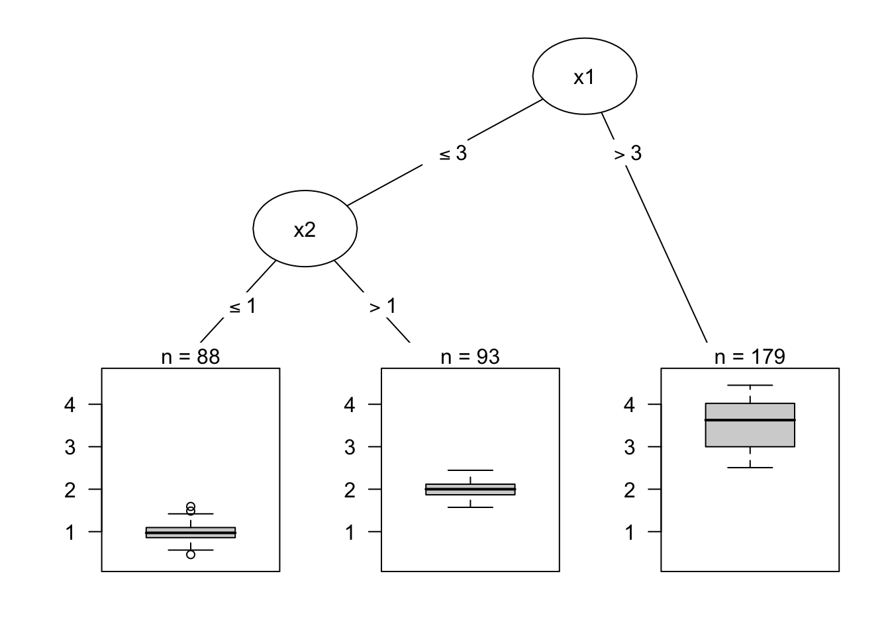
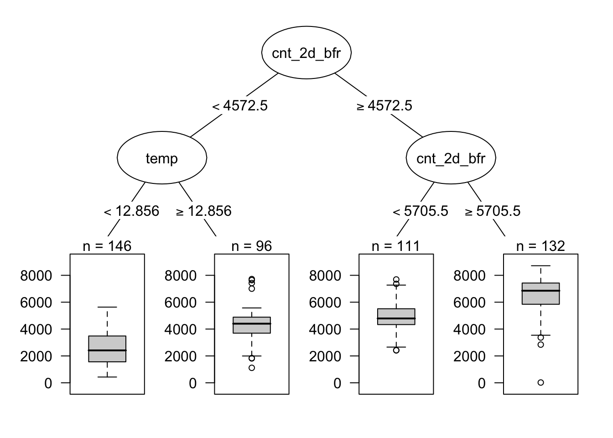
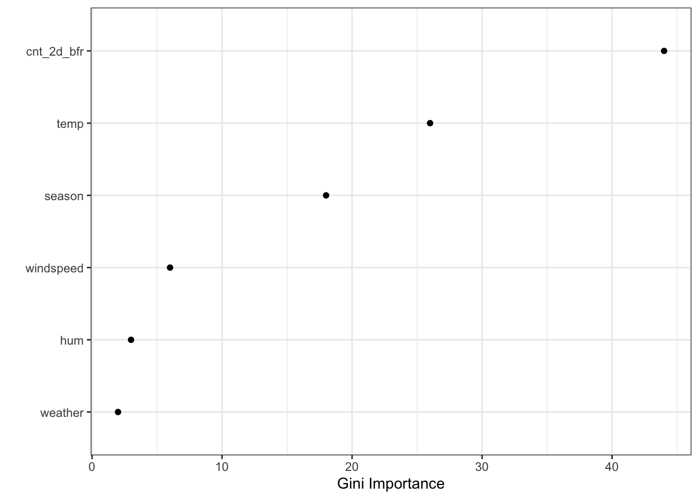

> **Çeviri kaynağı:** Christoph Molnar, *Interpretable Machine Learning*, 3. baskı (2025), [Bölüm 9: Decision Tree](https://christophm.github.io/interpretable-ml-book/tree.html). Özgün eser CC BY-NC-SA 4.0 lisanslıdır. Teknik terimler, gerekli olduğu yerlerde İngilizce karşılıklarıyla birlikte verilmiştir. Özgün bölümdeki R kodlarının ürettiği şekiller, kitabın yayımlanmış sürümünden alınmıştır.

Sade doğrusal regresyon ve lojistik regresyon modelleri, öznitelikler ile çıktı arasındaki ilişkinin doğrusal olmadığı ya da özniteliklerin birbiriyle etkileşime girdiği durumlarda başarısız olur.
Sahne artık karar ağacının (*decision tree*)!
Ağaç tabanlı modeller, veriyi özniteliklerdeki belirli eşik değerlerine (*cutoff values*) göre birçok kez böler.
Bölme yoluyla veri kümesinin farklı alt kümeleri oluşturulur ve her örnek (*instance*) bu alt kümelerden yalnızca birine ait olur.
En sondaki alt kümelere uç düğüm (*terminal node*) ya da yaprak düğüm (*leaf node*), aradaki alt kümelere ise iç düğüm (*internal node*) ya da bölünme düğümü (*split node*) denir.
Her yaprak düğümdeki çıktıyı tahmin etmek için eğitim verisinin o düğümdeki ortalama çıktısı kullanılır.
Ağaçlar hem sınıflandırma hem de regresyon için kullanılabilir.

Bir ağacı büyütebilen çeşitli algoritmalar vardır.
Bu algoritmalar; ağacın olası yapısı (örneğin düğüm başına bölünme sayısı), bölünmelerin nasıl bulunacağına ilişkin ölçütler, bölmenin ne zaman durdurulacağı ve yaprak düğümlerdeki basit modellerin nasıl kestirileceği bakımından birbirinden ayrılır.
Sınıflandırma ve regresyon ağaçları (*classification and regression trees*, CART) algoritması, ağaç oluşturma (*tree induction*) için muhtemelen en yaygın kullanılan algoritmadır.
@fig-tree-artificial'de bir örnek görselleştirilmiştir.
Biz CART'a odaklanacağız; ancak yorum, diğer ağaç türlerinin çoğu için de benzerdir.
CART'a daha ayrıntılı bir giriş için 'The Elements of Statistical Learning' kitabını [@hastie2009elements] öneririm.

{#fig-tree-artificial width=85%}

Aşağıdaki formül, $y$ çıktısı ile $\mathbf{x}$ öznitelikleri arasındaki ilişkiyi tanımlar.

$$\hat{f}(\mathbf{x})=\sum_{m=1}^M c_m I\{ \mathbf{x} \in R_m\}$$

Her örnek tam olarak bir yaprak düğüme (= $R_m$ alt kümesine) düşer.
$I_{\{ \mathbf{x} \in R_m \}}$, $\mathbf{x}$ $R_m$ alt kümesindeyse 1, değilse 0 döndüren gösterge fonksiyonudur (*indicator function*).
Bir örnek $R_l$ yaprak düğümüne düşerse tahmin edilen çıktı $c_l$ olur; burada $c_l$, $R_l$ yaprak düğümündeki tüm eğitim örneklerinin ortalamasıdır.

Peki alt kümeler nereden gelir?
Bu oldukça basittir:
CART bir öznitelik alır ve hangi eşik noktasının regresyon görevinde $y$'nin varyansını, sınıflandırma görevinde ise $y$'nin sınıf dağılımının Gini indeksini en aza indirdiğini belirler.
Varyans, bir düğümdeki $y$ değerlerinin ortalamaları etrafında ne kadar yayıldığını gösterir.
Gini indeksi ise bir düğümün ne kadar "saf olmadığını" (*impure*) gösterir; örneğin tüm sınıflar aynı sıklıktaysa düğüm saf değildir; yalnızca tek bir sınıf varsa düğüm en yüksek düzeyde saftır.
Düğümlerdeki veri noktalarının $y$ değerleri birbirine çok benzer olduğunda varyans ve Gini indeksi en küçük değerini alır.
Sonuç olarak en iyi eşik noktası, ortaya çıkan iki alt kümeyi hedef çıktı bakımından birbirinden olabildiğince farklı kılar.
Kategorik özniteliklerde algoritma, kategorilerin farklı gruplamalarını deneyerek alt kümeler oluşturmaya çalışır.
Her öznitelik için en iyi eşik belirlendikten sonra algoritma, varyans ya da Gini indeksi açısından en iyi bölmeyi sağlayacak özniteliği bölünme için seçer ve bu bölünmeyi ağaca ekler.
Algoritma, bir durdurma ölçütüne ulaşılana kadar bu arama ve bölme işlemini iki yeni düğümün her birinde özyinelemeli olarak (*recursively*) sürdürür.
Olası ölçütler şunlardır:
Bölünmeden önce bir düğümde bulunması gereken en az örnek sayısı ya da bir uç düğümde bulunması gereken en az örnek sayısı.

## Yorumlama

Yorumlama basittir:
Kök düğümden (*root node*) başlayarak sonraki düğümlere ilerlersiniz; kenarlar (*edges*) size hangi alt kümelere baktığınızı söyler.
Yaprak düğüme ulaştığınızda, düğüm size tahmin edilen çıktıyı söyler.
Tüm kenarlar 'VE' (*AND*) ile birbirine bağlanır.

::: {.callout-note}

## Yorumlama Şablonu

$x_j$ özniteliği c eşiğinden [küçük/büyük] ise VE ... ise, tahmin edilen çıktı o düğümdeki örneklerin $y$ değerlerinin ortalamasıdır.

:::

**Öznitelik önemi**

Bir özniteliğin karar ağacındaki genel önemi (*feature importance*) şu şekilde hesaplanabilir:
Özniteliğin kullanıldığı tüm bölünmeleri tek tek dolaşın ve her birinin, üst düğüme (*parent node*) kıyasla varyansı ya da Gini indeksini ne kadar azalttığını ölçün.
Tüm önem değerlerinin toplamı 100'e ölçeklenir.
Bu, her önem değerinin modelin toplam öneminden alınan bir pay olarak yorumlanabileceği anlamına gelir.

**Ağaç ayrıştırması**

Bir karar ağacının tekil tahminleri, karar yolunu (*decision path*) her öznitelik için bir bileşene ayrıştırarak açıklanabilir.
Bir kararı ağaç boyunca izleyebilir ve bir tahmini, her karar düğümünde eklenen katkılarla açıklayabiliriz.

Bir karar ağacındaki kök düğüm başlangıç noktamızdır.
Tahmin yapmak için kök düğümü kullansaydık, eğitim verisindeki çıktının ortalamasını tahmin ederdi.
Bir sonraki bölünmeyle, yoldaki bir sonraki düğüme bağlı olarak bu toplama bir terim ekler ya da bu toplamdan bir terim çıkarırız.
Nihai tahmine ulaşmak için açıklamak istediğimiz veri örneğinin yolunu izlememiz ve formüle eklemeye devam etmemiz gerekir.

$$\hat{f}(\mathbf{x}) = \bar{y} + \sum_{d=1}^D \text{split.contrib}(d, \mathbf{x}) = \bar{y} + \sum_{j=1}^p \text{feat.contrib}(j, \mathbf{x})$$

Tekil bir örneğin tahmini, hedef çıktının ortalaması ile kök düğüm ve örneğin düştüğü uç düğüm arasında gerçekleşen $D$ bölünmenin tüm katkılarının toplamına eşittir.
Ancak bizi ilgilendiren bölünme katkıları değil, öznitelik katkılarıdır.
Bir öznitelik birden fazla bölünmede kullanılabilir ya da hiç kullanılmayabilir.
$p$ özniteliğin her biri için katkıları toplayarak her özniteliğin bir tahmine ne kadar katkıda bulunduğuna dair bir yorum elde edebiliriz.

## Örnek

[Bisiklet kiralama verisine](https://christophm.github.io/interpretable-ml-book/data.html#bike-data) bir kez daha göz atalım.
Belirli bir günde kiralanan bisiklet sayısını bir karar ağacıyla tahmin etmek istiyoruz.
Öğrenilen ağaç @fig-tree-example'de gösterilmiştir.
Ağaç için izin verilen en büyük derinliği 2 olarak belirledim.
Bölünmeler için yakın geçmişteki kiralama sayısı (`cnt_2d_bfr`) ve sıcaklık (`temp`) seçilmiştir.

{#fig-tree-example width=85%}

::: {.callout-tip}

## Derinliği ve düğüm sayısını azaltın

Daha az derin ve daha az düğüme sahip ağaçların yorumlanması daha kolaydır.
Birçok hiperparametre, ağaç derinliğini ve/veya düğüm sayısını doğrudan ya da dolaylı olarak kontrol eder.
Bunların bazıları veri büyüklüğüyle etkileşim içindedir; bu nedenle belirli yorumlanabilirlik gereksinimleriniz varsa düğüm sayısını ve ağaç derinliğini doğrudan kontrol eden hiperparametreleri seçtiğinizden emin olun.

:::

İlk bölünme ve ikinci düzeydeki bölünmelerden biri, önceki kiralama sayısı özniteliğiyle yapılmıştır.
Özetle, yakın geçmişteki bisiklet kiralamalarının sayısı ne kadar büyükse o kadar fazla kiralama tahmin edilir.
Yakın zamanda çok fazla bisiklet kiralanmadıysa, daha fazla mı yoksa daha az mı kiralama tahmin edileceğine sıcaklık karar verir.
Görselleştirilen ağaç, bölünmeler için hem sıcaklığın hem de zaman eğiliminin kullanıldığını gösterir; ancak hangi özniteliğin daha önemli olduğunu nicel olarak ortaya koymaz.
@fig-tree-importance, ağacın daha derin büyümesine izin verdiğimizde öznitelik önemini göstermektedir.
Gini önemine göre en önemli öznitelik önceki bisiklet sayısı (`cnt_2d_bfr`) olmuş, onu sıcaklık ve mevsim izlemiştir.
Hava durumu en az önemli öznitelik olmuştur.

{#fig-tree-importance width=75%}

::: {.callout-warning}

Gini öneminin, sayısal özniteliklere ve çok kategorili kategorik özniteliklere daha yüksek önem verme yönünde bir yanlılığı vardır [@strobl2008conditional]. Bunun yerine [permütasyon öznitelik önemini](https://christophm.github.io/interpretable-ml-book/feature-importance.html) kullanmak daha iyidir.

:::

## Güçlü yönler

Ağaç yapısı, verideki öznitelikler arasındaki **etkileşimleri yakalamak** için idealdir.

Veri, sonunda **birbirinden ayrık gruplara** düşer; bu gruplar, doğrusal regresyondaki gibi çok boyutlu bir hiperdüzlem üzerindeki noktalara göre çoğu zaman daha kolay anlaşılır.
Yorumlamanın oldukça basit olduğu söylenebilir.

Ağaç yapısının, düğümleri ve kenarlarıyla **doğal bir görselleştirmesi** de vardır.

Ağaçlar, ["İnsan Dostu Açıklamalar" bölümünde](https://christophm.github.io/interpretable-ml-book/interpretability.html#good-explanation) tanımlandığı anlamda **iyi açıklamalar üretir**.
Ağaç yapısı, tekil örnekler için tahmin edilen değerleri kendiliğinden karşı-olgusal (*counterfactual*) biçimde düşünmeye davet eder:
"Bir öznitelik bölünme noktasından büyük / küçük olsaydı, tahmin y2 yerine y1 olurdu."
Ağaç açıklamaları karşıtlıklıdır (*contrastive*); çünkü bir örneğin tahminini her zaman, ağacın tanımladığı ve aslında ağacın diğer yaprak düğümlerinden ibaret olan ilgili "ya şöyle olsaydı" (*what if*) senaryolarıyla karşılaştırabilirsiniz.
Ağaç kısaysa, örneğin bir ila üç bölünme derinliğindeyse, ortaya çıkan açıklamalar seçicidir (*selective*).
Derinliği üç olan bir ağaç, tekil bir örneğin tahmini için açıklama üretirken en fazla üç öznitelik ve bölünme noktasına ihtiyaç duyar.
Tahminin doğruluğu (*truthfulness*) ağacın tahmin performansına bağlıdır.
Kısa ağaçların açıklamaları çok basit ve geneldir; çünkü her bölünmede örnek ya bir yaprağa ya da diğerine düşer ve ikili kararlar kolay anlaşılır.

**Öznitelikleri dönüştürmeye gerek yoktur**.
Doğrusal modellerde bazen bir özniteliğin logaritmasını almak gerekir.
Bir karar ağacı ise bir özniteliğin herhangi bir monoton dönüşümüyle aynı derecede iyi çalışır.

::: {.callout-tip}

## Öznitelik ölçeği önemli değildir

CART ve diğer ağaç algoritmaları, özniteliğin ölçeğine ve monoton dönüşümlerine karşı değişmezdir (*invariant*).
Örneğin bir özniteliği kilogramdan grama çevirmek (1000 ile çarpmak) bölünme değerini değiştirir; ancak ağacın genel yapısı değişmeden kalır.

:::

## Sınırlılıklar

**Ağaçlar doğrusal ilişkilerle başa çıkamaz**.
Bir girdi özniteliği ile çıktı arasındaki herhangi bir doğrusal ilişkinin bölünmelerle yaklaşık olarak ifade edilmesi gerekir; bu da bir basamak fonksiyonu (*step function*) oluşturur.
Bu verimli değildir.

Bu durum, **pürüzsüzlük eksikliği** (*lack of smoothness*) ile el ele gider.
Girdi özniteliğindeki küçük değişiklikler tahmin edilen çıktı üzerinde büyük bir etki yaratabilir ki bu genellikle istenen bir durum değildir.
Bir evin değerini tahmin eden ve bölünme özniteliklerinden biri olarak evin büyüklüğünü kullanan bir ağaç düşünün.
Bölünme 100,5 metrekarede gerçekleşiyor olsun.
Sizin karar ağacı modelinizi kullanan bir ev fiyatı tahmin aracının kullanıcısını hayal edin:
Kullanıcılar evlerini ölçer, evin 99 metrekare olduğu sonucuna varır, bunu fiyat hesaplayıcısına girer ve 200.000 Euro'luk bir tahmin alırlar.
Ardından 2 metrekarelik küçük bir depoyu ölçmeyi unuttuklarını fark ederler.
Deponun eğimli bir duvarı vardır; bu yüzden alanın tamamını mı yoksa yalnızca yarısını mı sayabileceklerinden emin değillerdir.
Bu nedenle hem 100,0 hem de 101,0 metrekareyi denemeye karar verirler.
Sonuç: Fiyat hesaplayıcısı 200.000 € ve 205.000 € verir; bu oldukça sezgiye aykırıdır, çünkü 99 metrekareden 100 metrekareye geçişte hiçbir değişiklik olmamıştır.

Ağaçlar ayrıca oldukça **kararsızdır** (*unstable*).
Eğitim veri kümesindeki birkaç değişiklik bambaşka bir ağaç oluşturabilir.
Bunun nedeni, her bölünmenin üst bölünmeye bağlı olmasıdır.
İlk bölünme özniteliği olarak farklı bir öznitelik seçilirse ağacın tüm yapısı değişir.
Yapısı bu kadar kolay değişen bir model güven vermez.

Karar ağaçları, kısa oldukları sürece çok yorumlanabilirdir.
**Uç düğümlerin sayısı derinlikle birlikte hızla artar.**
Uç düğüm sayısı arttıkça ve ağaç derinleştikçe, bir ağacın karar kurallarını anlamak o kadar zorlaşır.
1 derinlik 2 uç düğüm demektir.
2 derinlik en fazla 4 düğüm demektir.
3 derinlik en fazla 8 düğüm demektir.
İkili (*binary*) bir ağaçtaki en fazla uç düğüm sayısı, 2'nin derinlik kadar kuvvetidir.

## Yazılım

Bu bölümdeki örnekler için CART'ı (sınıflandırma ve regresyon ağaçları) uygulayan `rpart` R paketini kullandım.
CART, [Python](https://scikit-learn.org/stable/modules/tree.html) dahil birçok programlama dilinde uygulanmıştır.
CART'ın oldukça eski ve bir ölçüde güncelliğini yitirmiş bir algoritma olduğu söylenebilir; ağaç uyarlamak için ilginç yeni algoritmalar da mevcuttur.
Karar ağaçlarına yönelik bazı R paketlerine genel bir bakışı, [Machine Learning and Statistical Learning CRAN Task View](https://cran.r-project.org/web/views/MachineLearning.html) sayfasında "Recursive Partitioning" (özyinelemeli bölümleme) anahtar sözcüğü altında bulabilirsiniz.
Python'da [imodels paketi](https://github.com/csinva/imodels), karar ağaçlarını büyütmek (örneğin açgözlü ya da optimal uyarlama), budamak ve düzenlileştirmek (*regularization*) için çeşitli algoritmalar sunar.

## Kaynaklar {.unnumbered}

::: {#refs}
:::
