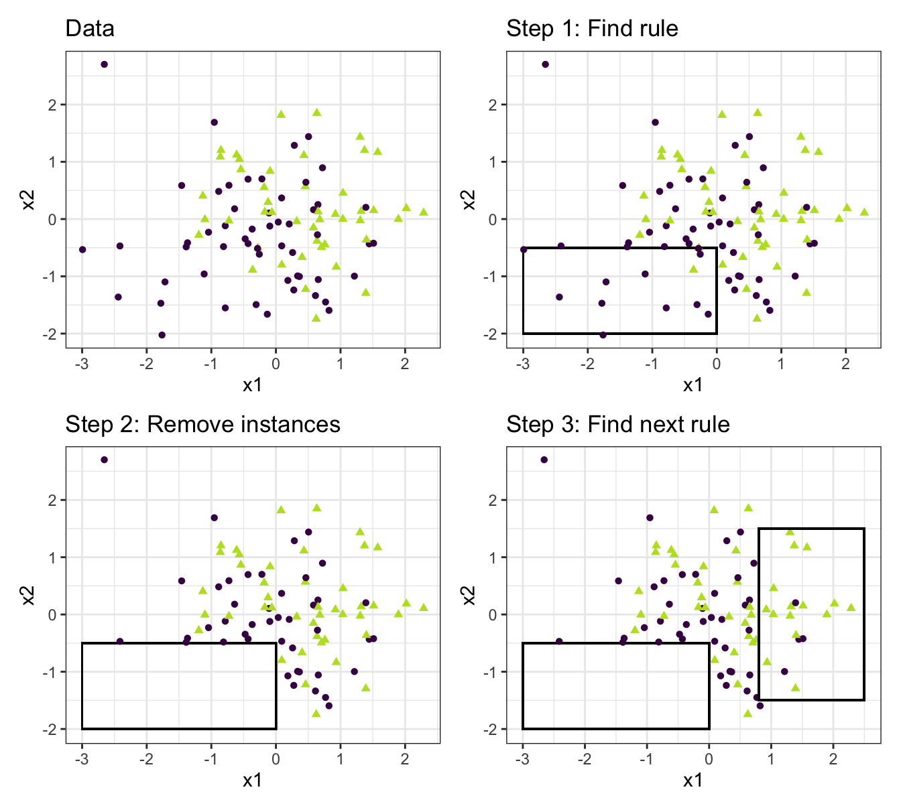

> **Çeviri kaynağı:** Christoph Molnar, *Interpretable Machine Learning*, 3. baskı (2025), [Bölüm 10: Decision Rules](https://christophm.github.io/interpretable-ml-book/rules.html). Özgün eser CC BY-NC-SA 4.0 lisanslıdır. Teknik terimler, gerekli olduğu yerlerde İngilizce karşılıklarıyla birlikte verilmiştir. Özgün bölümdeki R kodlarının (`OneR`, `RWeka`, `sbrl` paketleri) ürettiği şekil ve tablolar, kitabın yayımlanmış sürümünden alınmıştır. Tablolardaki öznitelik adları, değerler ve kurallar kodla tutarlılık için özgün hâliyle bırakılmıştır.

Bir karar kuralı (*decision rule*), bir koşul (öncül, *antecedent* olarak da adlandırılır) ve bir tahminden oluşan basit bir EĞER-İSE (*IF-THEN*) ifadesidir.
Örneğin:
EĞER bugün yağmur yağıyorsa VE aylardan Nisan ise (koşul), İSE yarın yağmur yağacaktır (tahmin).
Tahmin yapmak için tek bir karar kuralı ya da birkaç kuralın birleşimi kullanılabilir.

Karar kuralları genel bir yapıyı izler:
EĞER koşullar sağlanıyorsa İSE belirli bir tahmin yap.
Karar kuralları muhtemelen en yorumlanabilir tahmin modelleridir:
EĞER-İSE yapıları anlamsal olarak doğal dile ve düşünme biçimimize benzer; tabii koşulun anlaşılır özniteliklerden oluşturulması, koşulun kısa olması (VE ile birleştirilmiş az sayıda `öznitelik=değer` çifti) ve çok fazla kural olmaması şartıyla.
Programlamada EĞER-İSE kuralları yazmak son derece doğaldır.
Makine öğrenmesindeki yenilik, karar kurallarının bir algoritma aracılığıyla öğrenilmesidir.

Bir evin değerini (`low` [düşük], `ok` [orta] ya da `high` [yüksek]) tahmin etmek için karar kuralları öğrenen bir algoritma kullandığınızı düşünün.
Bu modelin öğrendiği karar kurallarından biri şu olabilir:
Bir ev 100 metrekareden büyükse ve bahçesi varsa değeri yüksektir.
Daha biçimsel olarak:
EĞER `size>100 AND garden=1` İSE `value=high`.

Bu karar kuralını parçalarına ayıralım:

- `size>100`, EĞER kısmındaki birinci koşuldur.
- `garden=1`, EĞER kısmındaki ikinci koşuldur.
- İki koşul, yeni bir koşul oluşturmak için 'VE' ile birbirine bağlanır.
Kuralın uygulanması için her ikisinin de doğru olması gerekir.
- Tahmin edilen çıktı (İSE kısmı) `value=high`'dır.

Bir karar kuralı, koşulda en az bir `öznitelik=değer` ifadesi kullanır; 'VE' ile eklenebilecek ifadelerin sayısı için bir üst sınır yoktur.
Bunun bir istisnası, açık bir EĞER kısmı bulunmayan ve başka hiçbir kural uygulanmadığında devreye giren varsayılan kuraldır (*default rule*); ancak buna daha sonra değineceğiz.

Bir karar kuralının yararlılığı genellikle iki sayıyla özetlenir: destek (*support*) ve doğruluk (*accuracy*).

**Bir kuralın desteği ya da kapsaması** (*coverage*):
Bir kuralın koşulunun uygulandığı örneklerin yüzdesine destek denir.
Ev değerlerini tahmin etmek için örneğin `size=big AND location=good THEN value=high` kuralını ele alalım.
1.000 evden 100'ünün büyük ve iyi konumda olduğunu varsayalım; bu durumda kuralın desteği %10'dur.
Desteğin hesaplanmasında tahmin (İSE kısmı) önemli değildir.

**Bir kuralın doğruluğu ya da güveni** (*confidence*):
Bir kuralın doğruluğu, kuralın koşulunun uygulandığı örnekler için kuralın doğru sınıfı ne kadar isabetli tahmin ettiğinin bir ölçüsüdür.
Örneğin:
`size=big AND location=good THEN value=high` kuralının uygulandığı 100 evden 85'inin `value=high`, 14'ünün `value=ok` ve 1'inin `value=low` olduğunu varsayalım; bu durumda kuralın doğruluğu %85'tir.

Genellikle doğruluk ile destek arasında bir ödünleşim (*trade-off*) vardır:
Koşula daha fazla öznitelik ekleyerek daha yüksek doğruluk elde edebiliriz, ancak destek kaybederiz.

Bir evin değerini tahmin etmek için iyi bir sınıflandırıcı oluşturmak istiyorsanız yalnızca bir kural değil, belki 10 ya da 20 kural öğrenmeniz gerekebilir.
O zaman işler daha karmaşık hâle gelebilir ve aşağıdaki sorunlardan biriyle karşılaşabilirsiniz:

- Kurallar örtüşebilir:
Bir evin değerini tahmin etmek istediğimde iki ya da daha fazla kural uygulanıyor ve bana çelişkili tahminler veriyorsa ne olacak?
- Hiçbir kural uygulanmayabilir:
Bir evin değerini tahmin etmek istediğimde kuralların hiçbiri uygulanmıyorsa ne olacak?

Birden çok kuralı birleştirmek için iki ana strateji vardır:
Karar listeleri (*decision lists*, sıralı) ve karar kümeleri (*decision sets*, sırasız).
Her iki strateji de örtüşen kurallar sorununa farklı çözümler getirir.

Bir **karar listesi**, karar kurallarına bir sıra getirir.
Bir örnek için ilk kuralın koşulu doğruysa, ilk kuralın tahminini kullanırız.
Değilse, bir sonraki kurala geçer ve uygulanıp uygulanmadığını kontrol ederiz; bu böyle devam eder.
Karar listeleri, örtüşen kurallar sorununu yalnızca listede uygulanan ilk kuralın tahminini döndürerek çözer.

Bir **karar kümesi**, kuralların bir demokrasisine benzer; ancak bazı kuralların oy gücü daha yüksek olabilir.
Bir kümede kurallar ya birbirini dışlar ya da çatışmaları çözmek için bir strateji vardır; örneğin tekil kural doğruluklarına ya da başka kalite ölçülerine göre ağırlıklandırılabilen çoğunluk oylaması gibi.
Birden fazla kural uygulandığında yorumlanabilirlik potansiyel olarak zarar görür.

Hem karar listeleri hem de karar kümeleri, bir örneğe hiçbir kuralın uygulanmaması sorunundan muzdarip olabilir.
Bu sorun, varsayılan bir kural getirilerek çözülebilir.
Varsayılan kural, başka hiçbir kural uygulanmadığında devreye giren kuraldır.
Varsayılan kuralın tahmini çoğu zaman, diğer kuralların kapsamadığı veri noktalarının en sık görülen sınıfıdır.
Bir kural kümesi ya da listesi tüm öznitelik uzayını kapsıyorsa ona kapsayıcı (*exhaustive*) deriz.
Varsayılan bir kural eklendiğinde küme ya da liste kendiliğinden kapsayıcı hâle gelir.

Veriden kural öğrenmenin pek çok yolu vardır ve bu kitap bunların hepsini kapsamaktan çok uzaktır.
Bu bölüm size bunlardan üçünü göstermektedir.
Algoritmalar, kural öğrenmeye ilişkin geniş bir genel fikir yelpazesini kapsayacak şekilde seçilmiştir; dolayısıyla üçü de birbirinden çok farklı yaklaşımları temsil eder.

1. **OneR**, kuralları tek bir öznitelikten öğrenir.
OneR; sadeliği, yorumlanabilirliği ve bir karşılaştırma ölçütü (*benchmark*) olarak kullanılmasıyla öne çıkar.
1. **Sıralı kapsama** (*sequential covering*), kuralları yinelemeli olarak öğrenen ve yeni kuralın kapsadığı veri noktalarını çıkaran genel bir yöntemdir.
Bu yöntem birçok kural öğrenme algoritması tarafından kullanılır.
1. **Bayesçi Kural Listeleri** (*Bayesian Rule Lists*), önceden madenlenmiş (*pre-mined*) sık örüntüleri Bayesçi istatistik kullanarak bir karar listesinde birleştirir.
Önceden madenlenmiş örüntülerin kullanılması, birçok kural öğrenme algoritmasının başvurduğu yaygın bir yaklaşımdır.

En basit yaklaşımla başlayalım: Kuralları öğrenmek için en iyi tek özniteliği kullanmak.

## Tek bir öznitelikten kural öğrenme (OneR)

OneR algoritması [@holte1993very], en basit kural çıkarım (*rule induction*) algoritmalarından biridir.
OneR, tüm öznitelikler arasından ilgilenilen çıktı hakkında en fazla bilgiyi taşıyanı seçer ve bu öznitelikten karar kuralları oluşturur.

"Tek Kural" (*One Rule*) anlamına gelen OneR adına rağmen algoritma birden fazla kural üretir:
Aslında seçilen en iyi özniteliğin her benzersiz değeri için bir kural üretir.
Daha uygun bir ad OneFeatureRule (Tek Öznitelik Kuralı) olurdu.

Algoritma basit ve hızlıdır:

1. Uygun aralıklar seçerek sürekli öznitelikleri kesikli hâle getirin (*discretize*).
1. Her öznitelik için:
    - Öznitelik değerleri ile (kategorik) çıktı arasında bir çapraz tablo (*cross table*) oluşturun.
    - Özniteliğin her değeri için, o öznitelik değerine sahip örneklerin en sık görülen sınıfını tahmin eden bir kural oluşturun (bu, çapraz tablodan okunabilir).
    - Öznitelik için kuralların toplam hatasını hesaplayın.
1. Toplam hatası en küçük olan özniteliği seçin.

OneR, seçilen özniteliğin tüm düzeylerini kullandığı için veri kümesindeki tüm örnekleri her zaman kapsar.
Eksik değerler ya ek bir öznitelik değeri olarak ele alınabilir ya da önceden doldurulabilir (*imputation*).

Bir OneR modeli, yalnızca tek bir bölünmesi olan bir karar ağacıdır.
Bölünme, CART'taki gibi ikili olmak zorunda değildir; benzersiz öznitelik değerlerinin sayısına bağlıdır.

::: {.callout-tip}

## OneR'ı temel model olarak kullanın

OneR, daha karmaşık modelleri karşılaştırmak için mükemmel bir temel model (*baseline*) oluşturur.

:::

OneR'ın en iyi özniteliği nasıl seçtiğine dair bir örneğe bakalım.
@tbl-oner-freq-table1, evlerin değeri, konumu, büyüklüğü ve evcil hayvanlara izin verilip verilmediği bilgilerini içeren yapay bir veri kümesini göstermektedir.
Bir evin değerini tahmin etmek için basit bir model öğrenmek istiyoruz.

| location | size | pets | value |
|:---|:---|:---|:---|
| good | small | yes | high |
| good | big | no | high |
| good | big | no | high |
| bad | medium | no | ok |
| good | medium | only cats | ok |
| good | small | only cats | ok |
| bad | medium | yes | ok |
| bad | small | yes | low |
| bad | medium | yes | low |
| bad | small | no | low |

: Ev değeri için yapay veri kümesi (location: konum, size: büyüklük, pets: evcil hayvan, value: değer). {#tbl-oner-freq-table1}

OneR, her öznitelik ile çıktı arasındaki çapraz tablolara dayanarak kurallar oluşturur.
@tbl-cross-tables üç çapraz tabloyu göstermektedir.

| | value=low | value=ok | value=high |
|:---|---:|---:|---:|
| size=big | 0 | 0 | 2 |
| size=medium | 1 | 3 | 0 |
| size=small | 2 | 1 | 1 |
| pets=no | 1 | 1 | 2 |
| pets=only cats | 0 | 2 | 0 |
| pets=yes | 2 | 1 | 1 |
| location=bad | 3 | 2 | 0 |
| location=good | 0 | 2 | 3 |

: Her bir öznitelik ile hedef arasındaki çapraz tablolar. {#tbl-cross-tables}

Her öznitelik için tabloyu satır satır dolaşırız:
Her öznitelik değeri bir kuralın EĞER kısmıdır;
bu öznitelik değerine sahip örnekler için en yaygın sınıf ise tahmindir, yani kuralın İSE kısmıdır.
Örneğin `small`, `medium` ve `big` düzeylerine sahip büyüklük özniteliği üç kurala yol açar.
Her öznitelik için, üretilen kuralların toplam hata oranını, yani hataların toplamını hesaplarız.
Konum özniteliğinin olası değerleri `bad` (kötü) ve `good`'dur (iyi).
Kötü konumdaki evler için en sık değer `low`'dur ve tahmin olarak `low` kullandığımızda iki hata yaparız, çünkü iki evin değeri `ok`'tur.
İyi konumdaki evlerin tahmin edilen değeri `high`'dır ve yine iki hata yaparız, çünkü iki evin değeri `ok`'tur.
Konum özniteliğini kullanarak yaptığımız hata $\frac{4}{10}$, büyüklük özniteliği için $\frac{3}{10}$ ve evcil hayvan özniteliği için $\frac{4}{10}$'dur.
Büyüklük özniteliği en düşük hatalı kuralları üretir ve nihai OneR modeli için kullanılır:

EĞER `size=small` İSE `value=low`
EĞER `size=medium` İSE `value=ok`
EĞER `size=big` İSE `value=high`

Uygun biçimde doğrulanmazsa OneR, olası düzey sayısı çok olan özniteliklerde aşırı öğrenmeye (*overfitting*) düşebilir.
Yalnızca gürültü içeren ve hiç sinyal içermeyen bir veri kümesi düşünün; yani tüm öznitelikler rastgele değerler alıyor ve hedef için hiçbir tahmin değeri taşımıyor.
Bazı özniteliklerin diğerlerinden daha fazla düzeyi vardır.
Daha fazla düzeyi olan öznitelikler bu durumda daha kolay aşırı öğrenebilir.
Verideki her örnek için ayrı bir düzeye sahip bir öznitelik, tüm eğitim veri kümesini kusursuz biçimde tahmin ederdi.
Bir çözüm, veriyi eğitim ve doğrulama kümelerine ayırmak, kuralları eğitim verisi üzerinde öğrenmek ve özniteliği seçmek için toplam hatayı doğrulama kümesi üzerinde değerlendirmek olacaktır.

::: {.callout-warning}

## Doğrulama verisi kullanın

Görülmemiş veride iyi performans gösterdiğinden emin olmak için, basit bir "tek kural" modeli bile olsa seçtiğiniz modeli her zaman ayrı bir doğrulama kümesiyle doğrulayın.

:::

Eşitlikler (*ties*), yani iki özniteliğin aynı toplam hatayı vermesi de bir başka sorundur.
OneR eşitlikleri, ya en düşük hatalı ilk özniteliği ya da ki-kare testinin p-değeri en düşük olan özniteliği alarak çözer.

**Örnek**

OneR'ı gerçek veriyle deneyelim.
OneR algoritmasını sınamak için [Palmer penguenleri verisini](https://christophm.github.io/interpretable-ml-book/data.html#penguins) kullanıyoruz.
Tüm sürekli girdi öznitelikleri 5 niceliğe (*quantile*) göre kesikli hâle getirilmiştir.
OneR öğrenme algoritmasının oluşturduğu kurallar @tbl-oner-penguins'te gösterilmiştir.

| bill_depth_mm | prediction |
|:---|:---|
| (13.1,14.7] | female |
| (14.7,16.3] | male |
| (16.3,18] | female |
| (18,19.6] | male |
| (19.6,21.2] | male |

: Penguen sınıflandırması için OneR'ın öğrendiği kural (prediction: tahmin; female: dişi, male: erkek). {#tbl-oner-penguins}

OneR, en iyi tahmin edici öznitelik olarak `bill_depth_mm` (gaga derinliği) özniteliğini seçmiştir.
Bu tek kuralın nasıl performans gösterdiğini daha iyi kavramak için (kesikli hâle getirilmiş) `bill_depth_mm` özniteliği ile penguen türü arasındaki çapraz tabloya bakalım; bkz. @tbl-oner-penguin-confusion.

| bill_depth_mm | female | male |
|:---:|:---:|:---:|
| [13.1,14.7) | %86,7 (13) | %13,3 (2) |
| [14.7,16.3) | %38,5 (10) | %61,5 (16) |
| [16.3,18) | %72,0 (18) | %28,0 (7) |
| [18,19.6) | %34,4 (11) | %65,6 (21) |
| [19.6,21.2) | %0 (0) | %100,0 (12) |

: OneR'ın bulduğu penguen cinsiyeti sınıflandırma kuralı için karışıklık matrisi (*confusion matrix*). {#tbl-oner-penguin-confusion}

Bu özniteliğin özellikle derin gagalı penguenleri sınıflandırmakta yararlı olduğunu görebiliriz.
Gaga derinliği 1,98 cm'nin üzerinde olan penguenlerin büyük olasılıkla erkek olduğu görülmektedir.
Çok kısa gagalar, dişi bir penguenle karşı karşıya olma olasılığımızı artırır.
Uyarı: Bu model türü göz ardı eder ya da daha doğrusu tüm türleri bir araya toplar.
Bunu düzeltmek için her tür için ayrı bir model eğitebiliriz.

OneR, doğası gereği regresyon görevlerini desteklemez.
Ancak sürekli çıktıyı aralıklara bölerek bir regresyon görevini sınıflandırma görevine dönüştürebiliriz.
Bu hileyi, bisiklet sayısını dört çeyreğine (%0-25, %25-50, %50-75 ve %75-100) bölerek [kiralanan bisiklet](https://christophm.github.io/interpretable-ml-book/data.html#bike-data) sayısını OneR ile tahmin etmek için kullanıyoruz.
@tbl-oner-bike, OneR modeli uyarlandıktan sonra seçilen özniteliği göstermektedir:
Seçilen öznitelik, önceki bisiklet kiralama sayısıdır.

| cnt_2d_bfr | prediction |
|:---|:---|
| (13.3,1.76e+03] | [22,3193] |
| (1.76e+03,3.5e+03] | [22,3193] |
| (3.5e+03,5.24e+03] | (4551,5978.5] |
| (5.24e+03,6.98e+03] | (5978.5,8714] |
| (6.98e+03,8.72e+03] | (5978.5,8714] |

: Bisiklet verisi için OneR sınıflandırma kuralı. {#tbl-oner-bike}

Şimdi basit OneR algoritmasından, birkaç öznitelikten oluşan daha karmaşık koşullara sahip kurallar kullanan daha karmaşık bir yönteme geçiyoruz: Sıralı Kapsama.

## Sıralı kapsama

Sıralı kapsama (*sequential covering*), tüm veri kümesini kural kural kapsayan bir karar listesi (ya da kümesi) oluşturmak için tekrar tekrar tek bir kural öğrenen genel bir yöntemdir.
Birçok kural öğrenme algoritması sıralı kapsama ailesine aittir.
Bu bölüm temel tarifi tanıtmakta ve örnekler için sıralı kapsama algoritmasının bir çeşidi olan RIPPER'ı kullanmaktadır.

Fikir basittir: Önce veri noktalarının bir kısmına uygulanan iyi bir kural bulun.
Kuralın kapsadığı tüm veri noktalarını çıkarın.
Bir veri noktası, noktaların doğru sınıflandırılıp sınıflandırılmadığından bağımsız olarak, koşullar ona uygulandığında kapsanmış olur.
Kural öğrenmeyi ve kapsanan noktaların çıkarılmasını, hiç nokta kalmayana ya da başka bir durdurma koşulu sağlanana kadar kalan noktalarla tekrarlayın.
Sonuç bir karar listesidir.
Tekrarlanan kural öğrenme ve kapsanan veri noktalarını çıkarma yaklaşımına "ayır ve fethet" (*separate-and-conquer*) denir.

Verinin bir kısmını kapsayan tek bir kural oluşturabilen bir algoritmamız zaten olduğunu varsayalım.
İki sınıf (bir pozitif, bir negatif) için sıralı kapsama algoritması şöyle çalışır:

- Boş bir kural listesiyle (rlist) başlayın.
- Bir $r$ kuralı öğrenin.
- Kural listesi belirli bir kalite eşiğinin altında olduğu sürece (ya da pozitif örneklerin hepsi henüz kapsanmadığı sürece):
    - $r$ kuralını rlist'e ekleyin.
    - $r$ kuralının kapsadığı tüm veri noktalarını çıkarın.
    - Kalan veri üzerinde başka bir kural öğrenin.
- Karar listesini döndürün.

{#fig-covering-algo width=85%}

Örneğin:
Evlerin değerlerini büyüklük, konum ve evcil hayvanlara izin verilip verilmediği bilgisinden tahmin etmeye yönelik bir görevimiz ve veri kümemiz var.
İlk kuralı öğreniriz ve bu kural şu çıkar:
Eğer `size=big` ve `location=good` ise `value=high`.
Ardından iyi konumdaki tüm büyük evleri veri kümesinden çıkarırız.
Kalan veriyle bir sonraki kuralı öğreniriz.
Belki de şu: Eğer `location=good` ise `value=ok`.
Bu kuralın, iyi konumdaki büyük evlerin bulunmadığı, yani iyi konumda yalnızca orta ve küçük evlerin kaldığı veri üzerinde öğrenildiğine dikkat edin.

Çok sınıflı durumlarda yaklaşımın değiştirilmesi gerekir.
Önce sınıflar artan yaygınlığa (*prevalence*) göre sıralanır.
Sıralı kapsama algoritması en az yaygın sınıfla başlar, onun için bir kural öğrenir, kapsanan tüm örnekleri çıkarır, ardından en az yaygın ikinci sınıfa geçer ve bu böyle sürer.
O anki sınıf her zaman pozitif sınıf olarak ele alınır ve yaygınlığı daha yüksek olan tüm sınıflar negatif sınıfta birleştirilir.
Son sınıf varsayılan kuraldır.
Sınıflandırmada buna bire karşı hepsi (*one-versus-all*) stratejisi de denir.

Tek bir kuralı nasıl öğreniriz?
OneR algoritması burada işe yaramaz, çünkü her zaman tüm öznitelik uzayını kapsar.
Ancak başka birçok olasılık vardır.
Olasılıklardan biri, ışın araması (*beam search*) ile bir karar ağacından tek bir kural öğrenmektir:

- Bir karar ağacı öğrenin (CART ya da başka bir ağaç öğrenme algoritmasıyla).
- Kök düğümden başlayın ve özyinelemeli olarak en saf düğümü seçin (örneğin yanlış sınıflandırma oranı en düşük olanı).
- Uç düğümün çoğunluk sınıfı kuralın tahmini olarak kullanılır;
o düğüme giden yol ise kuralın koşulu olarak kullanılır.

@fig-learn-one-rule bir ağaçtaki ışın aramasını göstermektedir:

{#fig-learn-one-rule}

Tek bir kural öğrenmek, arama uzayı olası tüm kuralların uzayı olan bir arama problemidir.
Aramanın amacı, belirli ölçütlere göre en iyi kuralı bulmaktır.
Birçok farklı arama stratejisi vardır:
tepe tırmanma (*hill-climbing*), ışın araması, kapsamlı arama (*exhaustive search*), en iyi öncelikli arama (*best-first search*), sıralı arama (*ordered search*), stokastik arama, yukarıdan aşağı arama (*top-down search*), aşağıdan yukarı arama (*bottom-up search*), ...

RIPPER (*Repeated Incremental Pruning to Produce Error Reduction*, Hata Azaltımı Sağlamak için Yinelemeli Artımlı Budama) [@cohen1995fast], Sıralı Kapsama algoritmasının bir çeşididir.
RIPPER biraz daha gelişmiştir ve karar listesini (ya da kümesini) optimize etmek için bir son işleme aşaması (kural budama, *rule pruning*) kullanır.
RIPPER sıralı ya da sırasız modda çalışabilir ve bir karar listesi ya da karar kümesi üretebilir.

**Örnekler**

Önce [penguen cinsiyeti sınıflandırma görevi](https://christophm.github.io/interpretable-ml-book/data.html#penguins) için kuralları çıkarıyoruz.
Kurallar ve varsayılan kural @tbl-jrip-penguins'te verilmiştir.
Yorumlama basittir:
Yeni bir örneği tahmin etmek için listenin en üstünden başlayın ve bir kuralın uygulanıp uygulanmadığını kontrol edin.
Koşullar uygulanıyorsa, kuralın sağ tarafındaki sınıfı tahmin edin.
Uygulanmıyorsa, bir sınıflandırmaya ulaşana kadar bir sonraki kurala geçin.
Varsayılan kural, her zaman bir tahmin bulunmasını güvence altına alır.

| Kurallar |
|:---|
| `(body_mass_g <= 3700) and (bill_depth_mm <= 18.5) => sex=F` |
| `(bill_depth_mm <= 14.8) and (body_mass_g <= 5200) => sex=F` |
| `(body_mass_g <= 3850) and (bill_length_mm <= 36.9) => sex=F` |
| `=> sex=M` |

: Penguen sınıflandırma görevi için öğrenilen JRip kuralları (F: dişi, M: erkek). {#tbl-jrip-penguins}

::: {.callout-note}

RIPPER'ın kurallar arasındaki çatışmaları çözmenin kendine özgü bir yolu vardır: Kuralları sırayla uygular.
Bu, en özgül EĞER cümleciğine sahip kurallardan en yüksek kesinliğe (*precision*) sahip kuralı kullanmaya kadar uzanan birçok genel stratejiden yalnızca biridir.

:::

RIPPER'ı [bisiklet sayılarını](https://christophm.github.io/interpretable-ml-book/data.html#bike-data) tahmin etmeye yönelik regresyon görevinde kullandığımızda bazı kurallar bulunur.
RIPPER yalnızca sınıflandırma için çalıştığından bisiklet sayılarının kategorik bir çıktıya dönüştürülmesi gerekir.
Bunu, bisiklet sayılarını çeyreklere bölerek yaptım.
Örneğin $[4548, 5956]$ aralığı, 4548 ile 5956 arasındaki tahmin edilen bisiklet sayılarını kapsar.
@tbl-jrip-bike, öğrenilen kuralların karar listesini göstermektedir.
Yorum yine aynıdır: Koşullar uygulanıyorsa, bisiklet sayısı için sağ taraftaki aralığı tahmin ederiz.
Bu örnekteki karar kurallarını beğenmiyorum.
`cnt_2d_bfr` özniteliğinin doğası, bisiklet kiralamalarındaki genel bir eğilimi düzeltmektir.
`cnt` ile `cnt_2d_bfr` arasında, karar kurallarının yansıtmakta zorlandığı doğrusal bir ilişki vardır.

| Kurallar |
|:---|
| `(cnt_2d_bfr <= 5729) and (cnt_2d_bfr >= 4780) and (temp <= 26) => cnt=(4551,5978.5]` |
| `(temp >= 14) and (cnt_2d_bfr <= 5515) and (hum <= 63) and (cnt_2d_bfr >= 3574) and (temp <= 27) => cnt=(4551,5978.5]` |
| `(cnt_2d_bfr >= 3544) and (cnt_2d_bfr <= 3915) and (temp >= 17) and (temp <= 28) => cnt=(4551,5978.5]` |
| `(cnt_2d_bfr <= 5336) and (cnt_2d_bfr >= 2914) and (weather = GOOD) and (temp >= 7) => cnt=(3193,4551]` |
| `(cnt_2d_bfr <= 4833) and (cnt_2d_bfr >= 2169) and (hum <= 72) and (workday = Y) => cnt=(3193,4551]` |
| `(cnt_2d_bfr <= 4097) and (season = WINTER) => cnt=[22,3193]` |
| `(cnt_2d_bfr <= 4570) and (temp <= 13) => cnt=[22,3193]` |
| `(hum >= 88) and (season = FALL) => cnt=[22,3193]` |
| `(cnt_2d_bfr <= 3351) and (cnt_2d_bfr >= 2710) => cnt=[22,3193]` |
| `=> cnt=(5978.5,8714]` |

: Bisiklet görevi için JRip kuralları. {#tbl-jrip-bike}

## Bayesçi Kural Listeleri

Bu kısımda size, kabaca aşağıdaki tarifi izleyen, karar listesi öğrenmeye yönelik başka bir yaklaşım göstereceğim:

1. Veriden, karar kuralları için koşul olarak kullanılabilecek sık örüntüleri önceden madenleyin.
1. Önceden madenlenmiş kurallardan bir seçki kullanarak bir karar listesi öğrenin.

Bu tarifi kullanan belirli bir yaklaşıma Bayesçi Kural Listeleri (*Bayesian Rule Lists*) [@letham2015interpretable] ya da kısaca BRL denir.
BRL, FP-ağacı (*FP-tree*) algoritmasıyla [@borgelt2005implementation] önceden madenlenmiş sık örüntülerden karar listeleri öğrenmek için Bayesçi istatistiği kullanır.

Ancak BRL'nin ilk adımıyla yavaş yavaş başlayalım.

**Sık örüntülerin önceden madenlenmesi**

Sık örüntü (*frequent pattern*), öznitelik değerlerinin sık (birlikte) görülmesidir.
BRL algoritması için bir ön işleme adımı olarak öznitelikleri kullanırız (bu adımda hedef çıktıya ihtiyacımız yoktur) ve bunlardan sık görülen örüntüleri çıkarırız.
Bir örüntü, `size=medium` gibi tek bir öznitelik değeri ya da `size=medium AND location=bad` gibi öznitelik değerlerinin bir birleşimi olabilir.

Bir örüntünün sıklığı, veri kümesindeki desteğiyle ölçülür:

$$Support(\mathbf{x}_j=A)=\frac{1}{n}\sum_{i=1}^nI(x^{(i)}_{j}=A)$$

Burada A öznitelik değeri, n veri kümesindeki veri noktası sayısı, I ise i örneğinin $x_j$ özniteliği A düzeyine sahipse 1, değilse 0 döndüren gösterge fonksiyonudur.
Ev değerlerinden oluşan bir veri kümesinde evlerin %20'sinin balkonu yoksa ve %80'inin bir ya da daha fazla balkonu varsa, `balcony=0` örüntüsünün desteği %20'dir.
Destek, örneğin `balcony=0 AND pets=allowed` gibi öznitelik değerlerinin birleşimleri için de ölçülebilir.

Bu tür sık örüntüleri bulmak için Apriori ya da FP-Growth gibi birçok algoritma vardır.
Hangisini kullandığınızın pek önemi yoktur; yalnızca örüntülerin bulunma hızı farklıdır, ortaya çıkan örüntüler ise her zaman aynıdır.

Apriori algoritmasının sık örüntüleri bulmak için nasıl çalıştığına dair size kaba bir fikir vereceğim.
Aslında Apriori algoritması iki kısımdan oluşur; birinci kısım sık örüntüleri bulur, ikinci kısım ise bunlardan birliktelik kuralları (*association rules*) oluşturur.
BRL algoritması için yalnızca Apriori'nin birinci kısmında üretilen sık örüntülerle ilgileniyoruz.

İlk adımda Apriori algoritması, desteği kullanıcının tanımladığı en düşük destekten büyük olan tüm öznitelik değerleriyle başlar.
Kullanıcı en düşük desteğin %10 olması gerektiğini söylerse ve evlerin yalnızca %5'i `size=big` ise, bu öznitelik değerini çıkarır ve örüntü olarak yalnızca `size=medium` ve `size=small`'u tutarız.
Bu, evlerin veriden çıkarıldığı anlamına gelmez; yalnızca `size=big`'in sık örüntü olarak döndürülmediği anlamına gelir.
Apriori algoritması, tek öznitelik değerli sık örüntülerden yola çıkarak giderek daha yüksek mertebeden öznitelik değeri birleşimlerini yinelemeli olarak bulmaya çalışır.
Örüntüler, `öznitelik=değer` ifadelerinin mantıksal VE ile birleştirilmesiyle oluşturulur; örneğin `size=medium AND location=bad`.
Desteği en düşük desteğin altında kalan üretilmiş örüntüler çıkarılır.
Sonunda tüm sık örüntülere sahip oluruz.
Bir sık örüntünün cümleciklerinin herhangi bir alt kümesi de yine sıktır; buna Apriori özelliği denir.
Bu sezgisel olarak da anlamlıdır:
Bir örüntüden bir koşul çıkarıldığında, indirgenmiş örüntü yalnızca daha fazla ya da aynı sayıda veri noktasını kapsayabilir, daha azını değil.
Örneğin evlerin %20'si `size=medium AND location=good` ise, yalnızca `size=medium` olan evlerin desteği %20 ya da daha fazladır.
Apriori özelliği, incelenmesi gereken örüntü sayısını azaltmak için kullanılır.
Yalnızca sık örüntüler söz konusu olduğunda daha yüksek mertebeden örüntüleri kontrol etmemiz gerekir.

Böylece Bayesçi Kural Listesi algoritması için koşulların önceden madenlenmesini tamamlamış olduk.
Ancak BRL'nin ikinci adımına geçmeden önce, önceden madenlenmiş örüntülere dayalı kural öğrenmenin başka bir yoluna değinmek istiyorum.
Diğer yaklaşımlar, ilgilenilen çıktının da sık örüntü madenciliği sürecine dahil edilmesini ve Apriori algoritmasının EĞER-İSE kuralları oluşturan ikinci kısmının da çalıştırılmasını önerir.
Algoritma denetimsiz (*unsupervised*) olduğundan İSE kısmı ilgilenmediğimiz öznitelik değerlerini de içerir.
Ancak İSE kısmında yalnızca ilgilenilen çıktıyı barındıran kurallara göre filtreleme yapabiliriz.
Bu kurallar zaten bir karar kümesi oluşturur; ancak kuralları düzenlemek, budamak, silmek ya da yeniden birleştirmek de mümkündür.

BRL yaklaşımında ise sık örüntülerle çalışırız ve İSE kısmını ve örüntülerin bir karar listesinde nasıl düzenleneceğini Bayesçi istatistik kullanarak öğreniriz.

**Bayesçi Kural Listelerinin öğrenilmesi**

BRL algoritmasının amacı, önceden madenlenmiş koşullardan bir seçki kullanarak, az kurallı ve kısa koşullu listelere öncelik veren isabetli bir karar listesi öğrenmektir.
BRL bu amaca, koşulların uzunluğu (tercihen daha kısa kurallar) ve kural sayısı (tercihen daha kısa bir liste) için önsel dağılımlarla (*prior distributions*) karar listelerinin bir dağılımını tanımlayarak ulaşır.

Listelerin sonsal olasılık dağılımı (*posterior probability distribution*), kısalık varsayımları ve listenin veriye ne kadar iyi uyduğu göz önüne alındığında bir karar listesinin ne kadar olası olduğunu söylemeyi mümkün kılar.
Amacımız, bu sonsal olasılığı en büyükleyen listeyi bulmaktır.
Tam olarak en iyi listeyi doğrudan liste dağılımlarından bulmak mümkün olmadığından BRL şu tarifi önerir:
1) Önsel dağılımdan rastgele çekilen bir başlangıç karar listesi üretin.
2) Ortaya çıkan listelerin, listelerin sonsal dağılımını izlemesini sağlayarak kurallar ekleyip yer değiştirerek ya da çıkararak listeyi yinelemeli olarak değiştirin.
3) Örneklenen listeler arasından sonsal dağılıma göre olasılığı en yüksek olan karar listesini seçin.

Algoritmayı daha yakından inceleyelim:
Algoritma, öznitelik değeri örüntülerini FP-Growth algoritmasıyla önceden madenleyerek başlar.
BRL, hedefin dağılımı ve hedefin dağılımını tanımlayan parametrelerin dağılımı hakkında bir dizi varsayımda bulunur.
(Bayesçi istatistik budur.)
Bayesçi istatistiğe aşina değilseniz aşağıdaki açıklamalara fazla takılmayın.
Önemli olan, Bayesçi yaklaşımın mevcut bilgiyi ya da gereksinimleri (önsel dağılımlar, *priori distributions*) birleştirirken aynı zamanda veriye uyum sağlamanın bir yolu olduğunu bilmektir.
Karar listeleri söz konusu olduğunda Bayesçi yaklaşım anlamlıdır; çünkü önsel varsayımlar karar listelerini kısa kurallara sahip kısa listeler olmaya doğru iter.

Amaç, sonsal dağılımdan d karar listeleri örneklemektir:

$$\underbrace{p(d|\mathbf{x},\mathbf{y},A,\alpha,\lambda,\eta)}_{sonsal}\propto\underbrace{p(\mathbf{y}|\mathbf{x},d,\alpha)}_{olabilirlik}\cdot\underbrace{p(d|A,\lambda,\eta)}_{önsel}$$

Burada d bir karar listesi, x öznitelikler, y hedef, A önceden madenlenmiş koşullar kümesi, $\lambda$ karar listelerinin önsel beklenen uzunluğu, $\eta$ bir kuraldaki koşulların önsel beklenen sayısı, $\alpha$ ise pozitif ve negatif sınıflar için en iyisi (1,1) olarak sabitlenen önsel sözde sayımdır (*pseudo-count*).

$$p(d|\mathbf{x},\mathbf{y},A,\alpha,\lambda,\eta)$$

ifadesi, gözlenen veri ve önsel varsayımlar göz önüne alındığında bir karar listesinin ne kadar olası olduğunu nicel olarak ifade eder.
Bu, karar listesi ve veri verildiğinde $Y$ çıktısının olabilirliği (*likelihood*) ile önsel varsayımlar ve önceden madenlenmiş koşullar verildiğinde listenin olasılığının çarpımıyla orantılıdır.

$$p(\mathbf{y}|\mathbf{x},d,\alpha)$$

ifadesi, karar listesi ve veri verildiğinde gözlenen $y$'nin olabilirliğidir.
BRL, y'nin bir Dirichlet-Multinom dağılımından üretildiğini varsayar.
d karar listesi veriyi ne kadar iyi açıklarsa olabilirlik o kadar yüksek olur.

$$p(d|A,\lambda,\eta)$$

ifadesi, karar listelerinin önsel dağılımıdır.
Listedeki kural sayısı için kesilmiş (*truncated*) bir Poisson dağılımını ($\lambda$ parametresi) ve kuralların koşullarındaki öznitelik değeri sayısı için kesilmiş bir Poisson dağılımını ($\eta$ parametresi) çarpımsal olarak birleştirir.

Bir karar listesi, y çıktısını iyi açıklıyorsa ve önsel varsayımlara göre de olasıysa yüksek bir sonsal olasılığa sahip olur.

Bayesçi istatistikte kestirimler her zaman biraz çetrefillidir; çünkü genellikle doğru cevabı doğrudan hesaplayamayız, bunun yerine adaylar çekmemiz, onları değerlendirmemiz ve Markov zinciri Monte Carlo (*Markov chain Monte Carlo*) yöntemiyle sonsal kestirimlerimizi güncellememiz gerekir.
Karar listeleri için bu daha da çetrefillidir, çünkü karar listelerinin dağılımından çekim yapmamız gerekir.
BRL yazarları, önce bir başlangıç karar listesi çekmeyi ve ardından listelerin sonsal dağılımından karar listesi örnekleri (karar listelerinden oluşan bir Markov zinciri) üretmek için onu yinelemeli olarak değiştirmeyi önerir.
Sonuçlar potansiyel olarak başlangıç karar listesine bağlıdır; bu yüzden geniş bir liste çeşitliliği sağlamak için bu yöntemin tekrarlanması tavsiye edilir.
Yazılım uygulamasındaki varsayılan değer 10 tekrardır.
Aşağıdaki tarif, bir başlangıç karar listesinin nasıl çekileceğini anlatır:

- Örüntüleri FP-Growth ile önceden madenleyin.
- Liste uzunluğu parametresi $m$'yi kesilmiş bir Poisson dağılımından örnekleyin.
- Varsayılan kural için: Hedef değerin Dirichlet-Multinom dağılımı parametresi $\theta_0$'ı örnekleyin (yani başka hiçbir şey uygulanmadığında devreye giren kural).
- $j=1,...,m$ karar listesi kuralları için şunları yapın:
    - $j$ kuralı için kural uzunluğu parametresi $l$'yi (koşul sayısı) örnekleyin.
    - Önceden madenlenmiş koşullardan $l_j$ uzunluğunda bir koşul örnekleyin.
    - İSE kısmı için Dirichlet-Multinom dağılımı parametresini örnekleyin (yani kural verildiğinde hedef çıktının dağılımı için).
- Veri kümesindeki her gözlem için:
    - Karar listesinden ilk uygulanan kuralı bulun (yukarıdan aşağıya).
    - Tahmin edilen çıktıyı, uygulanan kuralın önerdiği olasılık dağılımından (Binom) çekin.

Sonraki adım, karar listelerinin sonsal dağılımından çok sayıda örnek elde etmek için bu başlangıç örneğinden yola çıkarak çok sayıda yeni liste üretmektir.

Yeni karar listeleri, başlangıç listesinden yola çıkılıp ardından rastgele olarak ya bir kuralı listede farklı bir konuma taşıyarak, ya önceden madenlenmiş koşullardan mevcut karar listesine bir kural ekleyerek ya da karar listesinden bir kural çıkararak örneklenir.
Hangi kuralın yer değiştireceği, ekleneceği ya da silineceği rastgele seçilir.
Her adımda algoritma, karar listesinin sonsal olasılığını (doğruluk ve kısalığın bir karışımı) değerlendirir.
Metropolis-Hastings algoritması, sonsal olasılığı yüksek olan karar listelerini örneklememizi sağlar.
Bu yöntem bize karar listelerinin dağılımından çok sayıda örnek sağlar.
BRL algoritması, örnekler arasından sonsal olasılığı en yüksek olan karar listesini seçer.

**Örnekler**

Teori bu kadar; şimdi BRL yönteminin iş başında nasıl göründüğüne bakalım.
Örneklerde BRL'nin Ölçeklenebilir Bayesçi Kural Listeleri (*Scalable Bayesian Rule Lists*, SBRL) [@yang2017scalable] adı verilen daha hızlı bir çeşidi kullanılmaktadır.
SBRL algoritmasını [penguenlerin türünü](https://christophm.github.io/interpretable-ml-book/data.html#penguins) tahmin etmek için kullanıyoruz.
SBRL algoritmasının çalışması için tüm girdi özniteliklerini kesikli hâle getirmem gerekti.
Bunun için sürekli öznitelikleri, değerlerin sıklığına göre nicelikler üzerinden gruplara (*bin*) ayırdım.
@tbl-sbrl-penguins-show'da gösterilen kuralları elde ederiz.

| Kurallar |
|:---|
| `If {body_mass_g=[5.1e+03,6.3e+03]} (rule[41]) then p = 0.083` |
| `else if {species=Gentoo} (rule[76]) then p = 0.873` |
| `else if {body_mass_g=[3.9e+03,5.1e+03)} (rule[40]) then p = 0.066` |
| `else if {bill_depth_mm=[15.9,18.7)} (rule[15]) then p = 0.876` |
| `else (default rule) then p = 0.333` |

: SBRL modelinden elde edilen kurallar. {#tbl-sbrl-penguins-show}

Koşullar, FP-Growth algoritmasıyla önceden madenlenmiş örüntüler arasından seçilmiştir.
Aşağıdaki tablo, SBRL algoritmasının bir karar listesi oluştururken seçim yapabileceği koşul havuzunu göstermektedir.
Kullanıcı olarak bir koşulda izin verdiğim en fazla öznitelik değeri sayısı ikiydi.
@tbl-sbrl-penguins-premined, on örüntüden oluşan bir örneklem göstermektedir.

| Önceden madenlenmiş koşullar |
|:---|
| `species=Gentoo, bill_depth_mm=[13.1, 15.9)` |
| `body_mass_g=[2.7e+03, 3.9e+03)` |
| `bill_depth_mm=[13.1, 15.9), bill_length_mm=[41.3, 50.4)` |
| `bill_length_mm=[41.3, 50.4)` |
| `flipper_length_mm=[172, 192), body_mass_g=[3.9e+03, 5.1e+03)` |
| `bill_depth_mm=[15.9, 18.7), flipper_length_mm=[211, 231]` |
| `species=Adelie` |
| `species=Adelie, bill_depth_mm=[15.9, 18.7)` |
| `bill_depth_mm=[18.7, 21.5], flipper_length_mm=[172, 192)` |
| `species=Adelie, bill_length_mm=[41.3, 50.4)` |

: Penguen sınıflandırma görevi için önceden madenlenmiş kurallar. {#tbl-sbrl-penguins-premined}

::: {.callout-tip}

## Seyreklik her şeydir

Daha az ve daha kısa kurallar daha iyi bir model yorumu sağlar.
Ancak karmaşıklıkla, dolayısıyla da tahmin performansıyla bir ödünleşim söz konusudur.

:::

## Güçlü yönler

Bu kısım, genel olarak EĞER-İSE kurallarının faydalarını ele almaktadır.

EĞER-İSE kurallarının **yorumlanması kolaydır**.
Muhtemelen yorumlanabilir modeller içinde en yorumlanabilir olanlardır.
Bu ifade yalnızca kural sayısı az, kuralların koşulları kısa (bana sorarsanız en fazla 3) ve kurallar bir karar listesi ya da örtüşmeyen bir karar kümesi içinde düzenlenmişse geçerlidir.

Karar kuralları **karar ağaçları kadar ifade gücüne sahip olup onlardan daha derli topludur**.
Karar ağaçları çoğu zaman yinelenen alt ağaçlar sorunundan da muzdariptir; yani sol ve sağ alt düğümlerdeki bölünmelerin aynı yapıya sahip olması durumu.

**EĞER-İSE kurallarıyla tahmin yapmak hızlıdır**, çünkü hangi kuralların uygulandığını belirlemek için yalnızca birkaç ikili ifadenin kontrol edilmesi gerekir.

Karar kuralları, girdi özniteliklerinin monoton dönüşümlerine karşı **dayanıklıdır** (*robust*), çünkü yalnızca koşullardaki eşik değişir.
Ayrıca aykırı değerlere karşı da dayanıklıdırlar, çünkü önemli olan yalnızca bir koşulun uygulanıp uygulanmadığıdır.

EĞER-İSE kuralları genellikle seyrek modeller üretir; yani modele çok fazla öznitelik dahil edilmez.
Model için **yalnızca ilgili öznitelikleri seçerler**.
Örneğin doğrusal bir model varsayılan olarak her girdi özniteliğine bir ağırlık atar.
İlgisiz öznitelikler ise EĞER-İSE kuralları tarafından kolayca göz ardı edilebilir.

OneR'dakiler gibi basit kurallar, daha karmaşık algoritmalar için **temel model olarak kullanılabilir**.

## Sınırlılıklar

Bu kısım, genel olarak EĞER-İSE kurallarının dezavantajlarını ele almaktadır.

EĞER-İSE kurallarına ilişkin araştırmalar ve literatür sınıflandırmaya odaklanır ve **regresyonu neredeyse tamamen ihmal eder**.
Sürekli bir hedefi her zaman aralıklara bölüp bir sınıflandırma problemine dönüştürebilirsiniz; ancak bunu yaparken her zaman bilgi kaybedersiniz.
Genel olarak, hem regresyon hem de sınıflandırma için kullanılabilen yaklaşımlar daha caziptir.

Çoğu zaman **özniteliklerin de kategorik olması gerekir**.
Bu, sayısal öznitelikleri kullanmak istiyorsanız onları kategorilere ayırmanız gerektiği anlamına gelir.
Sürekli bir özniteliği aralıklara bölmenin birçok yolu vardır; ancak bu önemsiz bir iş değildir ve net cevabı olmayan birçok soruyu beraberinde getirir.
Öznitelik kaç aralığa bölünmelidir?
Bölme ölçütü nedir: Sabit aralık uzunlukları mı, nicelikler mi, yoksa başka bir şey mi?
Sürekli özniteliklerin kategorilere ayrılması çoğu zaman ihmal edilen önemsiz olmayan bir konudur ve insanlar (benim örneklerde yaptığım gibi) akla gelen ilk yöntemi kullanır.

Eski kural öğrenme algoritmalarının çoğu **aşırı öğrenmeye yatkındır**.
Burada sunulan algoritmaların hepsinde aşırı öğrenmeyi önlemek için en azından bazı güvenceler vardır:
OneR yalnızca tek bir öznitelik kullanabildiği için sınırlıdır (bu ancak özniteliğin çok fazla düzeyi varsa ya da çok sayıda öznitelik varsa sorun olur; bu da çoklu test sorununa denk düşer), RIPPER budama yapar ve Bayesçi Kural Listeleri karar listelerine bir önsel dağılım dayatır.

Karar kuralları, öznitelikler ile çıktı arasındaki **doğrusal ilişkileri tanımlamakta kötüdür**.
Bu, karar ağaçlarıyla paylaştıkları bir sorundur.
Karar ağaçları ve kurallar yalnızca basamak benzeri tahmin fonksiyonları üretebilir; bu fonksiyonlarda tahmindeki değişimler her zaman kesikli basamaklardır, asla pürüzsüz eğriler değildir.
Bu, girdilerin kategorik olması gerektiği sorunuyla ilişkilidir.
Karar ağaçlarında girdiler, bölünerek örtük biçimde kategorilere ayrılır.

## Yazılım ve alternatifler

OneR, bu kitaptaki örnekler için kullanılan [OneR R paketinde](https://cran.r-project.org/web/packages/OneR/) uygulanmıştır.
OneR ayrıca [Weka makine öğrenmesi kütüphanesinde](https://www.eecs.yorku.ca/tdb/_doc.php/userg/sw/weka/doc/weka/classifiers/rules/package-summary.html) de uygulanmıştır ve bu sayede Java, R ve Python'da kullanılabilir.
RIPPER da Weka'da uygulanmıştır.
Örnekler için JRIP'in [RWeka paketindeki](https://cran.r-project.org/web/packages/RWeka/index.html) R uygulamasını kullandım.
SBRL; bir [R paketi](https://cran.r-project.org/web/packages/sbrl/index.html) (örnekler için bunu kullandım) olarak, [Python'da](https://github.com/datascienceinc/Skater) ya da bir [C uygulaması](https://github.com/Hongyuy/sbrlmod) olarak mevcuttur.
Ayrıca Bayesçi kural listeleri, CORELS, OneR, açgözlü kural listeleri (*greedy rule lists*) ve daha fazlası gibi kural tabanlı modelleri birleşik bir scikit-learn arayüzüne sahip bir Python paketinde uygulayan [imodels paketini](https://github.com/csinva/imodels) öneririm.

Karar kuralı kümeleri ve listeleri öğrenmeye yönelik tüm alternatifleri listelemeye kalkışmayacağım; bunun yerine bazı derleyici çalışmalara işaret edeceğim.
@furnkranz2012foundations'ın "Foundations of Rule Learning" kitabını öneririm.
Konuya daha derinlemesine dalmak isteyenler için kural öğrenme üzerine kapsamlı bir eserdir.
Kural öğrenme hakkında düşünmek için bütüncül bir çerçeve sunar ve birçok kural öğrenme algoritmasını tanıtır.
RIPPER, M5Rules, OneR, PART ve daha birçoğunu uygulayan [Weka kural öğrenicilerine](http://weka.sourceforge.net/doc.dev/weka/classifiers/rules/package-summary.html) de göz atmanızı tavsiye ederim.
EĞER-İSE kuralları, bu kitapta [RuleFit algoritması](../../11_rulefit/ceviri/ahmetnailarslan-20269348010.html) bölümünde anlatıldığı gibi doğrusal modellerde kullanılabilir.

## Kaynaklar {.unnumbered}

::: {#refs}
:::
