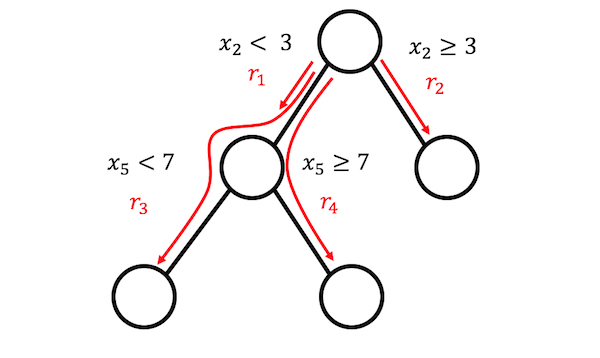
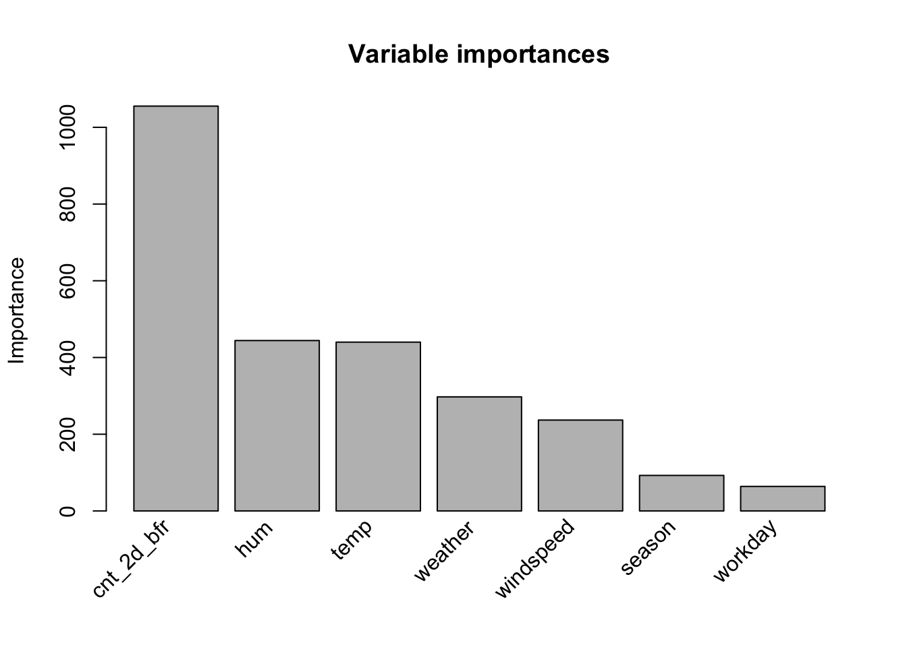

> **Çeviri kaynağı:** Christoph Molnar, *Interpretable Machine Learning*, 3. baskı (2025), [Bölüm 11: RuleFit](https://christophm.github.io/interpretable-ml-book/rulefit.html). Özgün eser CC BY-NC-SA 4.0 lisanslıdır. Teknik terimler, gerekli olduğu yerlerde İngilizce karşılıklarıyla birlikte verilmiştir. Özgün bölümdeki R kodlarının (`pre` paketi) ürettiği şekil, tablo ve sayısal değerler, kitabın yayımlanmış sürümünden alınmıştır.

RuleFit algoritması [@friedman2008predictive], otomatik olarak tespit edilen etkileşim etkilerini karar kuralları (*decision rules*) biçiminde içeren seyrek doğrusal modeller (*sparse linear models*) öğrenir.

Doğrusal regresyon modeli öznitelikler arasındaki etkileşimleri hesaba katmaz.
Doğrusal modeller kadar basit ve yorumlanabilir olan, ama öznitelik etkileşimlerini de içeren bir modelimiz olsa kullanışlı olmaz mıydı?
RuleFit bu boşluğu doldurur.
RuleFit, özgün öznitelikleri ve ayrıca karar kuralı niteliğindeki bir dizi yeni özniteliği içeren seyrek bir doğrusal model öğrenir.
Bu yeni öznitelikler, özgün öznitelikler arasındaki etkileşimleri yakalar.
RuleFit bu öznitelikleri karar ağaçlarından otomatik olarak üretir.
Bir ağaçtaki her yol, bölünme kararlarının bir kural hâlinde birleştirilmesiyle bir karar kuralına dönüştürülebilir; bkz. @fig-rulefit-rules.
Düğüm tahminleri atılır ve karar kurallarında yalnızca bölünmeler kullanılır:

{#fig-rulefit-rules width=80%}

Peki bu karar ağaçları nereden gelir?
Ağaçlar, ilgilenilen çıktıyı tahmin edecek şekilde eğitilir.
Bu, bölünmelerin tahmin görevi için anlamlı olmasını sağlar.
Çok sayıda ağaç üreten herhangi bir algoritma, örneğin bir rastgele orman (*random forest*), RuleFit için kullanılabilir.
Her ağaç, seyrek bir doğrusal regresyon modelinde (Lasso) ek öznitelik olarak kullanılan karar kurallarına ayrıştırılır.

RuleFit makalesi bunu Boston konut verisiyle örneklendirir:
Amaç, Boston'daki bir mahallenin medyan konut değerini tahmin etmektir.
RuleFit'in ürettiği kurallardan biri şudur:
EĞER `oda sayısı > 6.64` VE `nitrik oksit yoğunluğu < 0.67` İSE 1 DEĞİLSE 0.

RuleFit ayrıca, tahminler için önemli olan doğrusal terimleri ve kuralları belirlemeye yardımcı olan bir öznitelik önemi ölçüsüyle birlikte gelir.
Öznitelik önemi, regresyon modelinin ağırlıklarından hesaplanır.
Önem ölçüsü, özgün öznitelikler için (bunlar hem "ham" hâlleriyle hem de muhtemelen birçok karar kuralı içinde kullanılır) bir araya getirilebilir.

RuleFit, bir özniteliği değiştirmenin tahminde yol açtığı ortalama değişimi göstermek için kısmi bağımlılık grafiklerini (*partial dependence plots*) de tanıtır.
Kısmi bağımlılık grafiği, herhangi bir modelle kullanılabilen modelden bağımsız (*model-agnostic*) bir yöntemdir ve [kısmi bağımlılık grafikleri bölümünde](https://christophm.github.io/interpretable-ml-book/pdp.html) açıklanmaktadır.

## Yorumlama ve örnek

RuleFit sonuçta doğrusal bir model kestirdiği için yorumlama, "olağan" [doğrusal modellerdekiyle](../../06_linear-regression/ceviri/ahmetbatuhankaya-20269348005.html) aynıdır.
Tek fark, modelin karar kurallarından türetilmiş yeni özniteliklere sahip olmasıdır.
Karar kuralları ikili (*binary*) özniteliklerdir:
1 değeri, kuralın tüm koşullarının sağlandığı anlamına gelir; aksi hâlde değer 0'dır.
RuleFit'teki doğrusal terimler için yorum, doğrusal regresyon modellerindekiyle aynıdır:
Öznitelik bir birim artarsa, tahmin edilen çıktı ilgili öznitelik ağırlığı kadar değişir.

Bu örnekte, belirli bir gündeki [kiralanan bisiklet](https://christophm.github.io/interpretable-ml-book/data.html#bike-data) sayısını tahmin etmek için RuleFit kullanıyoruz.
@tbl-rulefit-example, RuleFit'in ürettiği kurallardan beşini Lasso ağırlıkları ve önem değerleriyle birlikte göstermektedir.
Hesaplama bölümün ilerleyen kısmında açıklanmaktadır.
En önemli kural "temp > 12 & hum <= 86" olmuş ve buna karşılık gelen ağırlık 626 bulunmuştur.
Yorumu şudur: Eğer temp > 12 & hum <= 86 ise, diğer tüm öznitelik değerleri sabit kaldığında tahmin edilen bisiklet sayısı 626 artar.
Toplamda, özgün 8 öznitelikten bu türden 368 kural oluşturulmuştur.
Epey fazla!
Ancak Lasso sayesinde 368 kuraldan yalnızca 33'ünün ağırlığı 0'dan farklıdır.

| Açıklama | Ağırlık | Önem |
|:---|---:|---:|
| temp > 12 & hum <= 86 | 626 | 311 |
| cnt_2d_bfr > 5382 & hum <= 80 | 661 | 299 |
| cnt_2d_bfr > 2703 & weather in ("GOOD") | 426 | 213 |
| cnt_2d_bfr > 5047 & temp > 9 | 376 | 178 |
| 4 <= windspeed <= 24 | -32 | 161 |

: RuleFit'in ürettiği kurallar ve bu kuralların doğrusal modeldeki ağırlıkları. {#tbl-rulefit-example}

Genel öznitelik önemlerinin hesaplanması, @fig-rulefit-importance'de görselleştirildiği gibi, sıcaklık ve zaman eğiliminin en önemli öznitelikler olduğunu ortaya koymaktadır.
Öznitelik önemi ölçümü, ham öznitelik teriminin ve özniteliğin yer aldığı tüm karar kurallarının önemini içerir.

{#fig-rulefit-importance width=85%}

**Yorumlama şablonu**

Yorum doğrusal modellere benzer:
Diğer tüm öznitelikler değişmeden kalmak koşuluyla, $X_j$ özniteliği bir birim değişirse tahmin edilen çıktı $\beta_j$ kadar değişir.
Bir karar kuralının ağırlık yorumu özel bir durumdur:
Bir $r_k$ karar kuralının tüm koşulları sağlanıyorsa, tahmin edilen çıktı $\alpha_k$ kadar ($r_k$ kuralının doğrusal modelde öğrenilen ağırlığı) değişir.

Sınıflandırma için (doğrusal regresyon yerine lojistik regresyon kullanıldığında):
$r_k$ karar kuralının tüm koşulları sağlanıyorsa, olayın gerçekleşmesine karşı gerçekleşmemesinin bahis oranı (*odds*) $\alpha_k$ katsayısıyla değişir.

::: {.callout-warning}

## Dışdeğerlemeye dikkat

"Diğer tüm öznitelikler aynı kalmak koşuluyla" ifadesi burada pek makul değildir; çünkü bir öznitelik hem doğrusal bir bileşene sahip olabilir hem de birden fazla kuralda yer alabilir.
Bu durumda özgün özniteliği değiştirmek birden fazla bileşeni değiştirir; dolayısıyla aslında modelin tüm öznitelikleri aynı kalmaz.

:::

## Teori

RuleFit algoritmasının teknik ayrıntılarına daha derinden bakalım.
RuleFit iki bileşenden oluşur:
Birinci bileşen karar ağaçlarından "kurallar" (*rules*) oluşturur; ikinci bileşen ise özgün öznitelikleri ve yeni kuralları girdi olarak alan doğrusal bir model uyarlar (*fit*); "RuleFit" adı da buradan gelir.

**1. Adım: Kural üretimi**

Bir kural neye benzer?
Algoritmanın ürettiği kurallar basit bir biçime sahiptir.
Örneğin:
EĞER $x_2 < 3$ VE $x_5 < 7$ İSE 1 DEĞİLSE 0.
Kurallar, karar ağaçları ayrıştırılarak oluşturulur:
Bir ağaçtaki bir düğüme giden herhangi bir yol, bir karar kuralına dönüştürülebilir.
Kurallar için kullanılan ağaçlar, hedef çıktıyı tahmin edecek şekilde uyarlanır.
Bu nedenle bölünmeler ve bunlardan elde edilen kurallar, ilgilendiğiniz çıktıyı tahmin etmek üzere optimize edilmiştir.
Belirli bir düğüme götüren ikili kararları "VE" ile birbirine bağlarsınız ve işte size bir kural.
Çok sayıda çeşitli ve anlamlı kural üretmek arzu edilir.
Çıktıları ($\mathbf{y}$) özgün öznitelikleriniz ($\mathbf{X}$) ile regresyona ya da sınıflandırmaya tabi tutarak bir karar ağacı topluluğu (*ensemble*) uyarlamak için gradyan artırma (*gradient boosting*) kullanılır.
Ortaya çıkan her ağaç birden çok kurala dönüştürülür.
RuleFit için ağaçları üretmekte yalnızca artırılmış (*boosted*) ağaçlar değil, herhangi bir ağaç topluluğu algoritması kullanılabilir.
Bir ağaç topluluğu şu genel formülle tanımlanabilir:

$$\hat{f}(\mathbf{x}) = a_0 + \sum_{m=1}^M a_m \hat{f}_m(\mathbf{x})$$

$M$ ağaç sayısıdır ve $\hat{f}_m(\mathbf{x})$, $m$-inci ağacın tahmin fonksiyonudur.
$a$'lar ağırlıklardır.
Torbalanmış topluluklar (*bagged ensembles*), rastgele orman, AdaBoost ve MART ağaç toplulukları üretir ve RuleFit için kullanılabilir.

Kuralları topluluğun tüm ağaçlarından oluştururuz.
Her $r_m$ kuralı şu biçimdedir:

$$r_m(\mathbf{x}) = \prod_{j \in \text{T}_m} I(x_j \in s_{jm})$$

Burada $\text{T}_{m}$, $m$-inci ağaçta kullanılan öznitelikler kümesidir; $I$ ise $x_j$ özniteliği $j$-inci öznitelik için (ağaç bölünmeleriyle belirlenen) $s_{jm}$ değer alt kümesindeyse 1, değilse 0 olan gösterge fonksiyonudur.
Sayısal öznitelikler için $s_{jm}$, özniteliğin değer aralığı içindeki bir aralıktır.
Bu aralık iki durumdan birine benzer:

$$x_{s_{jm},\text{lower}} < x_j$$

$$x_j < x_{s_{jm},\text{upper}}$$

O öznitelikte yapılan başka bölünmeler muhtemelen daha karmaşık aralıklara yol açar.
Kategorik öznitelikler için $s$ alt kümesi, özniteliğin bazı belirli kategorilerini içerir.

Bisiklet kiralama veri kümesi için uydurulmuş bir örnek:

$$
\begin{aligned}
r_{17}(\mathbf{x}) & = I(x_{\text{temp}} < 15) \cdot I(x_{\text{weather}} \in \{\text{good}, \text{misty}\}) \\
& \cdot I(10 \leq x_{\text{windspeed}} < 20)
\end{aligned}
$$

Bu kural, üç koşulun tümü sağlanırsa 1, aksi hâlde 0 döndürür.
RuleFit, bir ağaçtan yalnızca yaprak düğümlerden değil, olası tüm kuralları çıkarır.
Dolayısıyla oluşturulacak başka bir kural da şudur:

$$r_{18}(\mathbf{x}) = I(x_{\text{temp}} < 15) \cdot I(x_{\text{weather}} \in \{\text{good}, \text{misty}\})$$

Toplamda, her biri $t_m$ uç düğüme sahip $M$ ağaçlık bir topluluktan oluşturulan kural sayısı şudur:

$$K = \sum_{m=1}^M 2(t_m - 1)$$

RuleFit yazarlarının getirdiği bir hile, farklı uzunluklarda çok sayıda çeşitli kural üretilmesi için ağaçları rastgele derinlikte öğrenmektir.
Her düğümdeki tahmin değerini attığımıza ve yalnızca bizi o düğüme götüren koşulları tutup bunlardan bir kural oluşturduğumuza dikkat edin.
Karar kurallarının ağırlıklandırılması RuleFit'in 2. adımında yapılır.

1. adıma bakmanın bir başka yolu da şudur: RuleFit, özgün özniteliklerinizden yeni bir öznitelik kümesi üretir.
Bu öznitelikler ikilidir ve özgün öznitelikleriniz arasındaki oldukça karmaşık etkileşimleri temsil edebilir.
Kurallar, tahmin görevi için yararlı olacak şekilde seçilir.
Kurallar, $\mathbf{X}$ ortak değişkenler matrisinden (*covariates matrix*) otomatik olarak üretilir.
Kuralları, özgün özniteliklerinize dayanan yeni öznitelikler olarak görebilirsiniz.

::: {.callout-tip}

## Daha az koşul, daha iyi yorumlanabilirlik

Daha iyi yorumlanabilirlik için her kuraldaki koşul sayısını 1 ile 3 arasında tutun.

:::

**2. Adım: Seyrek doğrusal model**

1. adımda ÇOK sayıda kural elde edersiniz.
İlk adım yalnızca bir öznitelik dönüşümü olarak görülebileceğinden, model uyarlama işiniz henüz bitmemiştir.
Ayrıca kuralların sayısını da azaltmak istersiniz.
Kuralların yanı sıra özgün veri kümenizdeki tüm "ham" öznitelikler de seyrek doğrusal modelde kullanılır.
Her kural ve her özgün öznitelik doğrusal modelde bir öznitelik hâline gelir ve bir ağırlık kestirimi alır.
Özgün ham öznitelikler eklenir; çünkü ağaçlar $Y$ ile $X_j$ arasındaki basit doğrusal ilişkileri temsil etmekte başarısızdır.
Seyrek doğrusal bir modeli eğitmeden önce, özgün öznitelikleri aykırı değerlere karşı daha dayanıklı olmaları için winsorize ederiz (uç değerleri kırparız):

$$l_j^*(x_j)=\min(\delta_j^+, \max(\delta_j^-, x_j))$$

Burada $\delta_j^-$ ve $\delta_j^+$, $\mathbf{x}_j$'nin veri dağılımının $\delta$ nicelikleridir (*quantiles*).
$\delta$ için 0,05 seçilmesi, $X_j$ özniteliğinin en düşük %5'lik ya da en yüksek %5'lik dilimdeki her değerinin sırasıyla %5 ya da %95 niceliğine eşitleneceği anlamına gelir.
Pratik bir kural olarak $\delta = 0.025$ seçebilirsiniz.
Ayrıca doğrusal terimlerin, tipik bir karar kuralıyla aynı ön (*prior*) öneme sahip olmaları için normalleştirilmesi gerekir:

$$l_j(x_j) = 0.4 \cdot \frac{l^*_j(x_j)}{\mathrm{std}(l^*_j(x_j))}$$

$0.4$, destek dağılımı $s_k \sim U(0, 1)$ şeklinde düzgün olan kuralların ortalama standart sapmasıdır.

Her iki tür özniteliği birleştirerek yeni bir öznitelik matrisi oluşturur ve Lasso ile aşağıdaki yapıya sahip seyrek bir doğrusal model eğitiriz:

$$\hat{f}(\mathbf{x}) = \hat{\beta}_0 + \sum_{k=1}^K \hat{\alpha}_k r_k(\mathbf{x}) + \sum_{j=1}^p \hat{\beta}_j l_j(x_j)$$

Burada $\hat{\alpha}_k$, $k$ kuralı için kestirilen ağırlık; $\hat{\beta}_j$ ise $j$ özgün özniteliğinin ağırlığıdır.
RuleFit Lasso kullandığı için kayıp fonksiyonu, ağırlıkların bir kısmının sıfır kestirim almasını zorlayan ek bir kısıt kazanır:

$$
\begin{aligned}
(\{\hat{\alpha}\}_1^K,\{\hat{\beta}\}_0^p) = & \arg\min_{\{\hat{\alpha}\}_1^K,\{\hat{\beta}\}_0^p}\sum_{i=1}^n L(y^{(i)},\hat{f}(\mathbf{x}^{(i)})) \\
& + \lambda\cdot\left(\sum_{k=1}^K|\hat{\alpha}_k| + \sum_{j=1}^p|\hat{\beta}_j|\right)
\end{aligned}
$$

Sonuç, özgün özniteliklerin tümü ve kurallar için doğrusal etkileri olan doğrusal bir modeldir.
Yorum doğrusal modellerdekiyle aynıdır; tek fark, bazı özniteliklerin artık ikili kurallar olmasıdır.

**3. Adım (isteğe bağlı): Öznitelik önemi**

Özgün özniteliklerin doğrusal terimleri için öznitelik önemi, standartlaştırılmış yordayıcı (*standardized predictor*) ile ölçülür:

$$I_j = |\hat{\beta}_j| \cdot \mathrm{std}(l_j(x_j))$$

Burada $\hat{\beta}_j$ Lasso modelinden gelen ağırlık, $\mathrm{std}(l_j(x_j))$ ise doğrusal terimin veri üzerindeki standart sapmasıdır.

Karar kuralı terimleri için önem şu formülle hesaplanır:

$$I_k = |\hat{\alpha}_k| \cdot \sqrt{s_k(1-s_k)}$$

Burada $\hat{\alpha}_k$ karar kuralına ait Lasso ağırlığı, $s_k$ ise özniteliğin verideki desteğidir (*support*); yani karar kuralının geçerli olduğu ($r_k(\mathbf{x})=1$ olan) veri noktalarının oranıdır:

$$s_k = \frac{1}{n} \sum_{i=1}^n r_k(\mathbf{x}^{(i)})$$

Bir öznitelik doğrusal bir terim olarak ve muhtemelen birçok karar kuralının içinde de yer alır.
Bir özniteliğin toplam önemini nasıl ölçeriz?
Bir özniteliğin $J_j(\mathbf{x}_j)$ önemi her bir tekil tahmin için ölçülebilir:

$$J_j(x_j) = I_j(x_j) + \sum_{k \mid x_j \in r_k} \frac{I_k(r_k)}{m_k}$$

Burada $I_j$ doğrusal terimin önemi, $I_k$ $X_j$'nin yer aldığı karar kurallarının önemi, $m_k$ ise $r_k$ kuralını oluşturan öznitelik sayısıdır.
Tüm örneklerden gelen öznitelik önemlerinin toplanması bize genel (*global*) öznitelik önemini verir:

$$J_j(\mathbf{x}_j) = \sum_{i=1}^n J_j(x^{(i)}_j)$$

Örneklerin bir alt kümesini seçip öznitelik önemini bu grup için hesaplamak da mümkündür.

## Güçlü yönler

RuleFit, doğrusal modellere **öznitelik etkileşimlerini** otomatik olarak ekler.
Böylece doğrusal modellerde etkileşim terimlerini elle eklemek zorunda kalma sorununu çözer ve doğrusal olmayan ilişkilerin modellenmesi sorununa da biraz yardımcı olur.

RuleFit **hem sınıflandırma hem de regresyon** görevlerinin üstesinden gelebilir.

**Oluşturulan kuralların yorumlanması kolaydır**, çünkü bunlar ikili karar kurallarıdır.
Kural bir örneğe ya uygulanır ya da uygulanmaz.
İyi yorumlanabilirlik ancak bir kuraldaki koşul sayısı çok fazla değilse garanti edilir.
1 ila 3 koşullu bir kural bana makul görünüyor.
Bu, ağaç topluluğundaki ağaçlar için en fazla 3 derinlik demektir.

Modelde çok sayıda kural olsa bile bunlar her örneğe uygulanmaz.
Tekil bir örnek için yalnızca bir avuç kural geçerlidir (sıfır olmayan ağırlığa sahiptir).
Bu, **yerel yorumlanabilirliği** (*local interpretability*) iyileştirir.

RuleFit bir dizi **yararlı tanılama aracı** önerir.
Bu araçlar modelden bağımsızdır; bu yüzden onları kitabın modelden bağımsız yöntemler kısmında bulabilirsiniz: [öznitelik önemi](https://christophm.github.io/interpretable-ml-book/feature-importance.html), [kısmi bağımlılık grafikleri](https://christophm.github.io/interpretable-ml-book/pdp.html) ve [öznitelik etkileşimleri](https://christophm.github.io/interpretable-ml-book/interaction.html).

## Sınırlılıklar

RuleFit bazen Lasso modelinde sıfırdan farklı ağırlık alan çok sayıda kural oluşturur.
Modeldeki **öznitelik sayısı arttıkça yorumlanabilirlik azalır**.
Umut verici bir çözüm, öznitelik etkilerini monoton olmaya zorlamaktır; yani bir özniteliğin artışı tahminin artmasına yol açmak zorundadır.

Anekdot niteliğinde bir dezavantaj: Makaleler RuleFit'in iyi bir performansa sahip olduğunu öne sürüyor, hatta çoğu zaman rastgele ormanların tahmin performansına yakın olduğunu!
Ancak kişisel olarak denediğim birkaç durumda **performans hayal kırıklığı yarattı**.
Kendi probleminiz için deneyin ve nasıl performans gösterdiğine bakın.

RuleFit sürecinin nihai ürünü, ek süslü öznitelikleri (karar kurallarını) olan doğrusal bir modeldir.
Ancak doğrusal bir model olduğu için **ağırlık yorumu yine sezgisel değildir**.
Olağan bir doğrusal regresyon modeliyle aynı "dipnotu" taşır:
"... tüm öznitelikler sabitken."
Kurallar örtüştüğünde işler biraz daha çetrefilleşir.
Örneğin bisiklet tahmini için bir karar kuralı (öznitelik) "temp > 10", başka bir kural ise "temp > 15 & weather='GOOD'" olabilir.
Hava iyiyse ve sıcaklık 15 derecenin üzerindeyse, sıcaklık kendiliğinden 10'dan büyüktür.
İkinci kuralın geçerli olduğu durumlarda birinci kural da geçerlidir.
İkinci kural için kestirilen ağırlığın yorumu şudur:
"Diğer tüm özniteliklerin sabit kaldığı varsayımıyla, hava iyi ve sıcaklık 15 derecenin üzerinde olduğunda tahmin edilen bisiklet sayısı $\beta_2$ kadar artar."
Ancak burada 'diğer tüm öznitelikler sabit' ifadesinin sorunlu olduğu iyice netleşir; çünkü 2. kural geçerliyse 1. kural da geçerlidir ve bu yorum anlamsız hâle gelir.

## Yazılım ve alternatifler

RuleFit algoritması @fokkema2020fitting tarafından [R'da uygulanmıştır](https://CRAN.R-project.org/package=pre); ayrıca [GitHub'da bir Python sürümü](https://github.com/christophM/rulefit) de bulabilirsiniz.

Buna çok benzeyen bir çerçeve de topluluklardan yine kural çıkaran bir Python modülü olan [skope-rules](https://github.com/scikit-learn-contrib/skope-rules)'dur.
Nihai kuralları öğrenme biçimi bakımından farklılaşır:
skope-rules önce duyarlılık (*recall*) ve kesinlik (*precision*) eşiklerine göre düşük performanslı kuralları eler.
Ardından mantıksal terimlerin (değişken + büyüktür/küçüktür işleci) çeşitliliğine ve kuralların performansına (F1 skoru) dayalı bir seçim yaparak yinelenen ve benzer kuralları kaldırır.
Bu son adım Lasso kullanmaya dayanmaz; yalnızca torba dışı (*out-of-bag*) F1 skorunu ve kuralları oluşturan mantıksal terimleri dikkate alır.

[imodels paketi](https://github.com/csinva/imodels) de, birleşik bir scikit-learn arayüzüne sahip bir Python paketi olarak, Bayesçi kural kümeleri (*Bayesian rule sets*), artırılmış kural kümeleri (*Boosted rule sets*) ve SLIPPER kural kümeleri gibi diğer kural kümelerinin uygulamalarını içerir.
Bir de doğrusal bileşenlerle kural bileşenlerinin karıştırılmasına yine olanak tanıyan model tabanlı artırma (*model-based boosting*) [@buhlmann2007boosting] vardır; bu yöntem R'daki [mboost](https://cran.r-project.org/package=mboost) paketinde uygulanmıştır.

## Kaynaklar {.unnumbered}

::: {#refs}
:::
