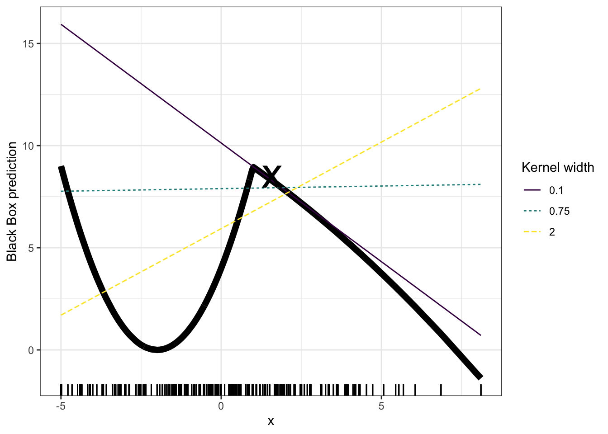
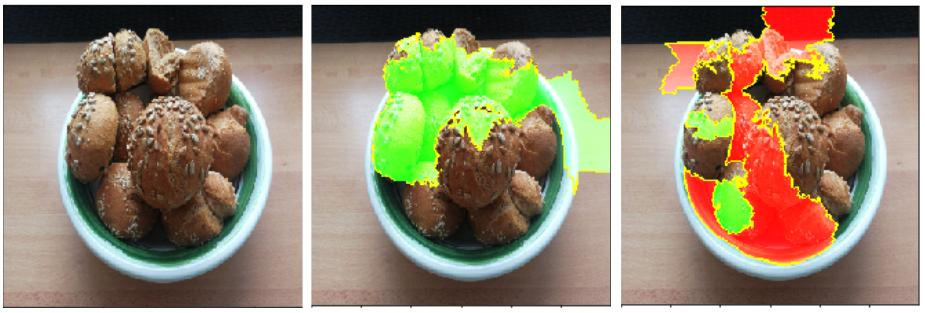

Yerel vekil modeller (local surrogate models), kara kutu makine öğrenmesi modellerinin bireysel tahminlerini açıklamak için kullanılan yorumlanabilir modellerdir. Ribeiro, Singh ve Guestrin ([2016](https://christophm.github.io/interpretable-ml-book/references.html#ref-ribeiro2016why)) tarafından önerilen Yerel Yorumlanabilir Modelden Bağımsız Açıklamalar (Local Interpretable Model-Agnostic Explanations - LIME), vekil modellerin uydurulmasına yönelik bir yaklaşımdır. Vekil modeller, temel alınan kara kutu modelinin tahminlerini yaklaşık olarak temsil etmek üzere eğitilir.

Fikir oldukça sezgiseldir. İlk olarak, eğitim verilerini unutun ve yalnızca veri noktalarını girebildiğiniz ve modelin tahminlerini elde edebildiğiniz kara kutu modele sahip olduğunuzu düşünün. Bu kutuyu istediğiniz kadar sorgulayabilirsiniz. Amacınız, makine öğrenmesi modelinin belirli bir tahmini neden yaptığını anlamaktır. LIME, verilerinizin farklı varyasyonlarını makine öğrenmesi modeline verdiğinizde tahminlere ne olduğunu test eder. LIME, pertürbe edilmiş örneklerden ve kara kutu modelin bunlara karşılık gelen tahminlerinden oluşan yeni bir veri kümesi oluşturur. Daha sonra LIME, bu yeni veri kümesi üzerinde, örneklenen örneklerin ilgilenilen örneğe olan yakınlığına göre ağırlıklandırılan yorumlanabilir bir model eğitir. Yorumlanabilir model, [Lasso](https://christophm.github.io/interpretable-ml-book/limo.html#lasso)'dan bir [karar ağacına](https://christophm.github.io/interpretable-ml-book/tree.html) kadar herhangi bir model olabilir. Öğrenilen model, makine öğrenmesi modelinin tahminlerinin yerel olarak iyi bir yaklaşımı olmalıdır, ancak küresel olarak iyi bir yaklaşım olması gerekmez. Bu tür doğruluk, yerel sadakat (local fidelity) olarak da adlandırılır.

Matematiksel olarak, yorumlanabilirlik kısıtına sahip yerel vekil modeller aşağıdaki şekilde ifade edilebilir:

$$
\operatorname{explanation}(\mathbf{x})
= \underset{g \in G}{\arg\min}\;
L(\hat{f}, g, \pi_{\mathbf{x}}) + \Omega(g)
$$

$x$ örneği için açıklama modeli, açıklamanın orijinal model $\hat{f}$'in (örneğin, bir XGBoost modeli) tahminine ne kadar yakın olduğunu ölçen $L$ kaybını (örneğin, ortalama karesel hata) en aza indiren $g$ modelidir (örneğin, doğrusal regresyon modeli). Aynı zamanda model karmaşıklığı $\Omega(g)$ düşük tutulur (örneğin, daha az özellik tercih edilir). $G$, olası açıklamaların ailesidir; örneğin, tüm olası doğrusal regresyon modelleri. Yakınlık ölçüsü $\pi_x$, açıklama için dikkate aldığımız $x$ örneğinin etrafındaki komşuluğun ne kadar büyük olduğunu tanımlar. Pratikte LIME yalnızca kayıp kısmını optimize eder. Kullanıcı, örneğin doğrusal regresyon modelinin kullanabileceği maksimum özellik sayısını seçerek karmaşıklığı belirlemelidir.

Yerel vekil modelleri eğitmek için izlenecek adımlar:

- Kara kutu tahmini için bir açıklama elde etmek istediğiniz ilgilenilen örneği seçin.
- Veri kümenizi pertürbe edin ve bu yeni noktalar için kara kutu modelin tahminlerini elde edin.
- Yeni örnekleri, ilgilenilen örneğe olan yakınlıklarına göre ağırlıklandırın.
- Varyasyonları içeren veri kümesi üzerinde ağırlıklandırılmış, yorumlanabilir bir model eğitin.
- Yerel modeli yorumlayarak tahmini açıklayın.

Örneğin, [R](https://cran.r-project.org/web/packages/lime/index.html) ve [Python](https://github.com/marcotcr/lime) dillerindeki mevcut uygulamalarda, yorumlanabilir bir vekil model olarak doğrusal regresyon seçilebilir. Önceden, yorumlanabilir modelinizde bulunmasını istediğiniz özellik sayısı olan $K$'yı seçmeniz gerekir. $K$ ne kadar düşükse, modeli yorumlamak o kadar kolaydır. Daha yüksek bir $K$, potansiyel olarak daha yüksek sadakate sahip modeller üretir. Tam olarak $K$ özelliğe sahip modelleri eğitmek için çeşitli yöntemler vardır. İyi bir seçenek [Lasso](https://christophm.github.io/interpretable-ml-book/limo.html#lasso)'dur. Yüksek düzenlileştirme parametresi $\lambda$'ya sahip bir Lasso modeli, hiçbir özellik içermeyen bir model üretir. Lasso modelleri, $\lambda$ yavaşça azaltılarak art arda yeniden eğitildiğinde, özellikler sıfırdan farklı ağırlık tahminleri elde eder. Modelde $K$ özellik bulunduğunda, istenen özellik sayısına ulaşılmış olur. Diğer stratejiler, özelliklerin ileriye veya geriye doğru seçilmesidir. Bu, ya tam modelle (= tüm özellikleri içeren) ya da yalnızca sabit terimi içeren bir modelle başladığınız ve ardından $K$ özelliğe sahip bir modele ulaşılana kadar hangi özelliğin eklenmesinin veya çıkarılmasının en büyük iyileşmeyi sağlayacağını test ettiğiniz anlamına gelir.

Verinin varyasyonlarını nasıl elde edersiniz? Bu, metin, görüntü veya tablo verisi olabilen veri türüne bağlıdır. Metin ve görüntüler için çözüm, tek tek kelimeleri veya süper pikselleri açıp kapatmaktır. Tablo verileri durumunda LIME, her bir özelliği ayrı ayrı pertürbe ederek ve özelliğin ortalama ve standart sapma değerlerine sahip bir normal dağılımdan örnekleme yaparak yeni örnekler oluşturur.

## Tablo verileri için LIME

Tablo verisi, her satırın bir örneği ve her sütunun bir özelliği temsil ettiği tablolar halinde sunulan verilerdir. LIME örnekleri, ilgilenilen örneğin çevresinden değil, eğitim verilerinin kütle merkezinden alınır ve bu durum sorunludur. Ancak bu, bazı örnek noktaların tahminlerinin ilgilenilen veri noktasının tahmininden farklı olma olasılığını artırır ve LIME'ın en azından bir açıklama öğrenebilmesini sağlar. @fig-lime-tabular, örnekleme ve yerel model eğitiminin nasıl çalıştığını görsel olarak açıklamaktadır:

{#fig-lime-tabular width=100%}

Her zaman olduğu gibi, asıl zorluk ayrıntılardadır. Bir noktanın etrafında anlamlı bir komşuluk tanımlamak zordur. LIME şu anda komşuluğu tanımlamak için üstel bir yumuşatma çekirdeği kullanır. Yumuşatma çekirdeği, iki veri örneğini alan ve bir yakınlık ölçüsü döndüren bir fonksiyondur. Çekirdek genişliği, komşuluğun ne kadar büyük olduğunu belirler: Küçük bir çekirdek genişliği, bir örneğin yerel modeli etkileyebilmesi için çok yakın olması gerektiği anlamına gelir; daha büyük bir çekirdek genişliği ise daha uzaktaki örneklerin de modeli etkilemesi anlamına gelir. [LIME'ın Python uygulamasına (lime/lime_tabular.py dosyası)](https://github.com/marcotcr/lime/tree/ce2db6f20f47c3330beb107bb17fd25840ca4606) bakarsanız, normalize edilmiş veriler üzerinde üstel bir yumuşatma çekirdeği kullandığını ve çekirdek genişliğinin eğitim verilerindeki sütun sayısının karekökünün 0,75 katı olduğunu görürsünüz. Bu, masum bir kod satırı gibi görünür, ancak büyükanne ve büyükbabanızdan kalan güzel porselenlerin yanında oturma odanızda oturan fil gibidir. Büyük sorun, en iyi çekirdeği veya çekirdek genişliğini bulmak için iyi bir yöntemimizin olmamasıdır. Peki 0,75 değeri nereden gelmektedir? Belirli senaryolarda, @fig-ml-graph-ce 'de gösterildiği gibi, yalnızca çekirdek genişliğini değiştirerek açıklamanızı kolayca tersine çevirebilirsiniz: Ortaya çıkan doğrusal regresyon modeli çekirdek genişliğine bağlıdır. $x = 1.6$ için “gerçek” yerel özellik etkisi negatif mi, pozitif mi, yoksa etkisiz mi olmalıdır?

{#fig-ml-graph-ce width=100%}

Örnek yalnızca bir özelliği göstermektedir. Yüksek boyutlu özellik uzaylarında durum daha da kötüleşir. Uzaklık ölçüsünün tüm özellikleri eşit şekilde ele alıp almaması gerektiği de oldukça belirsizdir. $X_1$ özelliği için bir uzaklık birimi, $X_2$ özelliği için bir birimle aynı mıdır? Uzaklık ölçüleri oldukça keyfidir ve farklı boyutlardaki (diğer bir deyişle özelliklerdeki) uzaklıklar hiçbir şekilde karşılaştırılabilir olmayabilir.

Somut bir örneğe bakalım. Vücut ölçümlerine dayanarak bir pengueni dişi veya erkek olarak sınıflandırmayı amaçlayan [penguen verilerine](https://christophm.github.io/interpretable-ml-book/data.html#bike-data) geri dönüyoruz. Bu amaçla eğitilen rastgele orman modelini analiz ediyoruz. Açıklamalar 2 özellik kullanılarak oluşturulmuştur. Farklı tahmin edilen sınıflara sahip iki örnek için eğitilen seyrek yerel doğrusal modellerin sonuçları @fig-ml-graph-ca 'te gösterilmektedir. Burada, daha yüksek vücut kütlesi ve daha uzun gagalar, daha düşük P(dişi) ile ilişkilidir.

{#fig-ml-graph-ca width=100%}

## Metin verileri için LIME

Metin için LIME, tablo verileri için kullanılan LIME'dan farklıdır. Veri varyasyonları farklı şekilde oluşturulur: Orijinal metinden başlanarak, kelimeler orijinal metinden rastgele çıkarılır ve yeni metinler oluşturulur. Veri kümesi, her kelime için ikili özelliklerle temsil edilir. İlgili kelime metinde bulunuyorsa özellik 1, çıkarılmışsa 0 değerini alır.

Metin sınıflandırmasına bir örnek olarak, 5 farklı YouTube videosundan alınan 1956 yorumla çalışıyoruz. Neyse ki, bu veri kümesini spam sınıflandırması üzerine bir makalede kullanan yazarlar verileri [ücretsiz olarak erişilebilir](https://archive.ics.uci.edu/ml/datasets/YouTube+Spam+Collection) hale getirmiştir ([Alberto, Lochter ve Almeida, 2015](https://christophm.github.io/interpretable-ml-book/references.html#ref-alberto2015tubespam)).

Yorumlar, 2015'in ilk yarısında YouTube'da en çok izlenen on videodan beşinden YouTube API aracılığıyla toplanmıştır. Beşinin tamamı müzik videosudur. Bunlardan biri Koreli sanatçı Psy'ın “Gangnam Style” adlı şarkısıdır. Diğer sanatçılar Katy Perry, LMFAO, Eminem ve Shakira'dır. Tablo 14.1'de biri spam (class=1), diğeri gerçek (class=0) olmak üzere iki yoruma göz atın. Yorumlar manuel olarak spam veya gerçek şeklinde etiketlenmiştir. Spam yorumlar “1”, gerçek yorumlar ise “0” ile kodlanmıştır. Ayrıca YouTube'a gidip yorumlar bölümüne de göz atabilirsiniz. Ancak lütfen YouTube cehennemine kapılıp sahilde turistlerden kokteyl çalan ve içen maymunların videolarını izlerken bulmayın kendinizi. Google'ın spam algılayıcısı da muhtemelen 2015'ten bu yana oldukça değişmiştir. [İzlenme rekorları kıran “Gangnam Style” videosunu buradan izleyebilirsiniz](https://www.youtube.com/watch?v=9bZkp7q19f0&feature=player_embedded).

Kara kutu model, doküman-kelime matrisi üzerinde eğitilmiş derin bir karar ağacıdır. Her yorum bir dokümandır (= bir satır) ve her sütun belirli bir kelimenin görülme sayısını ifade eder. Kısa karar ağaçlarının anlaşılması kolaydır, ancak bu durumda ağaç oldukça derindir. Ayrıca, bu ağacın yerine kelime gömmeleri (soyut vektörler) üzerinde eğitilmiş tekrarlayan bir sinir ağı veya destek vektör makinesi de kullanılabilirdi.

**Tablo 14.1: İki yorum örneği.**

|     | İÇERİK                                  | SINIF |
| :-- | :-------------------------------------- | ----: |
| 267 | PSY iyi bir adam                        |     0 |
| 173 | Noel Şarkısı için kanalıma uğrayın! ;)  |     1 |

Sonraki adım, yerel modelde kullanılan veri kümesinin bazı varyasyonlarını oluşturmaktır. Örneğin yorumlardan birinin bazı varyasyonları Tablo 14.2'de gösterilmiştir. Her sütun cümledeki bir sözcüğe karşılık gelir. Her satır bir varyasyondur; 1 sözcüğün bu varyasyonda bulunduğunu, 0 ise çıkarıldığını belirtir. Varyasyonlardan birine karşılık gelen cümle “Christmas Song visit my ;)” şeklindedir. “olasılık” sütunu, cümle varyasyonlarının her biri için tahmin edilen spam olasılığını gösterir. “ağırlık” sütunu ise varyasyonun özgün cümleye yakınlığını gösterir. Bu değer, çıkarılan sözcüklerin oranının 1'den çıkarılmasıyla hesaplanır; örneğin yedi sözcükten biri çıkarılmışsa yakınlık $1-1/7=0{,}86$ olur.

**Tablo 14.2: YouTube yorumlarından birinin varyasyonları; uzaklığa dayalı ağırlıkları ve tahmin edilen spam olasılıklarıyla birlikte.**

| For | Christmas | Song | visit | my | channel! | ;) | olasılık | ağırlık |
| --: | --------: | ---: | ----: | -: | -------: | -: | -------: | ------: |
|   1 |         0 |    1 |     1 |  0 |        0 |  1 |     0.17 |    0.57 |
|   0 |         1 |    1 |     1 |  1 |        0 |  1 |     0.17 |    0.71 |
|   1 |         0 |    0 |     1 |  1 |        1 |  1 |     0.99 |    0.71 |
|   1 |         0 |    1 |     1 |  1 |        1 |  1 |     0.99 |    0.86 |
|   0 |         1 |    1 |     1 |  0 |        0 |  1 |     0.17 |    0.57 |

Son olarak Tablo 14.3, iki cümleyi (biri spam, biri spam değil) LIME algoritmasının bulduğu tahmini yerel ağırlıklarıyla birlikte gösterir. “channel” sözcüğü yüksek spam olasılığına işaret eder. Spam olmayan yorum için sıfırdan farklı bir ağırlık tahmin edilmemiştir; çünkü hangi sözcük çıkarılırsa çıkarılsın tahmin edilen sınıf aynı kalmaktadır.

**Tablo 14.3: Metin sınıflandırması için LIME açıklamaları.**

| örnek | etiket_olasılığı | özellik  | özellik_ağırlığı |
| ----: | ---------------: | :------- | ----------------: |
|     1 |        0.1701170 | PSY      |          0.000000 |
|     1 |        0.1701170 | a        |          0.000000 |
|     1 |        0.1701170 | good     |          0.000000 |
|     2 |        0.9939024 | channel! |          6.180747 |
|     2 |        0.9939024 | For      |          0.000000 |
|     2 |        0.9939024 | Song     |          0.000000 |

## Görüntü verileri için LIME

*Bu bölüm Verena Haunschmid tarafından yazılmıştır.*

Görüntüler için LIME, tablo verileri ve metin için kullanılan LIME'dan farklı şekilde çalışır. Sezgisel olarak, tek tek pikselleri pertürbe etmek pek anlamlı olmazdı, çünkü bir sınıfa birden fazla piksel katkıda bulunur. Tek tek pikselleri rastgele değiştirmek muhtemelen tahminleri çok fazla değiştirmezdi. Bu nedenle, görüntülerin varyasyonları, görüntünün “süper piksellere” bölünmesi ve bu süper piksellerin açılıp kapatılmasıyla oluşturulur. Süper pikseller, benzer renklere sahip birbirine bağlı piksellerdir ve her bir piksel, gri gibi kullanıcı tarafından tanımlanan bir renkle değiştirilerek kapatılabilir. Kullanıcı ayrıca her permütasyonda bir süper pikselin kapatılma olasılığını da belirleyebilir.

Bu örnekte, Inception V3 sinir ağı tarafından yapılan bir sınıflandırmayı inceliyoruz. Kullanılan görüntü, bir kasenin içinde bulunan, benim pişirdiğim bazı ekmekleri göstermektedir (bkz. @fig-ml-graph-cb). Her görüntü için birden fazla tahmin edilen etikete sahip olabileceğimizden (olasılığa göre sıralanmış), en üstteki etiketleri açıklayabiliriz. En yüksek tahmin, $\mathbb{P}(Y = \text{Bagel}) = 0.77$ olasılığıyla “Bagel”dır ve bunu $\mathbb{P}(Y = \text{Strawberry}) = 0.04$ olasılığıyla “Strawberry” takip etmektedir.

Aşağıdaki görüntüler, “Bagel” ve “Strawberry” için LIME açıklamalarını göstermektedir. Açıklamalar doğrudan görüntü örnekleri üzerinde gösterilebilir. Yeşil, görüntünün bu bölümünün ilgili etiket için olasılığı artırdığı, kırmızı ise azalttığı anlamına gelir.

{#fig-ml-graph-cb width=100%}

“Bagel” için yapılan tahmin ve açıklama, tahmin yanlış olsa bile oldukça makuldür – bunlar kesinlikle bagel değildir, çünkü ortalarında delik bulunmamaktadır.

## Güçlü yönler

Temel makine öğrenmesi modelini **değiştirseniz bile**, açıklama için aynı yerel, yorumlanabilir modeli kullanmaya devam edebilirsiniz. Açıklamalara bakan kişilerin karar ağaçlarını en iyi şekilde anladığını varsayalım. Yerel vekil modeller kullandığınız için, tahminleri yapmak amacıyla gerçekten bir karar ağacı kullanmak zorunda kalmadan karar ağaçlarını açıklama olarak kullanabilirsiniz. Örneğin, bir SVM kullanabilirsiniz. Daha sonra bir XGBoost modelinin daha iyi çalıştığı ortaya çıkarsa, SVM'yi XGBoost ile değiştirebilir ve tahminleri açıklamak için yine bir karar ağacı kullanabilirsiniz.

Yerel vekil modeller, yorumlanabilir modellerin eğitilmesi ve yorumlanmasına ilişkin literatürden ve deneyimlerden yararlanır.

Lasso veya kısa ağaçlar kullanıldığında ortaya çıkan **açıklamalar kısadır (= seçicidir) ve muhtemelen karşılaştırmalıdır**. Bu nedenle, [insan dostu açıklamalar](https://christophm.github.io/interpretable-ml-book/interpretability.html#explanation) sunarlar.

LIME, **tablo verileri, metin ve görüntülerle çalışan** az sayıdaki yöntemden biridir.

**Sadakat ölçüsü** (yorumlanabilir modelin kara kutu tahminlerini ne kadar iyi yaklaşık olarak temsil ettiği), yorumlanabilir modelin ilgilenilen veri örneğinin komşuluğundaki kara kutu tahminlerini açıklamada ne kadar güvenilir olduğu konusunda bize iyi bir fikir verir.

LIME, Python'da ([lime](https://github.com/marcotcr/lime) kütüphanesi) ve R'da ([lime paketi](https://cran.r-project.org/web/packages/lime/index.html) ve [iml paketi](https://cran.r-project.org/web/packages/iml/index.html)) uygulanmıştır ve **kullanımı oldukça kolaydır**.

Yerel vekil modellerle oluşturulan açıklamalar, **orijinal modelin eğitildiği özelliklerden farklı (yorumlanabilir) özellikler kullanabilir**. Elbette bu yorumlanabilir özelliklerin veri örneklerinden türetilmesi gerekir. Bir metin sınıflandırıcısı, özellik olarak soyut kelime gömmelerine dayanabilir, ancak açıklama bir cümledeki kelimelerin varlığına veya yokluğuna dayanabilir. Bir regresyon modeli, bazı niteliklerin yorumlanamayan bir dönüşümüne dayanabilir, ancak açıklamalar orijinal nitelikler kullanılarak oluşturulabilir. Örneğin, regresyon modeli bir ankete verilen yanıtların temel bileşen analizi (PCA) bileşenleri üzerinde eğitilmiş olabilir, ancak LIME orijinal anket soruları üzerinde eğitilebilir. LIME için yorumlanabilir özelliklerin kullanılması, özellikle model yorumlanamayan özelliklerle eğitilmişse, diğer yöntemlere göre büyük bir avantaj sağlayabilir.

## Sınırlılıklar

LIME tablo verileriyle kullanıldığında **komşuluk seçimi çözülmemiş bir problemdir**. Bana göre bu, LIME'ın en büyük problemidir ve LIME'ın yalnızca büyük bir dikkatle kullanılmasını önermemin nedenidir. Her uygulama için farklı çekirdek ayarlarını denemeniz ve açıklamaların anlamlı olup olmadığını kendiniz değerlendirmeniz gerekir. Ne yazık ki, uygun çekirdek genişliklerini bulmak için verebileceğim en iyi tavsiye budur.

LIME'ın mevcut uygulamasında örnekleme geliştirilebilir. Veri noktaları, özellikler arasındaki korelasyon göz ardı edilerek bir Gauss dağılımından örneklenir. Bu durum, **olası olmayan veri noktalarının oluşmasına** yol açabilir ve bu noktalar daha sonra yerel açıklama modellerini öğrenmek için kullanılabilir.

**Açıklama modelinin karmaşıklığının önceden tanımlanması gerekir**. Bu yalnızca küçük bir eleştiridir, çünkü sonuçta kullanıcı her zaman sadakat ile seyreklik arasındaki ödünleşimi belirlemek zorundadır.

Bir diğer gerçekten büyük problem ise **açıklamaların kararsızlığıdır**. Bir makalede ([Alvarez-Melis ve Jaakkola, 2018](https://christophm.github.io/interpretable-ml-book/references.html#ref-melis2018robustness)), yazarlar birbirine çok yakın iki noktanın açıklamalarının simüle edilmiş bir ortamda büyük ölçüde farklılık gösterdiğini ortaya koymuştur. Ayrıca, benim deneyimime göre, örnekleme sürecini tekrarlarsanız ortaya çıkan açıklamalar farklı olabilir. Kararsızlık, açıklamalara güvenmeyi zorlaştırır ve bu nedenle oldukça eleştirel yaklaşmanız gerekir.

LIME açıklamaları, yanlılıkları gizlemek amacıyla veri bilimci tarafından manipüle edilebilir ([Slack ve diğerleri, 2020](https://christophm.github.io/interpretable-ml-book/references.html#ref-slack2020fooling)). Manipülasyon olasılığı, LIME ile oluşturulan açıklamalara güvenmeyi daha da zorlaştırmaktadır.

Sonuç: Somut bir uygulaması LIME olan yerel vekil modeller oldukça umut vericidir. Ancak yöntem hâlâ geliştirme aşamasındadır ve güvenli bir şekilde uygulanabilmesi için birçok problemin çözülmesi gerekmektedir.

## Yazılım

Özgün Python uygulaması [lime paketinde](https://github.com/marcotcr/lime) yer almaktadır. Diğer Python uygulamalarına [PiML](https://selfexplainml.github.io/PiML-Toolbox/_build/html/index.html) ve [eli5](https://eli5.readthedocs.io/en/latest/blackbox/lime.html) içinde ulaşılabilir. R'da [iml](https://github.com/giuseppec/iml) veya [DALEX](https://dalex.drwhy.ai/) kullanılabilir.
