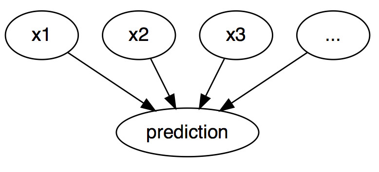
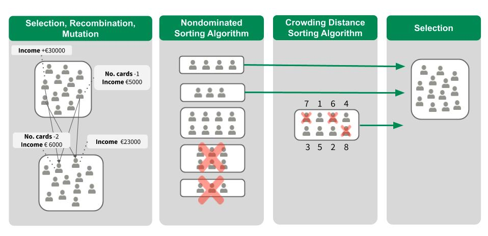

Karşı-olgusal bir açıklama, nedensel bir durumu şu biçimde tanımlar: “Eğer X gerçekleşmemiş olsaydı, Y gerçekleşmemiş olurdu.” Örneğin: “Eğer bu sıcak kahveden bir yudum almamış olsaydım, dilimi yakmazdım.” Y olayı, dilimi yakmış olmamdır; X nedeni ise sıcak bir kahve içmiş olmamdır. Karşı-olgusal düşünmek, gözlemlenen gerçeklerle çelişen varsayımsal bir gerçekliği hayal etmeyi gerektirir (örneğin, sıcak kahveyi içmediğim bir dünya); “karşı-olgusal” adı da buradan gelir. Karşı-olgusal düşünebilme yeteneği, biz insanları diğer hayvanlarla karşılaştırıldığında bu kadar zeki yapan şeydir.

Yorumlanabilir makine öğrenmesinde, karşı-olgusal açıklamalar, tekil örneklerin tahminlerini açıklamak için kullanılabilir.[^terim] Bir grafik olarak gösterildiğinde @fig-ml-graph-cf, girdiler ile tahmin arasındaki ilişki oldukça basittir: Özellik değerleri tahmine neden olur. Gerçekte girdiler ile tahmin edilecek sonuç arasındaki ilişki nedensel olmasa bile, bir modelin girdilerini tahminin nedeni olarak görebiliriz.

{#fig-ml-graph-cf width=80% fig-align="center"}

Bu basit grafik göz önüne alındığında, makine öğrenmesi modellerinin tahminleri için karşı-olgusal durumları nasıl simüle edebileceğimizi görmek kolaydır: Tahminleri yapmadan önce bir örneğin özellik değerlerini değiştirir ve tahminin nasıl değiştiğini analiz ederiz. Tahmin edilen sınıfın değişmesi (örneğin, kredi başvurusunun kabul edilmesi veya reddedilmesi) veya tahminin belirli bir eşiğe ulaşması (örneğin, kanser olasılığının %10’a ulaşması) gibi, tahminin anlamlı bir şekilde değiştiği senaryolarla ilgileniriz. **Bir tahminin karşı-olgusal açıklaması, tahmini önceden tanımlanmış bir çıktıya değiştiren özellik değerlerindeki en küçük değişikliği tanımlar.**

Hem modelden bağımsız hem de modele özgü karşı-olgusal açıklama yöntemleri bulunmaktadır, ancak bu bölümde yalnızca model girdileri ve çıktılarıyla çalışan (belirli modellerin iç yapısıyla çalışmayan) modelden bağımsız yöntemlere odaklanıyoruz.

Karşı-olgusalların nasıl oluşturulacağını tartışmadan önce, karşı-olgusalların bazı kullanım alanlarını ve iyi bir karşı-olgusal açıklamanın nasıl göründüğünü ele almak istiyorum.

Bu ilk örnekte Peter bir krediye başvurur ve (makine öğrenmesi destekli) bankacılık yazılımı tarafından başvurusu reddedilir. Başvurusunun neden reddedildiğini ve kredi alma şansını nasıl artırabileceğini merak eder. “Neden” sorusu bir karşı-olgusal olarak formüle edilebilir: Tahmini reddedilmeden onaylanmaya değiştirecek özelliklerdeki (gelir, kredi kartı sayısı, yaş, …) en küçük değişiklik nedir? Olası bir cevap şu olabilir: Eğer Peter yılda 10.000 daha fazla kazansaydı, krediyi alabilirdi. Ya da Peter’ın daha az kredi kartı olsaydı ve beş yıl önce bir krediyi ödeyememiş olmasaydı, krediyi alabilirdi. Bankanın şeffaflık konusunda bir çıkarı olmadığı için Peter reddedilme nedenlerini hiçbir zaman bilemeyecektir, ancak bu başka bir hikâyedir.

İkinci örneğimizde, sürekli bir sonuç tahmin eden bir modeli karşı-olgusal açıklamalarla açıklamak istiyoruz. Anna dairesini kiraya vermek istiyor, ancak ne kadar kira talep edeceğinden emin değil, bu nedenle kirayı tahmin etmek için bir makine öğrenmesi modeli eğitmeye karar veriyor. Elbette Anna bir veri bilimci olduğu için sorunlarını bu şekilde çözüyor. Dairenin büyüklüğü, konumu, evcil hayvanlara izin verilip verilmediği ve benzeri tüm ayrıntıları girdikten sonra model, daire için 900 EUR kira talep edebileceğini söylüyor. Anna 1000 EUR veya daha fazlasını bekliyordu, ancak modeline güveniyor ve dairenin değerini nasıl artırabileceğini görmek için dairenin özellik değerleriyle oynamaya karar veriyor. Dairenin 15 m² daha büyük olması durumunda 1000 EUR’nun üzerinde bir fiyata kiralanabileceğini öğreniyor. Bu ilginç, ancak uygulanabilir olmayan bir bilgidir; çünkü dairesini büyütemez. Son olarak, yalnızca kendi kontrolü altındaki özellik değerlerini (ankastre mutfak var/yok, evcil hayvanlara izin veriliyor/verilmiyor, zemin türü vb.) değiştirerek, evcil hayvanlara izin vermesi ve daha iyi yalıtıma sahip pencereler taktırması durumunda 1000 EUR kira talep edebileceğini öğreniyor. Anna, sonucu değiştirmek için sezgisel olarak karşı-olgusallarla çalışmıştır. Anna’nın kira tahmin modeliyle çalıştığını ve bu faktörlerin “gerçek dünyada” daha yüksek kira için gerçekten nedensel olup olmadığıyla ilgilenmek zorunda olmadığını unutmayın.

::: {.callout-warning title="Nedensellik uyarısı"}
Varsayılan olarak, karşı-olgusallar (IML yöntemi) tek başına gerçek dünya hakkında **nedensel** iddiaları desteklemez. Bunun için nedensel bir model gereklidir.
:::

Karşı-olgusallar, mevcut örnekle karşılaştırmalı olmaları ve seçici olmaları, yani genellikle az sayıda özellik değişikliğine odaklanmaları nedeniyle [insan dostu açıklamalardır](https://christophm.github.io/interpretable-ml-book/interpretability.html#good-explanation). Ancak karşı-olgusallar, **“Rashomon etkisi”** sorunundan etkilenir. Rashomon, bir Samurayın öldürülmesinin farklı kişiler tarafından anlatıldığı bir Japon filmidir. Hikâyelerin her biri sonucu eşit derecede iyi açıklar, ancak hikâyeler birbiriyle çelişir. Aynı durum karşı-olgusallarda da ortaya çıkabilir, çünkü genellikle birden fazla farklı karşı-olgusal açıklama vardır. Her karşı-olgusal, belirli bir sonuca nasıl ulaşıldığına ilişkin farklı bir “hikâye” anlatır. Bir karşı-olgusal A özelliğinin değiştirilmesi gerektiğini söylerken, başka bir karşı-olgusal A özelliğinin aynı bırakılıp B özelliğinin değiştirilmesi gerektiğini söyleyebilir; bu da bir çelişki oluşturur. Birden fazla doğrunun bulunması sorunu, ya tüm karşı-olgusal açıklamaların raporlanmasıyla ya da karşı-olgusalları değerlendirmek ve en iyisini seçmek için bir kriter belirlenmesiyle ele alınabilir.

Kriterlerden bahsetmişken, iyi bir karşı-olgusal açıklamayı nasıl tanımlarız? İlk olarak, karşı-olgusal açıklamanın kullanıcısı, bir örneğin tahmininde ilgili bir değişiklik (alternatif gerçeklik) tanımlar. İlk ve açık bir gereklilik, **karşı-olgusal bir örneğin önceden tanımlanmış tahmini mümkün olduğunca yakın bir şekilde üretmesidir**. Önceden tanımlanmış tahmine sahip bir karşı-olgusal bulmak her zaman mümkün değildir. Örneğin, biri nadir diğeri sık görülen iki sınıfa sahip bir sınıflandırma durumunda, model bir örneği her zaman sık görülen sınıf olarak sınıflandırabilir. Tahmin edilen etiketin sık görülen sınıftan nadir sınıfa değişmesini sağlayacak şekilde özellik değerlerini değiştirmek mümkün olmayabilir. Bu nedenle, karşı-olgusalın tahmininin önceden tanımlanmış sonuçla tam olarak eşleşmesi gerekliliğini esnetmek isteriz. Sınıflandırma örneğinde, nadir sınıfın tahmin edilen olasılığının mevcut %2 değerinden %10’a yükseltildiği bir karşı-olgusal arayabiliriz. Bu durumda soru şudur: Tahmin edilen olasılığın %2’den %10’a (veya %10’a yakın bir değere) değişmesi için özelliklerde yapılması gereken minimum değişiklikler nelerdir?

::: {.callout-tip title="Sınıflandırmada olasılık kullanın"}
Sınıflandırma görevleri için karşı-olgusalı sınıf sonuçları yerine tahmin edilen olasılıklar açısından tanımlamak daha iyidir.
:::

Bir diğer kalite kriteri, **karşı-olgusalın özellik değerleri açısından örneğe mümkün olduğunca benzer olması gerektiğidir**. İki örnek arasındaki uzaklık, örneğin Manhattan uzaklığıyla veya hem ayrık hem de sürekli özelliklere sahipsek Gower uzaklığıyla ölçülebilir. Karşı-olgusal yalnızca orijinal örneğe yakın olmakla kalmamalı, aynı zamanda **mümkün olduğunca az sayıda özelliği değiştirmelidir**. Bir karşı-olgusal açıklamanın bu metriğe göre ne kadar iyi olduğunu ölçmek için değiştirilen özelliklerin sayısını basitçe sayabilir veya daha matematiksel bir ifadeyle, karşı-olgusal örnek ile gerçek örnek arasındaki normu ölçebiliriz.

Üçüncü olarak, kararın öznesinin farklı bir sonuç elde etmek için birden fazla uygulanabilir yönteme erişebilmesi amacıyla **birden fazla ve çeşitli karşı-olgusal açıklama** oluşturmak genellikle tercih edilir. Örneğin, kredi örneğimize devam edersek, bir karşı-olgusal açıklama kredi alabilmek için yalnızca gelirin iki katına çıkarılmasını önerebilirken, başka bir karşı-olgusal açıklama yakın bir şehre taşınmayı ve geliri küçük bir miktar artırmayı önerebilir. İlk karşı-olgusal bazı kişiler için mümkün olabilirken, ikincisinin diğer kişiler için daha uygulanabilir olabileceği belirtilebilir. Dolayısıyla çeşitlilik, kararın öznesine istenen sonucu elde etmek için farklı yollar sunmanın yanı sıra, “farklı” bireylerin kendileri için uygun olan özellikleri değiştirmelerine de olanak tanır.

Son gereklilik, **karşı-olgusal bir örneğin olası özellik değerlerine sahip olması gerektiğidir**. Kira örneğinde, bir dairenin büyüklüğünün negatif olduğu veya oda sayısının 200 olarak belirlendiği bir karşı-olgusal açıklama oluşturmak anlamlı olmazdı. Karşı-olgusalın verilerin ortak dağılımına göre olası olması daha da iyidir; örneğin, 10 odalı ve 20 m² büyüklüğündeki bir daire karşı-olgusal bir açıklama olarak değerlendirilmemelidir. İdeal olarak, metrekare sayısı artırıldığında oda sayısında da bir artış önerilmelidir.

## Karşı-olgusal açıklamaların üretilmesi

Karşı-olgusal açıklamalar oluşturmak için basit ve naif bir yaklaşım, deneme yanılma yoluyla arama yapmaktır. Bu yaklaşım, ilgilenilen örneğin özellik değerlerini rastgele değiştirmeyi ve istenen çıktı tahmin edildiğinde durmayı içerir. Bu, Anna’nın daha yüksek kira talep edebileceği bir daire versiyonu bulmaya çalıştığı örneğe benzer. Ancak deneme yanılmadan daha iyi yaklaşımlar vardır.

İlk olarak, yukarıda belirtilen kriterlere dayalı bir kayıp fonksiyonu tanımlarız. Bu kayıp fonksiyonu girdi olarak ilgilenilen örneği, bir karşı-olgusalı ve istenen (karşı-olgusal) sonucu alır. Daha sonra, bir optimizasyon algoritması kullanarak bu kaybı en aza indiren karşı-olgusal açıklamayı bulabiliriz. Birçok yöntem bu şekilde ilerler, ancak kayıp fonksiyonunun tanımlanması ve optimizasyon yöntemi açısından birbirlerinden farklılık gösterir.

Aşağıda bunlardan ikisine odaklanıyoruz: İlk olarak, karşı-olgusal açıklamayı bir yorumlama yöntemi olarak tanıtan Wachter, Mittelstadt ve Russell’ın ([2018](https://christophm.github.io/interpretable-ml-book/references.html#ref-wachter2018counterfactual)) yöntemine ve ikinci olarak, yukarıda belirtilen dört kriterin tümünü dikkate alan Dandl ve diğerlerinin ([2020](https://christophm.github.io/interpretable-ml-book/references.html#ref-dandl2020multiobjective)) yöntemine odaklanıyoruz.

### Wachter ve diğerlerinin yöntemi

Wachter ve diğerleri, aşağıdaki kayıp fonksiyonunun en aza indirilmesini önermektedir:

$$
L(\mathbf{x}, \mathbf{x}', y', \lambda)
= \lambda\bigl(\hat{f}(\mathbf{x}')-y'\bigr)^2
+ d(\mathbf{x},\mathbf{x}').
$$

İlk terim, karşı-olgusal $x'$ için model tahmini ile kullanıcının önceden tanımlaması gereken istenen sonuç $y'$ arasındaki karesel uzaklıktır. İkinci terim, açıklanacak örnek $x$ ile karşı-olgusal $x'$ arasındaki $d$ uzaklığıdır. Kayıp, karşı-olgusalın tahmin edilen sonucunun önceden tanımlanmış sonuçtan ne kadar uzak olduğunu ve karşı-olgusalın ilgilenilen örnekten ne kadar uzak olduğunu ölçer. $d$ uzaklık fonksiyonu, her bir özelliğin medyan mutlak sapmasının (MAD) tersi ile ağırlıklandırılmış Manhattan uzaklığı olarak tanımlanır.

$$
d(\mathbf{x},\mathbf{x}')
=\sum_{j=1}^{p}\frac{|x_j-x'_j|}{MAD_j}.
$$

Toplam uzaklık, tüm $p$ özellik bazındaki uzaklıkların toplamıdır; yani, $x$ örneği ile karşı-olgusal $x'$ arasındaki özellik değerlerinin mutlak farklarının toplamıdır. Özellik bazındaki uzaklıklar, veri kümesi üzerindeki $j$ özelliğinin medyan mutlak sapmasının tersi ile ölçeklendirilir ve şu şekilde tanımlanır:

$$
MAD_j=
\operatorname{median}_{i\in\{1,\ldots,n\}}
\left(
\left|x_j^{(i)}-
\operatorname{median}_{l\in\{1,\ldots,n\}}(x_j^{(l)})
\right|
\right).
$$

Bir vektörün medyanı, vektördeki değerlerin yarısının kendisinden büyük, diğer yarısının ise kendisinden küçük olduğu değerdir. MAD, bir özelliğin varyansının eşdeğeridir; ancak merkez olarak ortalamayı kullanmak ve karesel uzaklıkları toplamak yerine, merkez olarak medyanı kullanır ve mutlak uzaklıkları toplarız. Önerilen uzaklık fonksiyonunun Öklid uzaklığına göre avantajı, aykırı değerlere karşı daha dayanıklı olmasıdır. MAD ile ölçeklendirme, tüm özellikleri aynı ölçeğe getirmek için gereklidir – bir dairenin büyüklüğünü metrekare veya fit kare cinsinden ölçmeniz fark etmemelidir.

$\lambda$ parametresi, tahmindeki uzaklık (birinci terim) ile özellik değerlerindeki uzaklık (ikinci terim) arasındaki dengeyi sağlar. Kayıp, belirli bir $\lambda$ değeri için çözülür ve bir karşı-olgusal $x'$ döndürür. Daha yüksek bir $\lambda$ değeri, istenen sonuç $y'$ değerine yakın tahminlere sahip karşı-olgusalları tercih ettiğimiz anlamına gelirken, daha düşük bir değer, özellik değerleri açısından $x$'e çok benzeyen karşı-olgusal $x'$ değerlerini tercih ettiğimiz anlamına gelir. Eğer $\lambda$ çok büyükse, $x$'ten ne kadar uzakta olduğuna bakılmaksızın, tahmini $y'$ değerine en yakın olan örnek seçilecektir.

Sonuç olarak kullanıcı, karşı-olgusalın tahmininin istenen sonuçla eşleşmesi gerekliliği ile karşı-olgusalın $x$'e benzer olması gerekliliği arasında nasıl bir denge kurulacağına karar vermelidir. Yöntemin yazarları, $\lambda$ için bir değer seçmek yerine, karşı-olgusal örneğin tahmininin $y'$ değerinden ne kadar uzakta olmasına izin verileceğini belirleyen bir tolerans $\epsilon$ seçilmesini önermektedir. Bu kısıt şu şekilde yazılabilir:

$$
|\hat f(\mathbf{x}')-y'|\leq\epsilon.
$$

Bu kayıp fonksiyonunu en aza indirmek için Nelder-Mead gibi uygun herhangi bir optimizasyon algoritması kullanılabilir. Makine öğrenmesi modelinin gradyanlarına erişiminiz varsa, ADAM gibi gradyan tabanlı yöntemleri kullanabilirsiniz. Açıklanacak örnek $x$, istenen çıktı $y'$ ve tolerans parametresi $\epsilon$ önceden belirlenmelidir. Kayıp fonksiyonu $x'$ için en aza indirilir ve yeterince yakın bir çözüm bulunana kadar $\lambda$ artırılarak (yerel olarak) optimal karşı-olgusal $x'$ döndürülür (= tolerans parametresi dahilinde):

$$
\arg\min_{\mathbf{x}'}\max_{\lambda}
L(\mathbf{x},\mathbf{x}',y',\lambda).
$$

#### Algoritma adımları

1. Açıklanacak bir $x$ örneği, istenen sonuç $y'$, bir tolerans $\epsilon$ ve $\lambda$ için (düşük) bir başlangıç değeri seçin.
2. Başlangıç karşı-olgusalı olarak rastgele bir örnek seçin.
3. Başlangıç noktası olarak ilk seçilen karşı-olgusalı kullanarak kaybı optimize edin.
4. $|\hat{f}(x') - y'| > \epsilon$ olduğu sürece:
   - $\lambda$ değerini artırın.
   - Mevcut karşı-olgusalı başlangıç noktası olarak kullanarak kaybı optimize edin.
   - Kaybı en aza indiren karşı-olgusalı döndürün.
5. 2-4. adımları tekrarlayın ve karşı-olgusalların listesini veya kaybı en aza indiren karşı-olgusalı döndürün.

Önerilen yöntemin bazı dezavantajları vardır. **Yalnızca birinci ve ikinci kriterleri dikkate alır**, son iki kriteri (“yalnızca birkaç özellik değişikliği ve olası özellik değerleri içeren karşı-olgusallar üretme”) dikkate almaz. $d$, seyrek çözümleri tercih etmez; çünkü 10 özelliği 1 artırmak, $x$'e olan uzaklık açısından bir özelliği 10 artırmakla aynı sonucu verir. Gerçekçi olmayan özellik kombinasyonları cezalandırılmaz.

Yöntem, çok sayıda farklı seviyeye sahip **kategorik özellikleri iyi bir şekilde ele alamaz**. Yöntemin yazarları, yöntemin kategorik özelliklerin her bir özellik değeri kombinasyonu için ayrı ayrı çalıştırılmasını önermiştir; ancak çok sayıda değere sahip birden fazla kategorik özellik olduğunda bu durum kombinatoryal bir patlamaya yol açacaktır. Örneğin, her biri on benzersiz seviyeye sahip altı kategorik özellik, yöntemin bir milyon kez çalıştırılması anlamına gelir.

Şimdi bu sorunların üstesinden gelen başka bir yaklaşıma bakalım.

### Dandl ve diğerlerinin yöntemi

Dandl ve diğerleri, dört amaçlı bir kayıp fonksiyonunun eş zamanlı olarak en aza indirilmesini önermektedir:

$$
L(\mathbf{x},\mathbf{x}',y',\mathbf{X}^{\mathrm{obs}})
=\Bigl(
o_1(\hat f(\mathbf{x}'),y'),
o_2(\mathbf{x},\mathbf{x}'),
o_3(\mathbf{x},\mathbf{x}'),
o_4(\mathbf{x}',\mathbf{X}^{\mathrm{obs}})
\Bigr).
$$

Dört amaçtan $o_1$ ile $o_4$ arasındaki her biri, yukarıda belirtilen dört kriterden birine karşılık gelir. İlk amaç $o_1$, karşı-olgusalımız $x'$ için tahminin, istenen tahminimiz $y'$ değerine mümkün olduğunca yakın olması gerektiğini ifade eder. Bu nedenle, $\hat{f}(x')$ ile $y'$ arasındaki uzaklığı en aza indirmek isteriz; burada bu uzaklık Manhattan metriği ($L_1$ normu) ile hesaplanır:

$$
o_1(\hat f(\mathbf{x}'),y')=
\begin{cases}
0, & \hat f(\mathbf{x}')\in y',\\
\displaystyle\inf_{z\in y'}|\hat f(\mathbf{x}')-z|, & \text{aksi hâlde}.
\end{cases}
$$

İkinci amaç $o_2$, karşı-olgusalımızın $x$ örneğimize mümkün olduğunca benzer olması gerektiğini ifade eder. $x'$ ile $x$ arasındaki uzaklığı Gower uzaklığı olarak ölçer:
$$
o_2(\mathbf{x},\mathbf{x}')
=\frac{1}{p}\sum_{j=1}^{p}\delta_G(x_j,x'_j),
$$

burada $p$ özellik sayısıdır. $\delta_G$ değeriyse $x_j$'nin özellik türüne bağlıdır:
$$
\delta_G(x_j,x'_j)=
\begin{cases}
\dfrac{|x_j-x'_j|}{\widehat R_j}, & x_j \text{ sayısal ise},\\
\mathbb{I}_{x_j\neq x'_j}, & x_j \text{ kategorik ise}.
\end{cases}
$$

Sayısal bir $j$ özelliğinin uzaklığının gözlemlenen değer aralığı olan $\widehat{R}_j$'ye bölünmesi, tüm özellikler için $\delta_G$ değerini 0 ile 1 arasında ölçeklendirir.

Gower uzaklığı hem sayısal hem de kategorik özellikleri ele alabilir, ancak kaç özelliğin değiştirildiğini hesaba katmaz. Bu nedenle, üçüncü amaç $o_3$'te değiştirilen özelliklerin sayısını $L_0$ normunu kullanarak sayarız:

$$
o_3(\mathbf{x},\mathbf{x}')
=\|\mathbf{x}-\mathbf{x}'\|_0
=\sum_{j=1}^{p}\mathbb{I}_{x'_j\neq x_j}.
$$

$o_3$'ü en aza indirerek üçüncü kriterimiz olan seyrek özellik değişikliklerini hedefleriz.

Dördüncü amaç $o_4$, karşı-olgusallarımızın olası özellik değeri kombinasyonlarına sahip olması gerektiğini ifade eder. Bir veri noktasının ne kadar “olası” olduğunu eğitim verilerini veya başka bir veri kümesini kullanarak çıkarabiliriz. Bu veri kümesini $\mathbf{X}^{\mathrm{obs}}$ olarak gösteririz. Olasılığın bir yaklaşımı olarak $o_4$, $x'$ ile gözlemlenen en yakın veri noktası $x^{[1]} \in \mathbf{X}^{\mathrm{obs}}$ arasındaki ortalama Gower uzaklığını ölçer:

$$
o_4(\mathbf{x}',\mathbf{X}^{\mathrm{obs}})
=\frac{1}{p}\sum_{j=1}^{p}\delta_G(x'_j,x_j^{[1]}).
$$

Wachter ve diğerlerinin yöntemine kıyasla, $L(\mathbf{x}, \mathbf{x}', y', \mathbf{X}^{\mathrm{obs}})$, $\lambda$ gibi dengeleme/ağırlıklandırma terimlerine sahip değildir. Dört amaç olan $o_1$, $o_2$, $o_3$ ve $o_4$'ü toplayıp ağırlıklandırarak tek bir amaç altında birleştirmek istemiyoruz; bunun yerine dört terimin tamamını eş zamanlı olarak optimize etmek istiyoruz.

#### NSGA-II ile çok amaçlı arama

Bunu nasıl yapabiliriz? **Nondominated Sorting Genetic Algorithm** ([Deb ve diğerleri, 2002](https://christophm.github.io/interpretable-ml-book/references.html#ref-deb2002fast)) veya kısaca NSGA-II'yi kullanırız. NSGA-II, Darwin'in “en uygun olanın hayatta kalması” ilkesini uygulayan, doğadan esinlenen bir algoritmadır. Bir karşı-olgusalın uygunluğunu, amaç değerlerinin vektörü $(o_1, o_2, o_3, o_4)$ ile gösteririz. Bir karşı-olgusal için amaçların değerleri ne kadar düşükse, o kadar “uygun”dur.

Algoritma, bir durdurma kriteri karşılanana kadar tekrarlanan dört adımdan oluşur; örneğin, maksimum iterasyon/nesil sayısına ulaşılması. @fig-nsgaii-cf, bir neslin dört adımını görselleştirmektedir.

{#fig-nsgaii-cf width=100% fig-align="center"}

İlk nesilde, açıklanacak $x$ örneğimize kıyasla bazı özellikler rastgele değiştirilerek bir grup karşı-olgusal aday başlatılır. Yukarıdaki kredi örneğine devam edersek, bir karşı-olgusal gelirin €30.000 artırılmasını önerebilirken, başka bir karşı-olgusal son beş yıl içinde temerrüde düşülmemesini ve yaşın on yıl azaltılmasını önerebilir. Diğer tüm özellik değerleri $x$'in değerlerine eşittir.

Daha sonra her aday, yukarıdaki dört amaç fonksiyonu kullanılarak değerlendirilir. Bunlar arasından bazı adayları rastgele seçeriz; daha uygun adayların seçilme olasılığı daha yüksektir. Adaylar, sayısal özellik değerlerinin ortalaması alınarak veya kategorik özellikleri çaprazlanarak kendilerine benzer çocuklar üretmek üzere ikili olarak yeniden birleştirilir. Ayrıca, tüm özellik uzayını keşfetmek için çocukların özellik değerlerini küçük ölçüde mutasyona uğratırız.

Ortaya çıkan iki gruptan, biri ebeveynlerden diğeri çocuklardan oluşan gruplardan, iki sıralama algoritması kullanarak yalnızca en iyi yarısını seçmek isteriz. Baskılanmayan sıralama (nondominated sorting) algoritması, adayları amaç değerlerine göre sıralar. Adaylar eşit derecede iyiyse, yığılma uzaklığı sıralama (crowding distance sorting) algoritması adayları çeşitliliklerine göre sıralar.

İki sıralama algoritmasının oluşturduğu sıralamaya göre, en umut verici ve/veya en çeşitli adayların yarısını seçeriz. Bu kümeyi bir sonraki nesil için kullanır ve seçim, yeniden birleştirme ve mutasyon sürecine tekrar başlarız. Adımları tekrar tekrar uygulayarak, düşük amaç değerlerine sahip çeşitli ve umut verici adaylardan oluşan bir kümeye yaklaşmayı umarız. Bu kümeden en çok memnun olduğumuz adayları seçebilir veya hangi özelliklerin ne sıklıkta değiştirildiğini vurgulayarak tüm karşı-olgusalların bir özetini sunabiliriz.

## Örnek

Aşağıdaki örnek, Dandl ve diğerlerinin (2020) çalışmasındaki kredi veri kümesi örneğine dayanmaktadır. German Credit Risk veri kümesi, makine öğrenmesi yarışmaları platformu olan [kaggle.com](https://www.kaggle.com/uciml/german-credit) üzerinde bulunabilir. Yazarlar, bir müşterinin iyi bir kredi riskine sahip olma olasılığını tahmin etmek için bir destek vektör makinesi (radyal tabanlı çekirdek ile) eğitmiştir. İlgili veri kümesi, 522 eksiksiz gözlemden ve kredi ile müşteri bilgilerini içeren dokuz özellikten oluşmaktadır.

Amaç, @tbl-customer 'deki özellik değerlerine sahip bir müşteri için karşı-olgusal açıklamalar bulmaktır.

| yaş | cinsiyet | iş | konut | birikim | tutar | süre | amaç |
|---:|:---:|:---|:---|:---|---:|---:|:---|
| 58 | kadın | vasıfsız | bedelsiz | az | 6143 | 48 | otomobil |

: Belirli bir müşterinin özellik değerleri {#tbl-customer}

SVM, kişinin iyi bir kredi riskine sahip olma olasılığını %24,2 olarak tahmin etmektedir. Karşı-olgusallar, %50'den daha yüksek bir tahmin olasılığı elde etmek için girdi özelliklerinin nasıl değiştirilmesi gerektiği sorusuna yanıt vermelidir. @tbl-best-counterfactuals en iyi on karşı-olgusalı göstermektedir. İlk beş sütun önerilen özellik değişikliklerini içerir (yalnızca değiştirilen özellikler gösterilmektedir), sonraki üç sütun amaç değerlerini gösterir ($o_1$ tüm durumlarda 0'a eşittir) ve son sütun tahmin edilen olasılığı gösterir.

| yaş | cinsiyet | iş | tutar | süre | $o_2$ | $o_3$ | $o_4$ | $f(x')$ |
|---:|:---:|:---|---:|---:|---:|---:|---:|---:|
|  |  | vasıflı |  | -20 | 0.108 | 2 | 0.036 | 0.501 |
|  |  | vasıflı |  | -24 | 0.114 | 2 | 0.029 | 0.525 |
|  |  | vasıflı |  | -22 | 0.111 | 2 | 0.033 | 0.513 |
| -6 |  | vasıflı |  | -24 | 0.126 | 3 | 0.018 | 0.505 |
| -3 |  | vasıflı |  | -24 | 0.120 | 3 | 0.024 | 0.515 |
| -1 |  | vasıflı |  | -24 | 0.116 | 3 | 0.027 | 0.522 |
| -3 | erkek |  |  | -24 | 0.195 | 3 | 0.012 | 0.501 |
| -6 | erkek |  |  | -25 | 0.202 | 3 | 0.011 | 0.501 |
| -30 | erkek | vasıflı |  | -24 | 0.285 | 4 | 0.005 | 0.590 |
| -4 | erkek |  | -1254 | -24 | 0.204 | 4 | 0.002 | 0.506 |

: Müşteri için bulunan en iyi on karşı-olgusal {#tbl-best-counterfactuals}

Tüm karşı-olgusalların tahmin edilen olasılıkları %50'den büyüktür ve hiçbiri diğerine baskın değildir. Baskın olmama (nondominated), karşı-olgusalların hiçbirinin tüm amaçlarda diğer karşı-olgusallardan daha küçük değerlere sahip olmadığı anlamına gelir. Karşı-olgusallarımızı bir ödünleşim (trade-off) çözümleri kümesi olarak düşünebiliriz.

Tüm karşı-olgusallar, sürenin 48 aydan en az 23 aya düşürülmesini önermektedir ve bazıları kadının vasıfsız yerine vasıflı hale gelmesini önermektedir. Bazı karşı-olgusallar, cinsiyetin kadından erkeğe değiştirilmesini bile önermektedir; bu da modeldeki cinsiyet yanlılığını göstermektedir. Bu değişikliğe her zaman yaşın bir ile 30 yıl arasında azaltılması eşlik etmektedir. Ayrıca, bazı karşı-olgusallar dört özellikte değişiklik önermesine rağmen, bu karşı-olgusalların eğitim verilerine en yakın olanlar olduğunu da görebiliriz.

## Güçlü yönler

**Karşı-olgusal açıklamaların yorumlanması oldukça açıktır**. Bir örneğin özellik değerleri karşı-olgusala göre değiştirilirse, tahmin önceden tanımlanmış tahmine dönüşür. Ek varsayımlar veya arka planda herhangi bir sihir yoktur. Bu aynı zamanda karşı-olgusalların, yorumlama için yerel modeli ne kadar uzağa ekstrapole edebileceğimizin belirsiz olduğu [LIME](https://christophm.github.io/interpretable-ml-book/lime.html) gibi yöntemler kadar tehlikeli olmadığı anlamına gelir.

Karşı-olgusal yöntem yeni bir örnek oluşturur, ancak hangi özellik değerlerinin değiştiğini bildirerek bir karşı-olgusalı özetleyebiliriz. Bu, **sonuçlarımızı raporlamak için bize iki seçenek sunar**. Karşı-olgusal örneği raporlayabilir veya ilgilenilen örnek ile karşı-olgusal örnek arasında hangi özelliklerin değiştirildiğini vurgulayabilirsiniz.

**Karşı-olgusal yöntem, verilere veya modele erişim gerektirmez**. Yalnızca modelin tahmin fonksiyonuna erişim gerektirir; bu, örneğin bir web API'si aracılığıyla da çalışabilir. Bu özellik, üçüncü taraflarca denetlenen veya modeli ya da verileri açıklamadan kullanıcılara açıklamalar sunan şirketler için caziptir. Bir şirket, ticari sırlar veya veri koruma nedenleriyle modelini ve verilerini korumak ister. Karşı-olgusal açıklamalar, model tahminlerini açıklamak ile model sahibinin çıkarlarını korumak arasında bir denge sunar.

Yöntem, **makine öğrenmesi kullanmayan sistemlerle de çalışır**. Girdileri alan ve çıktıları döndüren herhangi bir sistem için karşı-olgusallar oluşturabiliriz. Daire kiralarını tahmin eden sistem, elle yazılmış kurallardan da oluşabilir ve karşı-olgusal açıklamalar yine de çalışır.

**Karşı-olgusal açıklama yönteminin uygulanması nispeten kolaydır**, çünkü esas olarak standart optimizasyon kütüphaneleriyle optimize edilebilen bir kayıp fonksiyonudur (tek veya birden fazla amaç içeren). Özellik değerlerinin anlamlı aralıklarla sınırlandırılması (örneğin, daire büyüklüklerinin yalnızca pozitif olması) gibi bazı ek ayrıntıların dikkate alınması gerekir.

Karşı-olgusallar, doğru ve basit oldukları için **gerekçelendirme amacı, özellikle de telafi (recourse) açısından kullanışlıdır**. Diğer yorumlama yöntemleriyle karşılaştırıldığında, Shapley değerleri gibi yalnızca bir şeyin tahmini değildirler. Karşı-olgusallar, modelin ne tahmin ettiğini raporlayabileceğimiz, yeni oluşturulmuş veri örnekleridir.

## Sınırlılıklar

**Her bir örnek için genellikle birden fazla karşı-olgusal açıklama bulursunuz (Rashomon etkisi).** Bu durum elverişsizdir; çoğu insan gerçek dünyanın karmaşıklığı yerine basit açıklamaları tercih eder. Aynı zamanda pratik bir zorluktur. Bir örnek için 23 karşı-olgusal açıklama oluşturduğumuzu varsayalım. Bunların hepsini mi raporlayacağız? Yalnızca en iyisini mi? Ya hepsi nispeten “iyi”, ancak birbirlerinden çok farklıysa? Bu soruların her proje için yeniden yanıtlanması gerekir. Birden fazla karşı-olgusal açıklamaya sahip olmak avantajlı da olabilir, çünkü insanlar bu durumda önceki bilgileriyle örtüşen açıklamaları seçebilirler.

Karşı-olgusallar, **model ve veri hakkında içgörü elde etmek için o kadar kullanışlı değildir**, çünkü karşı-olgusallardan elde edilen içgörüler tek bir örneğe ve tek bir karşı-olgusal tahmine özgüdür. Bu, diğer yerel yöntemlerle karşılaştırıldığında bile oldukça sınırlı bir içgörüdür.

## Yazılım ve alternatifler

Dandl ve diğerleri tarafından geliştirilen çok amaçlı karşı-olgusal açıklama yöntemi bir [GitHub deposunda](https://github.com/susanne-207/moc/tree/master/counterfactuals) uygulanmıştır.

Python paketi [Alibi](https://github.com/SeldonIO/alibi) içerisinde yazarlar, [basit bir karşı-olgusal yöntemin](https://docs.seldon.io/projects/alibi/en/stable/methods/CF.html) yanı sıra, algoritma çıktılarının yorumlanabilirliğini ve yakınsamasını iyileştirmek için sınıf prototiplerini kullanan [genişletilmiş bir yöntem](https://docs.seldon.io/projects/alibi/en/stable/methods/CFProto.html) de uygulamıştır ([Van Looveren ve Klaise, 2021](https://christophm.github.io/interpretable-ml-book/references.html#ref-vanlooveren2021interpretable)).

Karimi ve diğerleri ([2020](https://christophm.github.io/interpretable-ml-book/references.html#ref-karimi2020modelagnostic)) de MACE algoritmalarının Python uygulamasını bir [GitHub deposunda](https://github.com/amirhk/mace) sunmuştur. Uygun karşı-olgusallar için gerekli kriterleri mantıksal formüllere dönüştürmüş ve bu kriterleri karşılayan karşı-olgusalları bulmak için tatmin edilebilirlik çözücüleri (satisfiability solvers) kullanmışlardır.

Mothilal, Sharma ve Tan ([2020](https://christophm.github.io/interpretable-ml-book/references.html#ref-mothilal2020explaining)), determinantal nokta süreçlerine dayalı çeşitli karşı-olgusal açıklamalar kümesi oluşturmak için [DiCE (Diverse Counterfactual Explanation)](https://github.com/interpretml/DiCE) yöntemini geliştirmiştir. DiCE, hem modelden bağımsız hem de gradyan tabanlı bir yöntem uygular.

Karşı-olgusalları aramanın bir başka yolu, Laugel ve diğerleri ([2017](https://christophm.github.io/interpretable-ml-book/references.html#ref-laugel2017inverse)) tarafından geliştirilen Growing Spheres algoritmasıdır. Makalelerinde karşı-olgusal terimini kullanmasalar da yöntem oldukça benzerdir. Onlar da özellik değerlerinde mümkün olduğunca az değişiklik içeren karşı-olgusalları tercih eden bir kayıp fonksiyonu tanımlarlar. Fonksiyonu doğrudan optimize etmek yerine, önce ilgilenilen noktanın etrafında bir küre oluşturmayı, bu küre içerisinden noktalar örneklemeyi ve örneklenen noktalardan birinin istenen tahmini üretip üretmediğini kontrol etmeyi önerirler. Daha sonra, (seyrek) bir karşı-olgusal bulunana kadar küreyi buna göre daraltır veya genişletir ve son olarak bulunan karşı-olgusalı döndürürler.

Ribeiro, Singh ve Guestrin ([2018](https://christophm.github.io/interpretable-ml-book/references.html#ref-ribeiro2018anchors)) tarafından geliştirilen Anchors, karşı-olgusalların tersidir; [Kapsamlı Kurallar (Anchors)](https://christophm.github.io/interpretable-ml-book/anchors.html) bölümüne bakınız.

[^terim]: “Karşı-olgusal” terimi birden fazla alanda kullanılır. Nedensel çıkarımda varsayımsal nedensel müdahalelerle ilişkili, daha özel bir anlam taşır.
