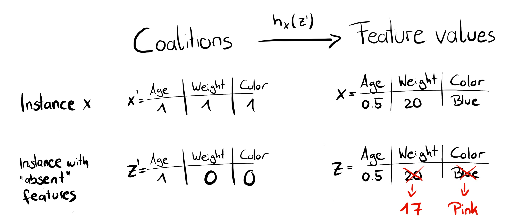
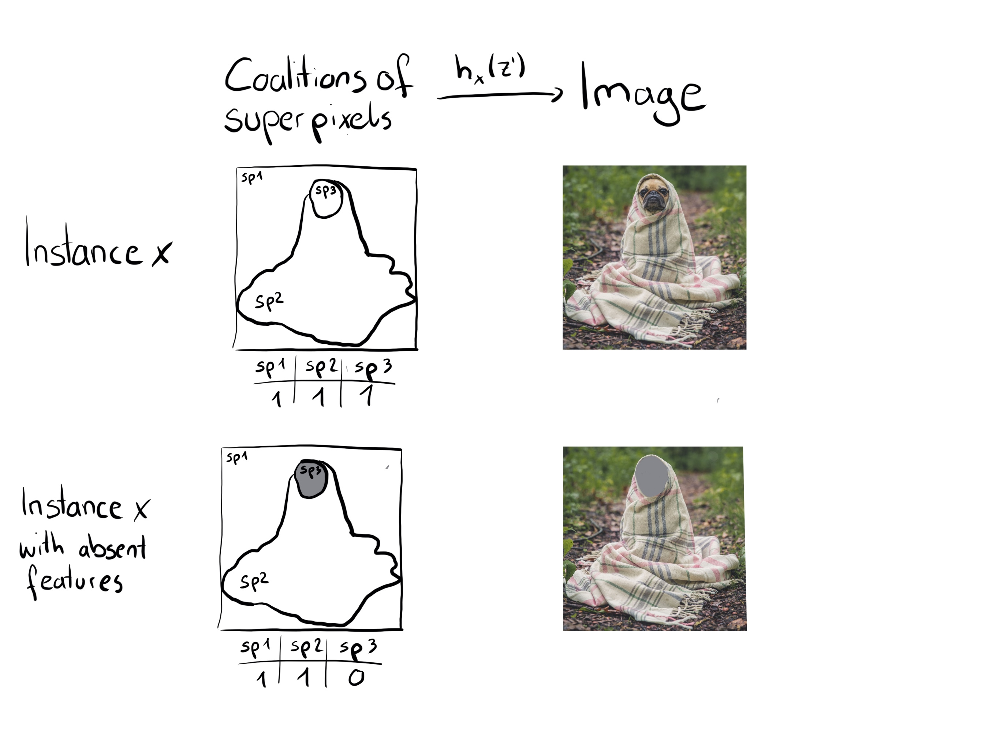
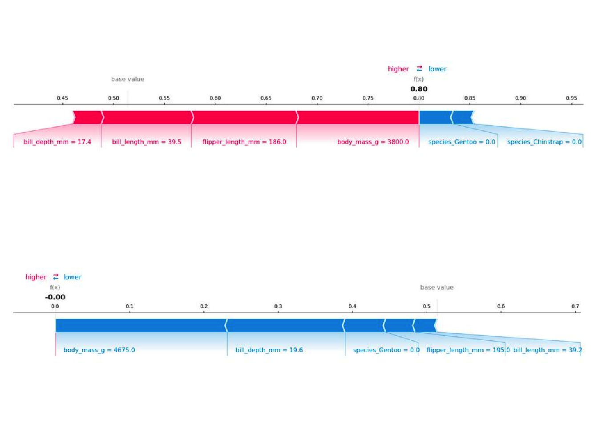
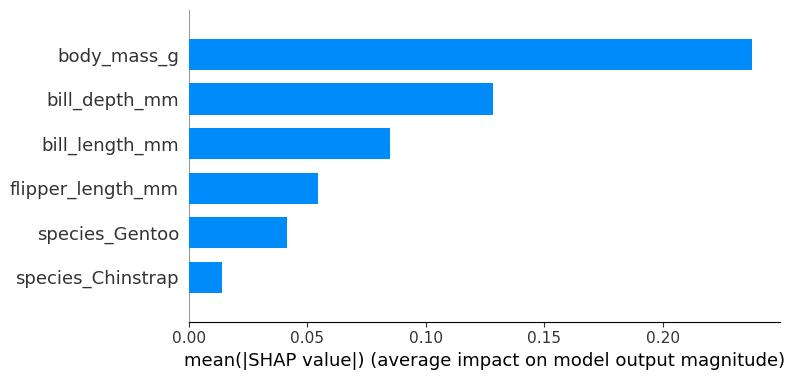
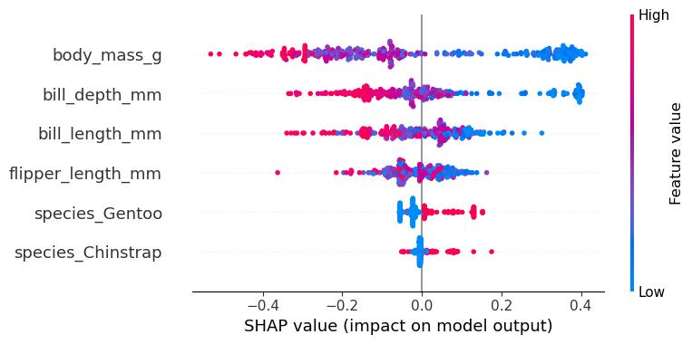
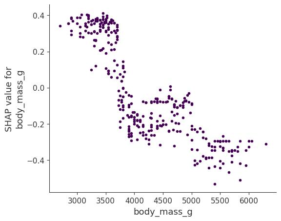
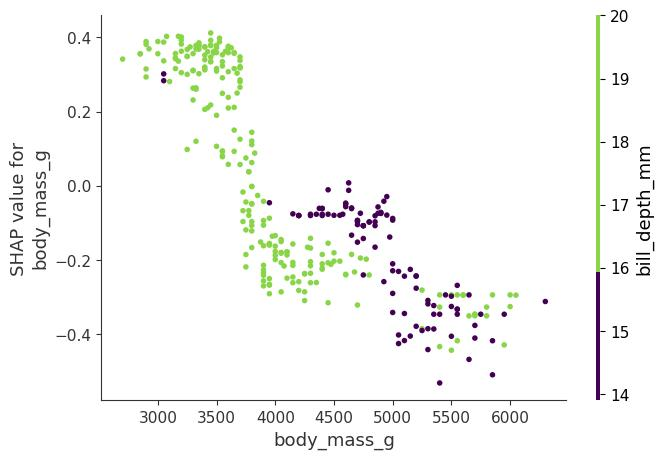
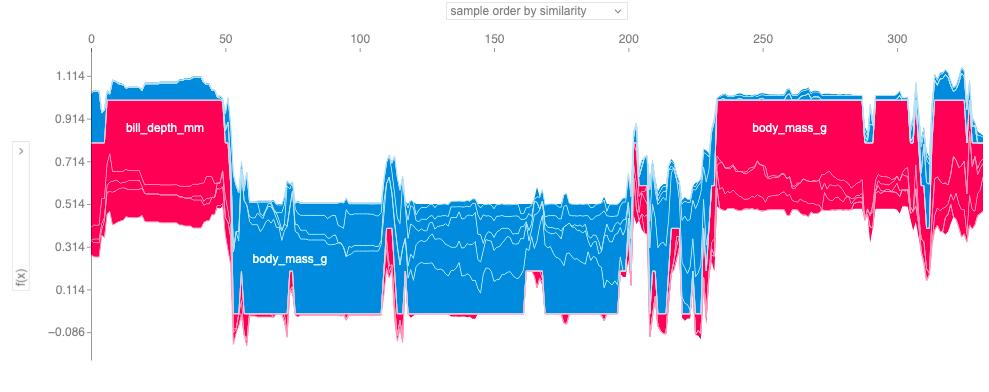

**SHAP**

Lundberg ve Lee (2017) tarafından geliştirilen SHAP (SHapley Additive
exPlanations), bireysel tahminleri açıklamak için kullanılan bir
yöntemdir. SHAP, oyun teorisi açısından optimal olan Shapley değerlerine
dayanır. Öncelikle [[Shapley
değerleri]{.underline}](https://www.google.com/search?q=%23shapley&utm_source=gemini)
bölümünü okumanızı tavsiye ederim.

SHAP\'in neden sadece [[Shapley değerleri
bölümünün]{.underline}](https://www.google.com/search?q=%23shapley&utm_source=gemini)
bir uzantısı olmadığını ve kendi başına önemli bir konu olduğunu anlamak
için biraz tarihçe: 1953 yılında Lloyd Shapley, oyun teorisi için
Shapley değerleri kavramını tanıttı. Makine öğrenmesi tahminlerini
açıklamak için Shapley değerleri ilk kez Štrumbelj ve Kononenko (2011)
ile Štrumbelj ve Kononenko (2014) tarafından önerildi. Ancak bu yaklaşım
o dönem pek popüler olmadı. Nihayetinde birkaç yıl sonra Lundberg ve Lee
(2017), makine öğrenmesi tahminlerini yorumlamak amacıyla Shapley
değerlerini tahmin etmede temel olarak yeni bir yol sunan SHAP\'i
önerdi. Bu çalışma, Shapley değerlerini
[[LIME]{.underline}](https://www.google.com/search?q=%23lime&utm_source=gemini)
ve diğer post-hoc (model sonrası) öznitelik atama yöntemleriyle bağlayan
bir teori ve Shapley değerlerine dair ilave teorik katkılar içeriyordu.

SHAP\'in yalnızca Shapley değerlerinin yeniden markalanmış bir hali
olduğunu söyleyebilirsiniz (ki bu doğrudur); ancak bu durum, SHAP\'in
Shapley değerlerinin popülaritesinde ve kullanımında büyük bir dönüşümü
tetiklediğini, bu değerleri hesaplamak ve yeni yollarla bir araya
getirmek için yeni yöntemler sunduğunu görmezden gelmek olur. Ayrıca
SHAP, Shapley değerlerini metin ve görüntü modellerine de taşımıştır.

Bu bölüm tamamen [[Shapley değeri
bölümünün]{.underline}](https://www.google.com/search?q=%23shapley&utm_source=gemini)
bir alt bölümü olabilecekken, onu makine öğrenmesi modellerini
yorumlamaya yönelik \"Shapley değerleri 2.0\" olarak da görebilirsiniz.
Bu bölüm, Shapley değerlerini tahmin etmenin yeni yollarını ve yeni
grafik türlerini vurgulamaktadır. Ancak önce biraz teori.

**SHAP Teorisi**

SHAP\'in amacı, her bir özniteliğin tahmine olan katkısını hesaplayarak
bir $x$ gözleminin tahminini açıklamaktır. SHAP, tıpkı [[Shapley değeri
bölümünde]{.underline}](https://www.google.com/search?q=%23shapley&utm_source=gemini)
tartıştığımız gibi, koalisyonel oyun teorisinden Shapley değerlerini
hesaplar. Bir veri gözleminin öznitelik değerleri, bir koalisyondaki
oyuncular gibi davranır. Shapley değerleri, \"kazancın\" (= tahminin)
öznitelikler arasında adil bir şekilde nasıl dağıtılacağını söyler. Bir
oyuncu, örneğin tablosal veriler için bireysel bir öznitelik değeri
olabilir. Bir oyuncu aynı zamanda bir öznitelik değerleri grubu da
olabilir. Örneğin bir görseli açıklamak için pikseller süper pikseller
halinde gruplanabilir ve tahmin bunlar arasında dağıtılabilir. SHAP\'in
sunduğu yeniliklerden biri, Shapley değeri açıklamasının toplanabilir
bir öznitelik atama yöntemi (toplanabilir bir lineer model) olarak
temsil edilmesidir. Bu bakış açısı LIME ile Shapley değerlerini
birbirine bağlar. SHAP açıklamayı şu şekilde tanımlar:

$g(z') = \phi_{0} + \sum_{j = 1}^{M}\phi_{j}z'_{j}$

burada $g$ açıklama modelini,
$z' = (z_{1}',\ldots,z_{M}')^{T} \in \{ 0,1\}^{M}$ koalisyon vektörünü,
$M$ maksimum koalisyon boyutunu ve $\phi_{j} \in R$ ise $j$ özniteliği
için öznitelik atamasını (Shapley değerlerini) temsil eder. Benim
\"koalisyon vektörü\" olarak adlandırdığım şey, SHAP makalesinde
\"basitleştirilmiş öznitelikler\" (simplified features) olarak
adlandırılır. Sanırım bu isim tercih edildi çünkü örneğin görüntü
verilerinde görüntüler piksel düzeyinde temsil edilmez, süper pikseller
halinde birleştirilir. $z'$ vektörünü koalisyonları tanımlayan bir yapı
olarak düşünmek faydalıdır: Koalisyon vektöründe 1 değeri karşılık gelen
öznitelik değerinin \"mevcut\" (var) olduğunu, 0 değeri ise \"eksik\"
(yok) olduğunu gösterir. Ancak yine de buradaki bir öznitelik, pikseller
yerine süper pikseller gibi modelin kullandığı özniteliklerden farklı
olabilir. Önemli olan bu iki temsil arasında dönüşüm yapabilmemizdir.
Shapley değerlerini hesaplamak için, yalnızca bazı öznitelik
değerlerinin oynadığını (\"var olduğunu\") ve bazılarının oynamadığını
(\"yok olduğunu\") simüle ederiz. Koalisyonların lineer bir model olarak
temsil edilmesi, $\phi_{j}$\'lerin hesaplanması için bir yöntemdir.
Açıklanmak istenen $x$ gözlemi için, koalisyon vektörü $x'$ tamamen
1\'lerden oluşan bir vektördür; yani tüm öznitelik değerleri \"mevcut\"
durumdadır. Formül şu şekilde sadeleşir:

$g(x') = \phi_{0} + \sum_{j = 1}^{M}\phi_{j}$

Bu formülü benzer bir gösterimle [[Shapley
değeri]{.underline}](https://www.google.com/search?q=%23shapley&utm_source=gemini)
bölümünde de bulabilirsiniz.

Gerçek tahminleme süreçleri hakkında daha fazla ayrıntı bu bölümün
ilerleyen kısımlarında yer almaktadır.

Hesaplama ayrıntılarına girmeden önce $\phi$\'lerin özelliklerinden
bahsedelim.

Shapley değerleri; Etkinlik (Efficiency), Simetri (Symmetry), Kukla
(Dummy) ve Toplanabilirlik (Additivity) özelliklerini sağlayan tek
çözümdür.

SHAP da Shapley değerlerini hesapladığı için bu özellikleri sağlar.

Lundberg ve Lee (2017) tarafından yazılan SHAP makalesinde, SHAP
özellikleri ile standart Shapley özellikleri arasında bazı isim farkları
göreceksiniz.

SHAP şu üç arzu edilen özelliği tanımlar:

**1) Yerel Doğruluk (Local accuracy)**

$\widehat{f}(x) = g(x') = \phi_{0} + \sum_{j = 1}^{M}\phi_{j}x'_{j}$

Eğer $\phi_{0} = E\lbrack\widehat{f}(X)\rbrack$ olarak tanımlar ve tüm
$x_{j}'$ değerlerini 1 yaparsanız, bu Shapley etkinlik (efficiency)
özelliğidir. Sadece farklı bir isimle ve koalisyon vektörü kullanılarak
ifade edilmiştir.

$\widehat{f}(x) = \phi_{0} + \sum_{j = 1}^{M}\phi_{j}x'_{j} = E\lbrack\widehat{f}(X)\rbrack + \sum_{j = 1}^{M}\phi_{j}$

**2) Eksiklik (Missingness)**

$x'_{j} = 0 \Rightarrow \phi_{j} = 0$

Eksiklik özelliği, eksik olan bir özniteliğin sıfır katkı payı alacağını
söyler. $x_{j}'$ ifadesinin, 0 değerinin bir öznitelik değerinin
yokluğunu temsil ettiği koalisyonlara atıfta bulunduğunu unutmayın.
Koalisyon gösteriminde, açıklanacak gözlemin tüm $x_{j}'$ öznitelik
değerleri \'1\' olmalıdır. Bu özellik \"normal\" Shapley değerlerinin
özellikleri arasında yer almaz. Peki SHAP için buna neden ihtiyaç
duyarız? Lundberg bunu bir [[\"küçük muhasebe
kuralı\"]{.underline}](https://github.com/slundberg/shap/issues/175?utm_source=gemini#issuecomment-407134438)
olarak adlandırır. Eksik bir öznitelik --- teorik olarak --- yerel
doğruluk özelliğine zarar vermeden rastgele bir Shapley değerine sahip
olabilir, çünkü $x_{j}' = 0$ ile çarpılır. Eksiklik özelliği, eksik
özniteliklerin 0 Shapley değeri almasını zorunlu kılar. Uygulamada bu
yalnızca sabit olan öznitelikler için geçerlidir.

**3) Tutarlılık (Consistency)**

${\widehat{f}}_{x}(z') = \widehat{f}(h_{x}(z'))$ olsun ve $z_{- j}'$
ifadesi $z_{j}' = 0$ durumunu göstersin.

Aşağıdaki koşulu sağlayan herhangi iki $\widehat{f}$ ve $\widehat{f}'$
modeli için:

$\widehat{f}'_{x}(z') - \widehat{f}'_{x}(z'_{- j}) \geq {\widehat{f}}_{x}(z') - {\widehat{f}}_{x}(z'_{- j})$

tüm $z' \in \{ 0,1\}^{M}$ girdilerinde,daha sonra:

$\phi_{j}(\widehat{f}',x) \geq \phi_{j}(\widehat{f},x)$

olur.

$\phi_{j}(\widehat{f},x)$ gösterimi, Shapley değerlerinin hangi modele
ve veri noktasına bağlı olduğunu vurgular. Tutarlılık özelliği, eğer bir
model bir öznitelik değerinin marjinal katkısı artacak veya aynı kalacak
şekilde değişirse (diğer özniteliklerden bağımsız olarak), Shapley
değerinin de artacağını veya aynı kalacağını söyler. Lundberg ve Lee
(2017) makalesinin [[Ek Belgeler
(Supplemental)]{.underline}](https://papers.nips.cc/paper_files/paper/2017/hash/8a20a8621978632d76c43dfd28b67767-Abstract.html?utm_source=gemini)
kısmında açıklandığı gibi Doğrusallık (Linearity), Kukla (Dummy) ve
Simetri (Symmetry) Shapley özellikleri Tutarlılık ilkelerinden
türetilir.

## **SHAP Tahmini (Estimation)**

Bu bölüm, tahminleri açıklamak amacıyla Shapley değerlerini hesaplamaya
yönelik üç yöntemi incelemektedir: KernelSHAP, Permütasyon Yöntemi ve
TreeSHAP.

### **KernelSHAP**

KernelSHAP ile ilgili durum biraz kafa karıştırıcıdır: SHAP\'in
arkasındaki ana motivasyonu oluşturmuş, onu
[[LIME]{.underline}](https://www.google.com/search?q=%23lime&utm_source=gemini)
ve diğer katkı payı yöntemleriyle bağlamış ve orijinal Lundberg ve Lee
(2017) makalesinde tanıtılmıştır.

Ayrıca SHAP hakkındaki birçok blog yazısı KernelSHAP\'ten bahseder.

Ancak KernelSHAP, TreeSHAP ve Permütasyon Yöntemine kıyasla yavaştır ve
bu nedenle shap Python paketi artık onu varsayılan olarak
kullanmamaktadır.

Artık varsayılan olmasa bile KernelSHAP, Shapley değerlerini anlamaya
yardımcı olur ve Shapley değerleri ile
[[LIME]{.underline}](https://www.google.com/search?q=%23lime&utm_source=gemini)
arasındaki bağı gösterir; bazı uygulamalar halen bunu kullanmaktadır.

KernelSHAP tahmini beş adımdan oluşur:

- Koalisyon vektörlerini örnekleyin:
  $z_{k}' \in \{ 0,1\}^{M},k \in \{ 1,\ldots,K\}$ (1 = öznitelik
  koalisyonda var, 0 = öznitelik yok).

- Her bir $z_{k}'$ için önce $z_{k}'$ vektörünü orijinal öznitelik
  alanına dönüştürerek ve ardından $\widehat{f}$ modelini uygulayarak
  tahmini elde edin: $\widehat{f}(h_{x}(z_{k}'))$.

- SHAP çekirdeği (kernel) ile her bir $z_{k}'$ koalisyonu için ağırlığı
  hesaplayın.

- Ağırlıklı lineer modeli kurun (fit).

- Lineer modelin katsayıları olan Shapley değerlerini ($\phi_{k}$)
  döndürün.

0 ve 1 dizisi elde edene kadar ardışık yazı-tura atışlarıyla rastgele
bir koalisyon oluşturabiliriz.

Örneğin $(1,0,1,0)^{T}$ vektörü, birinci ve üçüncü özniteliklerden
oluşan bir koalisyona sahip olduğumuz anlamına gelir.

Örneklenen $K$ sayıdaki koalisyon, regresyon modeli için veri seti
haline gelir.

Regresyon modelinin hedef değişkeni, bir koalisyona ait tahmindir.

(\"Bir dakika!\" diyebilirsiniz.

\"Model bu ikili koalisyon verileri üzerinde eğitilmedi ve bunlar için
tahmin yapamaz.\")

Öznitelik değerlerinin koalisyonlarından geçerli veri gözlemlerine
ulaşmak için $h_{x}(z') = z$ şeklinde bir fonksiyona ihtiyacımız vardır;
burada \$h\_\\mathbf{x}: \\{0,1\\}\^M\\rightarrow\\mathbb{R}\^p\$
şeklindedir.

$h_{x}$ fonksiyonu, 1 değerlerini açıklamak istediğimiz $x$ gözlemindeki
karşılık gelen değerle eşleştirir.

Tablosal veriler için 0 değerlerini, veriden örneklediğimiz başka bir
gözlemin değerleriyle eşleştirir.

Bu, \"öznitelik değeri yok\" ifadesini \"öznitelik değeri veriden alınan
rastgele bir öznitelik değeriyle değiştirildi\" şeklinde ele aldığımız
anlamına gelir.

Tablosal veriler için \@fig-shap-simplified-feature, koalisyonlardan
öznitelik değerlerine yapılan eşlemeyi görselleştirmektedir.

{width="5.317708880139983in"
height="2.2966841644794402in"}

Tablosal veriler için $h_{x}$, $X_{j}$ özniteliği ile $X_{- j}$ (diğer
öznitelikler) özniteliklerini bağımsız olarak ele alır ve marjinal
dağılım üzerinden entegre eder:

$\widehat{f}(h_{x}(z')) = E_{X_{- j}}\lbrack\widehat{f}(x_{j},X_{- j})\rbrack$

Marjinal dağılımdan örnekleme yapmak, mevcut ve eksik öznitelikler
arasındaki bağımlılık yapısını göz ardı etmek anlamına gelir.

Bu nedenle KernelSHAP, permütasyona dayalı tüm yorumlama yöntemleriyle
aynı sorundan muzdariptir.

Tahminleme süreci, düşük olasılıklı gözlemlere ağırlık verme
potansiyeline sahiptir.

Sonuçlar güvenilmez hale gelebilir.

Koşullu dağılımdan örnekleme yapsaydık, değer fonksiyonu değişirdi ve
dolayısıyla çözümü Shapley değerleri olan oyun da değişirdi.

Sonuç olarak, Shapley değerleri farklı bir yoruma sahip olurdu: Örneğin,
model tarafından hiç kullanılmamış olabilecek bir öznitelik, koşullu
örnekleme kullanıldığında sıfırdan farklı bir Shapley değerine sahip
olabilir.

Marjinal oyun için bu öznitelik değeri her zaman 0 Shapley değeri
alırdı, aksi takdirde Kukla (Dummy) aksiyomunu ihlal ederdi. SHAP\'in bu
koşullu örnekleme versiyonu mevcuttur ve Aas ve arkadaşları (2021)
tarafından önerilmiştir.

# **Koşullu Shapley değerleri, kullanılmayan özniteliklere sıfırdan farklı Shapley değerleri verebilir**

Koşullu beklentiyle ilgili sorun, $\widehat{f}$ tahmin fonksiyonu
üzerinde hiçbir etkisi olmayan özniteliklerin, Sundararajan ve Najmi
(2020) ile Janzing ve arkadaşları (2020) tarafından gösterildiği gibi,
TreeSHAP tahmininde sıfırdan farklı bir değer alabilmesidir.

Sıfırdan farklı bu tahmin, özniteliğin tahmin üzerinde gerçekten etkisi
olan başka bir öznitelikle korelasyonu olduğunda gerçekleşebilir.

{width="3.2968755468066493in"
height="2.7445188101487314in"}

SHAP ile LIME arasındaki en büyük fark, regresyon modelindeki
gözlemlerin ağırlıklandırılmasıdır. LIME, gözlemleri orijinal gözleme ne
kadar yakın olduklarına göre ağırlıklandırır. Koalisyon vektöründe ne
kadar çok 0 varsa LIME\'daki ağırlık o kadar küçük olur. SHAP,
örneklenen gözlemleri, koalisyonun Shapley değeri tahmininde alacağı
ağırlığa göre ağırlıklandırır. Küçük koalisyonlar (az sayıda 1 içeren)
ve büyük koalisyonlar (yani çok sayıda 1 içeren) en büyük ağırlıkları
alır. Arkasındaki sezgisel mantık şudur: Özniteliklerin etkilerini tek
başlarına inceleyebilirsek, bireysel öznitelikler hakkında en çok
bilgiyi ediniriz. Bir koalisyon tek bir öznitelikten oluşuyorsa, bu
özniteliğin tahmin üzerindeki izole edilmiş ana etkisini öğrenebiliriz.
Bir koalisyon biri hariç tüm özniteliklerden oluşuyorsa, bu özniteliğin
toplam etkisini (ana etki artı öznitelik etkileşimleri) öğrenebiliriz.
Eğer bir koalisyon özniteliklerin yarısından oluşuyorsa, özniteliklerin
yarısını içeren çok sayıda olası koalisyon olduğu için, bireysel bir
özniteliğin katkısı hakkında pek az şey öğreniriz. Shapley uyumlu
ağırlıklandırmayı elde etmek için Lundberg ve Lee (2017) SHAP
çekirdeğini (kernel) önermiştir:

$\pi_{x}(z') = \frac{M - 1}{\frac{M}{|z'|}|z'|(M - |z'|)}$

$\$

Burada $M$ maksimum koalisyon boyutunu, $z'$ gözlemindeki mevcut
özniteliklerin sayısını gösterir.

Lundberg ve Lee (2017), bu çekirdek ağırlığıyla yapılan lineer
regresyonun Shapley değerlerini verdiğini göstermektedir.

LIME ile koalisyon verileri üzerinde SHAP çekirdeğini kullanacak
olsaydınız, LIME da Shapley değerlerini tahmin ederdi!

Koalisyonların örneklenmesi konusunda biraz daha zekice davranabiliriz:
En küçük ve en büyük koalisyonlar ağırlığın çoğunu kapsar.

Körlemesine örnekleme yapmak yerine, bu yüksek ağırlıklı koalisyonları
dahil etmek için $K$ örnekleme bütçesinin bir kısmını kullanarak daha
iyi Shapley değeri tahminleri elde ederiz.

İşe 1 ve $M - 1$ özniteliğe sahip tüm olası koalisyonlarla başlarız; bu
da toplamda $2M$ koalisyon yapar.

Yeterince bütçemiz kaldığında (mevcut bütçe $K - 2M$), 2 öznitelikli ve
$M - 2$ öznitelikli koalisyonları vb. dahil edebiliriz.

Kalan koalisyon boyutlarından ise yeniden ayarlanmış ağırlıklarla
örneklem yaparız.

Elimizde veri, hedef değişken ve ağırlıklar var; Ağırlıklı lineer
regresyon modelimizi kurmak için ihtiyacımız olan her şeye sahibiz:

$g(z') = \phi_{0} + \sum_{j = 1}^{M}\phi_{j}z'_{j}$

Lineer $g$ modelini aşağıdaki kayıp fonksiyonunu ($L$) minimize ederek
eğitiriz:

$L(\widehat{f},g,\pi_{x}) = \sum_{z' \in Z}^{}\lbrack\widehat{f}(h_{x}(z')) - g(z')\rbrack^{2}\pi_{x}(z')$

burada $Z$ eğitim verisidir.

Bu, lineer modeller için genellikle optimize ettiğimiz o bildiğimiz
klasik karesel hatalar toplamıdır.

Modelin tahmin edilen katsayıları olan $\phi_{j}$\'ler Shapley
değerleridir.

Lineer regresyon ortamında olduğumuz için standart regresyon
araçlarından da yararlanabiliriz.

Örneğin, modeli seyrek (sparse) hale getirmek için düzenlileştirme
(regularization) terimleri ekleyebiliriz.

Kayıp $L$\'ye bir L1 cezası eklersek, seyrek açıklamalar
oluşturabiliriz.

(Yine de elde edilen katsayıların halen geçerli Shapley değerleri olup
olmayacağından pek emin değilim.)

**AĞAÇ ŞEKLİ**

Lundberg ve arkadaşları (2019), karar ağaçları, rastgele ormanlar
(random forests) ve gradyan artırma ağaçları (gradient-boosted trees)
gibi ağaç tabanlı makine öğrenmesi modelleri için SHAP\'in bir varyantı
olan TreeSHAP\'i önermiştir. TreeSHAP, KernelSHAP\'e hızlı ve modele
özgü bir alternatif olarak sunulmuştur. TreeSHAP ne kadar daha hızlıdır?
Kesin KernelSHAP ile karşılaştırıldığında, hesaplama karmaşıklığını
$O(TL2^{M})$ değerinden $O(TLD^{2})$ değerine düşürür; burada T ağaç
sayısını, L herhangi bir ağaçtaki maksimum yaprak sayısını ve D herhangi
bir ağaçtaki maksimum derinliği temsil eder.

TreeSHAP iki versiyonla gelir:

- \"Interventional\" (Müdahaleli) klasik Shapley değerlerini hesaplar.

- \"Tree-path dependent\" (Ağaç yoluna bağımlı) koşullu SHAP değerlerine
  benzer bir şey hesaplar.

Python paketindeki orijinal uygulama eskiden shap ağaç yoluna bağımlı
versiyondu, ancak şimdi müdahaleli (interventional) olanıdır.

Hem müdahaleli hem de ağaç yoluna bağımlı tahmin yöntemleri oldukça
karmaşıktır, bu yüzden sadece genel fikri vereceğim (okunuşu: tam
versiyonu ben de tam olarak kavrayamadım). Esas itibarıyla TreeSHAP,
Shapley değerlerini daha verimli hesaplamak için ağaç yapısından
yararlanır.

Müdahaleli (Interventional) TreeSHAP alışılagelmiş SHAP değerlerini
hesaplar.

Aşağıdaki açıklama, tek bir ağaç için, açıklanacak bir $x$ veri noktası
için ve basitlik açısından yalnızca tek bir $z$ veri noktası içeren arka
plan veri seti için Shapley değerlerinin tahmin edilmesini
anlatmaktadır:

Bildiğimiz gibi Shapley değeri; mevcut oyuncuları ($x$\'ten gelen
öznitelik değerleri) ve eksik oyuncuları ($z$\'den gelen öznitelik
değerleri) içeren koalisyonların tekrar tekrar oluşturulmasıyla
hesaplanır.

Ancak bu koalisyonların birçoğu için $x$\'ten bir öznitelik eklemek
tahmini değiştirmez, çünkü bir karar ağacı karar yapısı nedeniyle
yalnızca sınırlı sayıda farklı tahmine sahiptir.

Örneğin, 5 derinliğindeki ikili bir ağaç maksimum 32 olası tahmine
sahiptir.

Bu nedenle tüm koalisyonları tek tek gezmek yerine, Müdahaleli TreeSHAP
tahmincisi yalnızca tahminleri gerçekten değiştirecek koalisyonlarla
çalışmak üzere ağaç yollarını keşfeder.

Zor olan kısım, bu marjinal katkıları doğru bir şekilde ağırlıklandırmak
ve birleştirmektir; bu da müdahaleli TreeSHAP algoritmasının
anlaşılmasını daha zor hale getirir.

Ve elbette lanet özyineleme (recursion). Bir ağaç topluluğunun (örneğin
bir rastgele ormanın) Shapley değerlerini elde etmek için, topluluk
tahminlerinin birleştirildiği şekilde Shapley değerlerini birleştirmeniz
yeterlidir. Rastgele orman durumunda bu, değerlerin ortalamasını almak
olacaktır.

Yola bağımlı (Path-dependent) TreeSHAP, ağaç yapısından yararlanarak
benzer bir şekilde çalışır. Temel fikir, S koalisyonunun tüm alt
kümelerini aynı anda ağaçta aşağı doğru itmektir. Ve her ayrımda
(split), alt kümeler için gözlem sayısını takip ederiz.

### **Permütasyon Yöntemi (Permutation Method)**

Modelden bağımsız en verimli tahminci Permütasyon Yöntemidir.

Fikir, özniteliklerin permütasyonlarını oluşturarak koalisyonlardan
zekice örnekleme yapmaktır.

Dört öznitelik değerine sahip bir örneğe bakalım ([[Interpreting Machine
Learning Models with
SHAP]{.underline}](https://christophmolnar.com/books/shap/?utm_source=gemini)
kitabından alınmıştır): $x_{park},x_{cat},x_{area}$ ve $x_{floor}$.

Sadeleştirmek adına $x_{park}^{(i)}$ ifadesini $x_{park}$ olarak
kısaltacağım.

Bu özniteliklerin rastgele bir permütasyonu şöyle olurdu:

$(x_{cat},x_{area},x_{park},x_{floor})$

Bu permütasyona dayanarak, soldan sağa doğru koalisyonlar oluşturmaya
başlayarak marjinal katkıları hesaplayabiliriz:

- xcat özniteliğini ∅ kümesine ekle

- $x_{area}$ özniteliğini $\{ x_{cat}\}$ kümesine ekle

- $x_{park}$ özniteliğini $\{ x_{cat},x_{area}\}$ kümesine ekle

- $x_{floor}$ özniteliğini $\{ x_{cat},x_{area},x_{park}\}$ kümesine
  ekle

Ve aynısını geriye doğru da yapabiliriz:

- $x_{floor}$ özniteliğini ∅ kümesine ekle

- $x_{park}$ özniteliğini $\{ x_{floor}\}$ kümesine ekle

- $x_{area}$ özniteliğini $\{ x_{park},x_{floor}\}$ kümesine ekle

- $x_{cat}$ özniteliğini $\{ x_{area},x_{park},x_{floor}\}$ kümesine
  ekle

Permütasyon her seferinde tek bir özniteliği değiştirir. Bu durum model
çağrılarının sayısını azaltır, çünkü bir marjinal katkının ikinci terimi
(bir model tahmini), bir sonraki marjinal katkıyı hesaplamak için de
gereklidir. Örneğin $\{ x_{cat},x_{area}\}$ koalisyonu, hem
$x_{park}$\'ın $\{ x_{cat},x_{area}\}$\'ya olan marjinal katkısını hem
de $x_{area}$\'nın $\{ x_{cat}\}$\'ya olan marjinal katkısını hesaplamak
için kullanılır. Her ileri ve geri permütasyon bize öznitelik başına iki
marjinal katkı verir. Bu şekilde birkaç permütasyon yaparak Shapley
değerlerinin oldukça iyi bir tahminini elde ederiz. Shapley değerlerini
gerçekten hesaplamak için, Shapley değerlerini koalisyonlar yerine
permütasyonlar cinsinden tanımlamamız gerekir: Özniteliklerin olası $p!$
sayıda permütasyonu ve k-ncı permütasyon olan $o(k)$ varsa, bu durumda
$j$ özniteliği için Shapley değeri şöyle hesaplanabilir:

${\widehat{\phi}}_{j}^{(i)} = \frac{1}{m}\sum_{k = 1}^{m}{\widehat{\Delta}}_{o(k),j}$

Buradaki ${\widehat{\Delta}}_{o(k),j}$ terimi $k$-ncı marjinal katkıdır.
Bu, Shapley değerini tüm katkıların basit bir ortalaması olarak
hesaplayabileceğimiz anlamına gelir. Ancak permütasyon tahmininin temel
motivasyonu, tüm olası koalisyonları veya permütasyonları hesaplamaktan
kaçınmaktı. Güzel haber şu ki, permütasyonları örnekleyebilir ve yine de
ortalamasını alabiliriz. İleri ve geri yinelemeler gerçekleştirdiğimiz
için Shapley değerini şu şekilde hesaplarız:

${\widehat{\phi}}_{j}^{(i)} = \frac{1}{2m}\sum_{k = 1}^{m}({\widehat{\Delta}}_{o(k),j} + {\widehat{\Delta}}_{- o(k),j})$

$- o(k)$ permütasyonu, permütasyonun tersine çevrilmiş halidir.
Antitetik örnekleme (antithetic sampling) olarak da bilinen ileri ve
geri yinelemeli permütasyon prosedürü, diğer SHAP değeri örnekleme
tahmincilerine kıyasla oldukça iyi performans gösterir (Mitchell ve
arkadaşları, 2022). Permütasyon yöntemi ek olarak etkinlik (efficiency)
aksiyomunun her zaman sağlanmasını garanti eder; yani SHAP değerlerini
topladığınızda, bu toplam tahmin eksi ortalama tahmine eşit olur. Kaç
permütasyona ihtiyacınız olabileceğine dair genel bir fikir vermek
gerekirse: shap paketi varsayılan olarak 10 değerini kullanır.

## **Örnek**

[[Penguen
cinsiyetini]{.underline}](https://www.google.com/search?q=%23penguins&utm_source=gemini)
tahmin etmek için 100 ağaçlı bir rastgele orman (random forest)
sınıflandırıcısı eğittim. Bireysel tahminleri açıklamak için SHAP
kullanacağız. Rastgele orman bir ağaç topluluğu olduğundan, daha yavaş
olan KernelSHAP yöntemi yerine hızlı olan Müdahaleli (Interventional)
TreeSHAP tahmin yöntemini kullanabiliriz. Ancak bu örnek koşullu
dağılıma dayanmak yerine marjinal dağılımı kullanmaktadır. Bu durum
pakette açıklanmıştır ancak orijinal makalede yer almaz. Python TreeSHAP
fonksiyonu marjinal dağılımla daha yavaştır, ancak verideki satır sayısı
ile lineer olarak ölçeklendiğinden KernelSHAP\'ten yine de daha
hızlıdır.

Burada marjinal dağılımı kullandığımız için yapılan yorumlama [[Shapley
değeri
bölümündeki]{.underline}](https://www.google.com/search?q=%23shapley&utm_source=gemini)
ile aynıdır. Ancak Python shap paketi farklı bir görselleştirme ile
gelir: Shapley değerleri gibi öznitelik katkılarını \"kuvvetler
(forces)\" olarak görselleştirebilirsiniz. Her bir öznitelik değeri,
tahmini artıran ya da azaltan bir kuvvettir. Tahmin temel çizgiden
(baseline) başlar. Shapley değerleri için temel çizgi, tüm tahminlerin
ortalamasıdır. Grafikte her bir Shapley değeri, tahmini artırmak
(pozitif değer) veya azaltmak (negatif değer) için iten bir oktur. Bu
kuvvetler, veri gözleminin gerçek tahmininde birbirini dengeler.

Palmer penguenleri veri setindeki iki penguen için SHAP açıklama kuvvet
grafiklerini (force plots) göstermektedir: Birinci penguenin, küçük gaga
uzunluğu nedeniyle Adelie pengueni olma olasılığı yüksektir. İkinci
penguenin ise büyük gaga uzunluğu ve yüzgeç uzunluğu nedeniyle Adelie
olma olasılığı düşüktür.

{width="6.267716535433071in" height="4.5in"}

İki penguen için SHAP değerleri. Temel değer -- ortalama tahmin edilen
olasılık -- 0,47\'dir. Her özellik, tahmini temel değerden yukarı veya
aşağı doğru iten bir kuvvet olarak görülebilir.

## **SHAP Toplulaştırma Grafikleri**

Önceki bölüm bireysel tahminler için yapılan açıklamaları gösteriyordu.

Shapley değerleri küresel açıklamalara dönüştürülebilir. Her bir gözlem
için SHAP çalıştırırsak, bir Shapley değerleri matrisi elde ederiz. Bu
matris veri gözlemi başına bir satıra ve öznitelik başına bir sütuna
sahiptir. Bu matristeki Shapley değerlerini analiz ederek tüm modeli
yorumlayabiliriz.

SHAP öznitelik önemi ile başlıyoruz.

### **SHAP Öznitelik Önemi (Feature Importance)**

SHAP öznitelik öneminin arkasındaki fikir basittir: Büyük mutlak Shapley
değerlerine sahip öznitelikler önemlidir. Küresel önemi istediğimiz
için, veri genelinde öznitelik başına **mutlak** Shapley değerlerinin
ortalamasını alırız:

$I_{j} = \frac{1}{n}\sum_{i = 1}^{n}\left| \phi_{j}^{(i)} \right|$

Ardından öznitelikleri azalan öneme göre sıralar ve grafiklerini
çizeriz. penguenleri sınıflandırmak için daha önce eğitilen rastgele
orman modeli için SHAP öznitelik önemini göstermektedir. Vücut kütlesi
en önemli öznitelikti ve Adelie için tahmin edilen olasılığı 25 yüzde
puanı değiştirdi (x ekseninde 0.25).

{width="5.286458880139983in"
height="2.7046992563429573in"}

Ortalama mutlak Shapley değerleri olarak ölçülen SHAP özelliği önemi.

SHAP öznitelik önemi, [[permütasyon öznitelik
önemine]{.underline}](https://www.google.com/search?q=%23feature-importance&utm_source=gemini)
bir alternatiftir. Her iki önem ölçütü arasında büyük bir fark vardır:
Permütasyon öznitelik önemi, model performansındaki düşüşe dayanır. SHAP
ise öznitelik katkılarının büyüklüğüne dayanır.

Öznitelik önemi grafiği kullanışlıdır ancak önem derecelerinin ötesinde
hiçbir bilgi içermez. Daha bilgilendirici bir grafik için sırada özet
grafiğe (summary plot) bakacağız.

### 

### **SHAP Özet Grafiği (Summary Plot)**

Özet grafik, öznitelik önemini öznitelik etkileriyle birleştirir. Özet
grafikteki her nokta, bir öznitelik ve bir gözlem için bir Shapley
değeridir. Y eksenindeki konum öznitelik tarafından, x eksenindeki konum
ise Shapley değeri tarafından belirlenir. Renk, özniteliğin düşükten
yükseğe değerini temsil eder. Üst üste binen noktalar y ekseni yönünde
rastgele dağıtılır (jitter), böylece öznitelik başına Shapley
değerlerinin dağılımı hakkında bir fikir ediniriz. Öznitelikler
önemlerine göre sıralanır. Özet grafikte (@fig-shap-summary-plot), bir
özniteliğin değeri ile tahmin üzerindeki etkisi arasındaki ilişkinin ilk
belirtilerini görürüz. Daha yüksek bir vücut kütlesi, P(dişi)
olasılığına negatif katkıda bulunur. Özet grafik ayrıca vücut kütlesinin
farklı penguenler için en geniş etki aralığına sahip olduğunu gösterir.

{width="5.306563867016623in"
height="2.6885411198600173in"}

SHAP özet grafiği.

Ancak ilişkinin tam şeklini görmek için SHAP bağımlılık grafiklerine
bakmamız gerekir.

### **SHAP Bağımlılık Grafiği (Dependence Plot)**

SHAP öznitelik bağımlılığı belki de en basit küresel yorumlama
grafiğidir:

1.  Bir öznitelik seçin.

2.  Her bir veri gözlemi için, x ekseninde öznitelik değeri ve y
    ekseninde karşılık gelen Shapley değeri olacak şekilde bir nokta
    çizin.

3.  Tamamlandı.

Matematiksel olarak grafik şu noktaları içerir:
$\{(x_{j}^{(i)},\phi_{j}^{(i)})\}_{i = 1}^{n}$

\@fig-shap-dependence, vücut kütlesi için SHAP öznitelik bağımlılığını
göstermektedir.

Penguen ne kadar ağırsa dişi olma olasılığı o kadar düşüktür.

{width="4.194469597550306in"
height="3.276042213473316in"}

Vücut kütlesi için SHAP bağımlılık grafiği. X ekseni özelliği, Y ekseni
ise SHAP değerlerini göstermektedir. Her nokta bir veri noktasını temsil
eder.

SHAP bağımlılık grafikleri, [[kısmi bağımlılık grafikleri
(PDP)]{.underline}](https://www.google.com/search?q=%23pdp&utm_source=gemini)
ve [[birikimli yerel etkiler
(ALE)]{.underline}](https://www.google.com/search?q=%23ale&utm_source=gemini)
gibi küresel öznitelik etkisi yöntemlerine bir alternatiftir. PDP ve ALE
grafikleri ortalama etkileri gösterirken, SHAP bağımlılığı y eksenindeki
varyansı da gösterir. Özellikle etkileşimlerin olduğu durumlarda, SHAP
bağımlılık grafiği y ekseninde çok daha dağılmış olacaktır. Bağımlılık
grafiği, bu öznitelik etkileşimleri vurgulanarak geliştirilebilir.

### **SHAP Etkileşim Değerleri (Interaction Values)**

Etkileşim etkisi, bireysel öznitelik etkileri hesaba katıldıktan sonraki
ilave birleşik öznitelik etkisidir. Oyun teorisindeki Shapley etkileşim
indeksi şu şekilde tanımlanır:

(φᵢ,ⱼ = ∑₍S ⊆ F∖₎ (\|S\|!(M − \|S\| − 2)!)/(2(M − 1)!) δᵢ,ⱼ(S))

$i \neq j$ olduğunda ve
$\delta_{ij}(S) = {\widehat{f}}_{x}(S \cup \{ i,j\}) - {\widehat{f}}_{x}(S \cup \{ i\}) - {\widehat{f}}_{x}(S \cup \{ j\}) + {\widehat{f}}_{x}(S)$.

Bu formül, bireysel etkiler hesaba katıldıktan sonra saf etkileşim
etkisini elde etmemiz için özniteliklerin ana etkisini çıkarır. Shapley
değeri hesaplamasında olduğu gibi, değerlerin tüm olası öznitelik
koalisyonları $S$ üzerinden ortalamasını alırız. Tüm öznitelikler için
SHAP etkileşim değerlerini hesapladığımızda, gözlem başına $M \times M$
boyutlarında bir matris elde ederiz; burada $M$ öznitelik sayısıdır.
Etkileşim indeksini nasıl kullanabiliriz? Örneğin,
\@fig-shap-interaction grafiğinde olduğu gibi SHAP öznitelik bağımlılık
grafiğini en güçlü etkileşime sahip öznitelikle otomatik olarak
renklendirmek için. Burada vücut kütlesi, gaga derinliği ile etkileşime
girmektedir.

{width="4.505208880139983in"
height="3.0906692913385827in"}

Etkileşim görselleştirmeli SHAP özellik bağımlılık grafiği. Burada gaga
uzunluğunun vücut kütlesiyle etkileşim halindeki bağımlılık grafiğini
görüyoruz. Özellikle daha uzun gagalar için, gaga uzunluğunun
P(Adelie)\'ye katkısı vücut kütlesine bağlı olarak farklılık gösterir.

# 

# **Etkileşimleri derinlemesine analiz edin**

SHAP ve etkileşimler konusu çok daha derinlere gitmektedir. SHAP
etkileşimlerinin daha gelişmiş analizine ihtiyaç duyuyorsanız, [[shapiq
paketini]{.underline}](https://github.com/mmschlk/shapiq?utm_source=gemini)
incelemenizi öneririm (Muschalik ve arkadaşları, 2024).

### **Shapley Değerlerini Kümeleme (Clustering)**

Shapley değerlerinin yardımıyla verilerinizi kümeleyebilirsiniz.
Kümelemenin amacı benzer gözlem gruplarını bulmaktır. Normalde kümeleme
özniteliklere dayanır. Öznitelikler genellikle farklı ölçeklerdedir.
Örneğin, boy metre cinsinden, renk yoğunluğu 0 ile 100 arasında ve bir
sensör çıktısı -1 ile 1 arasında ölçülebilir. Zorluk, bu tür farklı ve
karşılaştırılamaz özniteliklere sahip gözlemler arasındaki uzaklıkları
hesaplamaktır.

SHAP kümelemesi, her bir gözlemin Shapley değerlerini kümeleyerek
çalışır. Bu, gözlemleri açıklama benzerliğine göre kümelediğiniz
anlamına gelir. Tüm SHAP değerleri aynı birime sahiptir \-- tahmin
alanının birimi. Herhangi bir kümeleme yöntemini kullanabilirsiniz.

Gözlemleri sıralamak için hiyerarşik kümeleme yöntemini kullanır.
Grafik, her biri bir gözlemin tahminini açıklayan birçok kuvvet
grafiğinden (force plot) oluşur. Kuvvet grafiklerini dikey olarak
döndürür ve kümeleme benzerliklerine göre yan yana yerleştiririz.

{width="5.807292213473316in"
height="2.4213123359580053in"}

Açıklama benzerliğine göre kümelenmiş yığılmış SHAP açıklamaları. X
eksenindeki her konum, verinin bir örneğini temsil eder. Kırmızı SHAP
değerleri tahmini artırırken, mavi değerler azaltır.

## **Güçlü Yönleri**

SHAP, Shapley değerlerini hesapladığı için Shapley değerlerinin tüm
avantajları geçerlidir: SHAP, oyun teorisinde **sağlam bir teorik
temele** sahiptir. Tahmin, öznitelik değerleri arasında **adil bir
şekilde dağıtılır**. Tahmini ortalama tahminle karşılaştıran **zıt
açıklamalar (contrastive explanations)** elde ederiz.

SHAP, **LIME ve Shapley değerlerini birbirine bağlar**. Bu, her iki
yöntemi de daha iyi anlamak için çok kullanışlıdır. Ayrıca açıklanabilir
makine öğrenmesi alanını birleştirmeye de yardımcı olur.

SHAP, **ağaç tabanlı modeller için hızlı bir uygulamaya** sahiptir.
Bunun SHAP\'in popülaritesinin anahtarı olduğuna inanıyorum, çünkü
Shapley değerlerinin benimsenmesinin önündeki en büyük engel yavaş
hesaplamadır.

Hızlı hesaplama, **küresel model yorumlamaları** için gerekli olan
birçok Shapley değerini hesaplamayı mümkün kılar. Küresel yorumlama
yöntemleri öznitelik önemini, öznitelik bağımlılığını, etkileşimleri,
kümelemeyi ve özet grafikleri içerir. SHAP ile küresel yorumlamalar
yerel açıklamalarla tutarlıdır, çünkü Shapley değerleri küresel
yorumlamaların \"atomik birimidir\". Yerel açıklamalar için LIME ve
küresel açıklamalar için kısmi bağımlılık grafikleri artı permütasyon
öznitelik önemi kullanırsanız, ortak bir temelden yoksun kalırsınız.

## **Sınırlılıkları**

**KernelSHAP yavaştır**. Bu durum, birçok gözlem için Shapley
değerlerini hesaplamak istediğinizde KernelSHAP\'i kullanışsız hale
getirir. Ayrıca SHAP öznitelik önemi gibi tüm küresel SHAP yöntemleri
çok sayıda gözlem için Shapley değerlerinin hesaplanmasını gerektirir.

**KernelSHAP öznitelik bağımlılığını göz ardı eder**. Permütasyona
dayalı diğer çoğu yorumlama yöntemi de bu soruna sahiptir. Öznitelik
değerlerini rastgele gözlemlerden alınan değerlerle değiştirerek
marjinal dağılımdan rastgele örneklemek genellikle daha kolaydır. Ancak,
öznitelikler bağımlıysa (örneğin korelasyonluysa), bu durum olası
olmayan veri noktalarına çok fazla ağırlık verilmesine yol açar.

**Yola bağımlı (Path-dependent) TreeSHAP sezgisel olmayan öznitelik
katkıları üretebilir**. TreeSHAP, olası olmayan veri noktalarına
ekstrapolasyon yapma sorununu çözerken, bunu değer fonksiyonunu
değiştirerek yapar ve bu nedenle oyunu hafifçe değiştirir. TreeSHAP
değer fonksiyonunu koşullu beklenen tahmine dayanarak değiştirir. Değer
fonksiyonundaki bu değişiklikle, tahmin üzerinde hiçbir etkisi olmayan
öznitelikler sıfırdan farklı bir TreeSHAP değeri alabilir.

Shapley değerlerinin dezavantajları SHAP için de geçerlidir: Shapley
değerleri **yanlış yorumlanabilir**.

SHAP ile **kasıtlı olarak yanıltıcı açıklamalar oluşturmak mümkündür**
ve bu durum önyargıları gizleyebilir (Slack ve arkadaşları, 2020).
Açıklamaları oluşturan veri bilimci sizseniz bu gerçek bir sorun
değildir (yanıltıcı açıklamalar oluşturmak isteyen kötü niyetli bir veri
bilimci iseniz bu bir avantaj bile olurdu). Bir SHAP açıklamasını alan
kişiler için ise bu bir dezavantajdır: açıklamanın doğruluğundan emin
olamazlar.

## **Yazılım**

Lundberg, SHAP\'i Python\'daki
[[shap]{.underline}](https://github.com/slundberg/shap?utm_source=gemini)
paketinde uygulamıştır; bu paket şu anda çok daha büyük bir ekip
tarafından sürdürülmektedir.

Bu uygulama, Python için
[[scikit-learn]{.underline}](https://scikit-learn.org/stable/?utm_source=gemini)
makine öğrenmesi kütüphanesi ile eğitilmiş modeller için çalışır. shap
paketi bu bölümdeki örnekler için de kullanılmıştır. SHAP, ağaç artırma
(tree boosting) çatıları olan
[[xgboost]{.underline}](https://github.com/dmlc/xgboost/tree/master/python-package?utm_source=gemini)
ve
[[LightGBM]{.underline}](https://github.com/microsoft/LightGBM?utm_source=gemini)
kütüphanelerine entegre edilmiştir ve bunu daha genel bir
yorumlanabilirlik kütüphanesi olan
[[PiML]{.underline}](https://selfexplainml.github.io/PiML-Toolbox/_build/html/index.html?utm_source=gemini)
içinde de bulabilirsiniz. R dilinde
[[shapper]{.underline}](https://modeloriented.github.io/shapper/?utm_source=gemini)
ve
[[fastshap]{.underline}](https://github.com/bgreenwell/fastshap?utm_source=gemini)
paketleri mevcuttur. SHAP ayrıca R
[[xgboost]{.underline}](https://rdrr.io/cran/xgboost/man/xgb.plot.shap.html?utm_source=gemini)
paketine de dahil edilmiştir. Özellikle SHAP etkileşimleri için Python
[[shapiq]{.underline}](https://github.com/mmschlk/shapiq?utm_source=gemini)
paketi bulunmaktadır.
