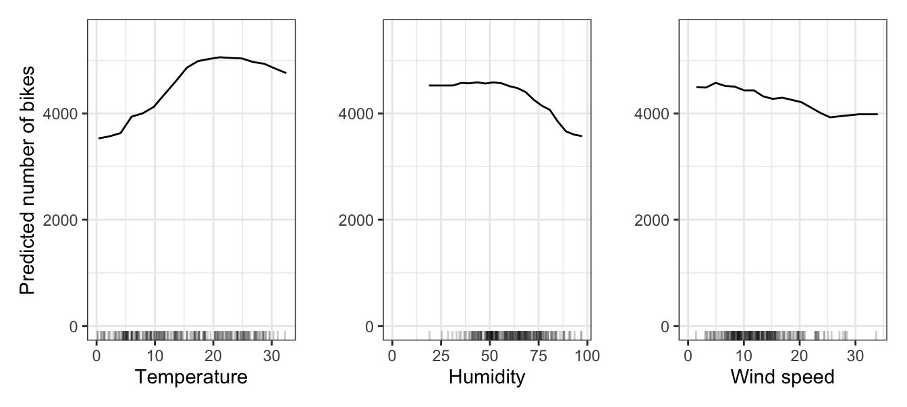
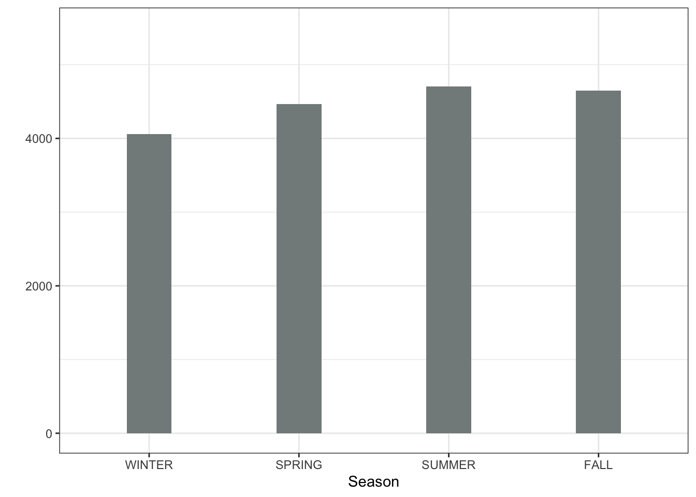
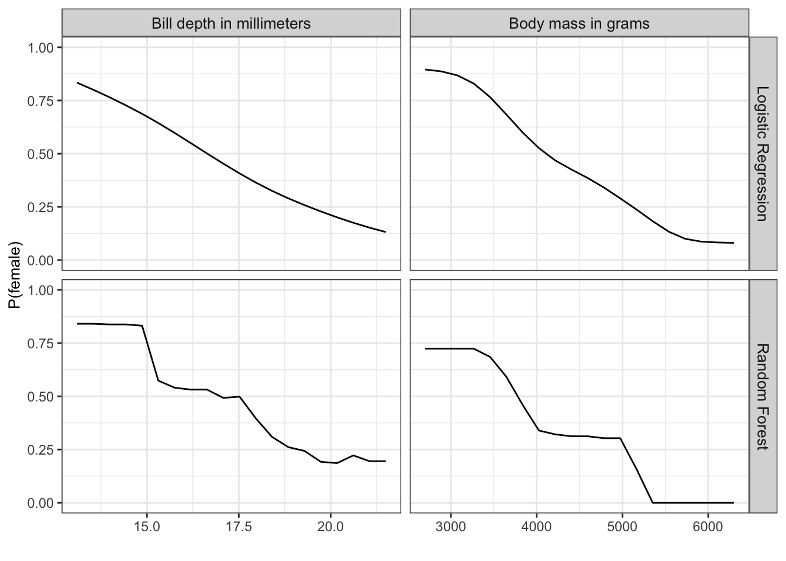
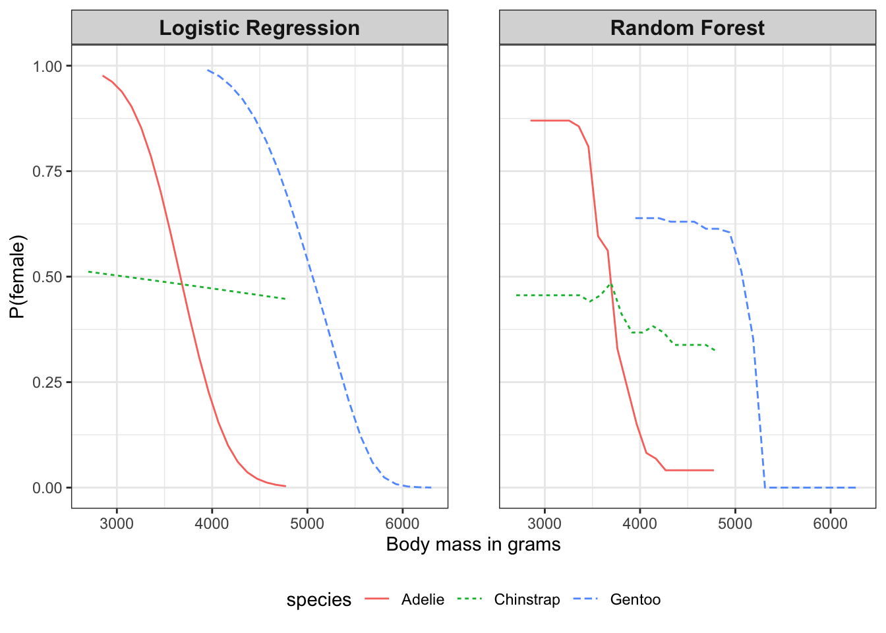
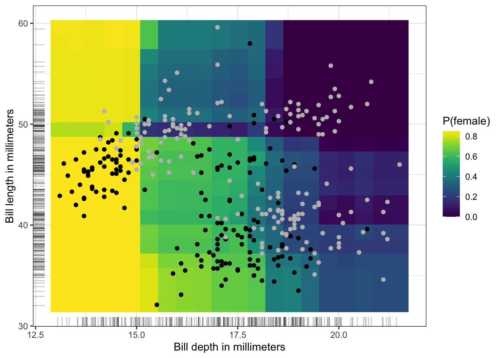

# Kısmi Bağımlılık Grafiği (PDP) {#pdp}

Kısmi bağımlılık grafiği (kısaca PDP veya PD grafiği), bir veya iki özniteliğin bir makine öğrenmesi modelinin tahmin edilen çıktısı üzerindeki marjinal etkisini gösterir (Friedman, 2001). Bir kısmi bağımlılık grafiği, hedef ile bir öznitelik arasındaki ilişkinin doğrusal, monoton veya daha karmaşık olup olmadığını gösterebilir. Örneğin, doğrusal bir regresyon modeline uygulandığında, kısmi bağımlılık grafikleri her zaman doğrusal bir ilişki sergiler.

## Tanım ve Tahminleme

Regresyon için kısmi bağımlılık fonksiyonu şu şekilde tanımlanır:

$$\hat{f}_S(\mathbf{x}_S) = \mathbb{E}_{\mathbf{X}_C}\left[\hat{f}(\mathbf{x}_S, X_C)\right] = \int \hat{f}(\mathbf{x}_S, X_C) d\mathbb{P}(\mathbf{X}_C)$$

Burada $\mathbf{x}_S$, kısmi bağımlılık fonksiyonunun çizdirilmek istendiği özniteliklerdir; $X_C$ ise $\hat{f}$ makine öğrenmesi modelinde kullanılan ve burada rastgele değişkenler olarak ele alınan diğer özniteliklerdir.
Genellikle $S$ kümesinde yalnızca bir veya iki öznitelik bulunur.
$S$ kümesindeki öznitelik(ler), tahmin üzerindeki etkisini öğrenmek istediğimiz özniteliklerdir.
$\mathbf{x}_S$ ve $\mathbf{x}_C$ öznitelik vektörleri birlikte toplam $\mathbf{X}$ verisini oluşturur.
Kısmi bağımlılık, makine öğrenmesi model çıktısını $C$ kümesindeki özniteliklerin dağılımı üzerinden marjinalleştirerek çalışır; böylece fonksiyon, ilgilendiğimiz $S$ kümesindeki öznitelikler ile tahmin edilen çıktı arasındaki ilişkiyi gösterir.
Diğer öznitelikler üzerinden marjinalleştirme yaparak, yalnızca $S$'deki özniteliklere bağlı olan ve diğer özniteliklerle olan etkileşimleri de içeren bir fonksiyon elde ederiz.

Kısmi fonksiyon $\hat{f}_S$, eğitim verisindeki ortalamalar hesaplanarak tahmin edilir; bu yöntem Monte Carlo yöntemi olarak da bilinir:

$$\hat{f}_S(\mathbf{x}_S) = \frac{1}{n} \sum_{i=1}^n \hat{f}(\mathbf{x}_S, \mathbf{x}^{(i)}_{C})$$

Bu işlem, bir veri kümesinin tüm ICE eğrilerinin ortalamasını almaya eşdeğerdir. Kısmi fonksiyon, $S$ kümesindeki özniteliklerin verilen değer(ler)i için tahmin üzerindeki ortalama marjinal etkinin ne olduğunu söyler. Bu formülde $\mathbf{x}^{(i)}_{C}$, ilgilenmediğimiz öznitelikler için veri kümesindeki gerçek öznitelik değerleridir ve $n$, veri kümesindeki gözlem sayısıdır. PDP, $C$'deki öznitelikleri $S$'deki özniteliklerle olan korelasyonlarına bakılmaksızın ele alır. Korelasyon olması durumunda, kısmi bağımlılık grafiği için hesaplanan ortalamalar, gerçekleşme olasılığı çok düşük hatta imkansız olan veri noktalarını da içerecektir (bkz. dezavantajlar).

::: {.callout-warning}
# Korelasyonlu öznitelikler bir sorundur
(Güçlü) korelasyona sahip öznitelikler için PDP'leri yorumlarken dikkatli olun: Bu durumda kısmi bağımlılık grafiği gerçekçi olmayan veri örneklerini içerir.
:::

Makine öğrenmesi modelinin olasılıklar ürettiği sınıflandırma problemlerinde, kısmi bağımlılık grafiği $S$'deki öznitelik(ler)in farklı değerleri için belirli bir sınıfın olasılığını görüntüler.
Çoklu sınıflarla başa çıkmanın kolay bir yolu, sınıf başına bir çizgi veya grafik çizmektir.

Kısmi bağımlılık grafiği küresel (global) bir yöntemdir:
Yöntem tüm gözlemleri dikkate alır ve bir özniteliğin tahmin edilen çıktı ile olan küresel ilişkisi hakkında bir ifade sunar.

### Kategorik Öznitelikler

Şimdiye kadar sadece sayısal öznitelikleri ele aldık. Kategorik öznitelikler için kısmi bağımlılığı hesaplamak çok kolaydır. Kategorilerin her biri için, tüm veri örneklerini aynı kategoriye sahip olmaya zorlayarak bir PDP tahmini elde ederiz. Örneğin, bisiklet kiralama veri kümesine bakıyorsak ve mevsim için kısmi bağımlılık grafiğiyle ilgileniyorsak, her bir mevsim için bir tane olmak üzere dört sayı elde ederiz. "Yaz" değerini hesaplamak için, tüm veri örneklerinin mevsim değerini "yaz" ile değiştiririz ve tahminlerin ortalamasını alırız.

## Örnekler

Uygulamada, $S$ öznitelik kümesi genellikle tek bir öznitelik veya en fazla iki öznitelik içerir; çünkü tek öznitelik 2B grafikler, iki öznitelik ise 3B grafikler üretir.
Bunun ötesindeki her şeyi görselleştirmek oldukça zordur.

Belirli bir günde kiralanacak bisiklet sayısını tahmin ettiğimiz regresyon örneğine geri dönelim.
İlk olarak bir makine öğrenmesi modeli eğitiyoruz, ardından kısmi bağımlılıkları analiz ediyoruz.
Bu senaryoda, bisiklet sayısını tahmin etmek için bir rastgele orman (random forest) modeli eğittik ve modelin öğrendiği ilişkileri görselleştirmek için kısmi bağımlılık grafiğini kullandık (@fig-pdp-bike).
Hava durumu özniteliklerinin tahmin edilen bisiklet sayıları üzerindeki etkisi aşağıdaki şekilde görselleştirilmiştir.
En büyük farklar sıcaklıkta görülmektedir.
Hava ne kadar sıcaksa, o kadar çok bisiklet kiralanmaktadır.
Bu eğilim 20 derece Celsius'a kadar yükselir, ardından düzleşir ve 30 derece civarında hafifçe düşer.

{#fig-pdp-bike}

Potansiyel bisikletçilerin bisiklet kiralama eğilimi, nem oranı %60'ı aştığında giderek azalmaktadır. Buna ek olarak, rüzgar arttıkça daha az insan bisiklete binmeyi tercih etmektedir ki bu da mantıklıdır. İlginç bir şekilde, rüzgar hızı 25 km/s'den 35 km/s'ye çıktığında tahmin edilen bisiklet kiralama sayısı düşmemektedir; ancak bu aralıkta fazla eğitim verisi olmadığından makine öğrenmesi modeli muhtemelen bu aralık için anlamlı bir tahmin öğrenememiştir. En azından sezgisel olarak, özellikle rüzgar hızı çok yüksek olduğunda rüzgar hızının artmasıyla bisiklet sayısının azalmasını beklerdim.

Kategorik bir özniteliğe sahip kısmi bağımlılık grafiğini örneklendirmek için, mevsim özniteliğinin tahmin edilen bisiklet kiralamaları üzerindeki etkisini inceliyoruz (@fig-pdp-bike-cat). Tüm mevsimler model tahminleri üzerinde benzer bir etki göstermektedir; model yalnızca kış için ve biraz da ilkbahar için daha az bisiklet kiralaması tahmin etmektedir.

{#fig-pdp-bike-cat}

Ayrıca penguen sınıflandırması (dişi/erkek) için kısmi bağımlılığı hesaplıyoruz. Çeşitlilik katmak adına hem rastgele orman hem de lojistik regresyon yaklaşımını analiz ediyoruz. Her ikisi de vücut ölçülerine dayanarak $\mathbb{P}(Y^{(i)} = \text{dişi})$ olasılığını tahmin eder. Rastgele orman modeli için vücut kütlesi ve gaga derinliğine dayalı dişi olma olasılığının kısmi bağımlılığını hesaplıyor ve görselleştiriyoruz (@fig-pdp-penguin). Penguen ne kadar ağırsa, dişi olma olasılığı o kadar düşüktür. Gaga derinliği için de benzer bir desen görüyoruz. Rastgele orman PDP'si, karar ağacı tabanlı yapısı nedeniyle çok daha pürüzlü/dalgalıdır.

{#fig-pdp-penguin}

@fig-pdp-penguin büyük bir soruna sahiptir: Tüm penguen türlerini aynı kefeye koyar. Ancak PDP'yi tür bazında kolayca hesaplayabiliriz. Bunun için @fig-pdp-penguin-by-species'te yaptığım gibi, verileri alt kümelere ayırarak bireysel PDP'leri hesaplamamız ve eğrileri aynı grafikte çizdirmemiz yeterlidir. Daha nüanslı bir yorum ortaya çıkar. Adelie için daha fazla ağırlık, dişi olma olasılığının daha düşük olması anlamına gelir. Chinstrap için ağırlık olasılığı pek etkilemez. Gentoo penguenleri genel olarak daha ağırdır ancak yine de "erkekler daha ağırdır" kalıbını gösterirler. Ayrıca, lojistik regresyon beklenildiği üzere daha pürüzsüzdür ve rastgele orman olasılıkları ortalamaya doğru çekilmektedir.

{#fig-pdp-penguin-by-species}

Aynı anda iki özniteliğin kısmi bağımlılığını da görselleştirebiliriz (@fig-pdp-penguins-2d): burada gaga derinliği ve gaga uzunluğu. Analiz edilen model rastgele ormandır. İkisi arasında bir etkileşim vardır, çünkü küçük gaga derinliklerinde gaga uzunluğu bir fark yaratmazken, daha uzun gagalar için $\mathbb{P}(\text{dişi})$ küçülmektedir.

{#fig-pdp-penguins-2d}

::: {.callout-tip}
# Etkileşimleri azaltın, PDP yorumlanabilirliğini artırın
PDP modelden bağımsız bir yöntem olsa da, daha az etkileşime ve daha homojen etkilere sahip bir modele sahip olmak PDP yorumlamasını kolaylaştırır ve yanlış yorumlama risklerini (bazılarını) azaltır. Bunu yapmanın yolları, ağaç tabanlı yöntemler kullanırken ağaç derinliğini azaltmak veya monotonluk kısıtlamaları eklemektir. Alternatif olarak, modelden bağımsız bir şekilde daha düşük etkileşimler, seyreklik (sparsity) ve daha az karmaşık etkiler için optimizasyon yapabilirsiniz; bkz. (Molnar vd., 2020).
:::

## PDP Tabanlı Öznitelik Önemi

Greenwell ve arkadaşları (2018), PDP tabanlı basit bir öznitelik önemi ölçütü önermiştir.
Temel motivasyon, düz bir PDP'nin özniteliğin önemli olmadığını, PDP ne kadar çok değişirse özniteliğin o kadar önemli olduğunu göstermesidir. Sayısal öznitelikler için önem, her bir benzersiz öznitelik değerinin ortalama eğriden sapması olarak tanımlanır:

$$I(\mathbf{x}_S) = \sqrt{\frac{1}{K-1}\sum_{k=1}^K(\hat{f}_S(\mathbf{x}^{(k)}_S) - \frac{1}{K}\sum_{k=1}^K \hat{f}_S(\mathbf{x}^{(k)}_S))^2}$$

Burada $\mathbf{x}^{(k)}_S$ ifadelerinin, $X_S$ özniteliğinin $K$ adet benzersiz değeri olduğuna dikkat edin.
Kategorik öznitelikler için şuna sahibiz:

$$I(X_S) = \frac{\max_k(\hat{f}_S(\mathbf{x}^{(k)}_S)) - \min_k(\hat{f}_S(\mathbf{x}^{(k)}_S))}{4}$$

Bu, benzersiz kategoriler için PDP değerlerinin aralığının dörde bölünmesidir. Sapmayı hesaplamanın bu ilginç yoluna aralık kuralı (range rule) denir. Yalnızca aralığı bildiğinizde sapma için kaba bir tahmin elde etmeye yardımcı olur. Ve paydadaki dört sayısı standart normal dağılımdan gelir: Normal dağılımda, verilerin %95'i ortalamanın eksi iki ve artı iki standart sapma etrafındadır. Bu nedenle aralığın dörde bölünmesi, muhtemelen gerçek varyansı olması gerekenden düşük gösteren kaba bir tahmin verir.

Bu PDP tabanlı öznitelik önemi dikkatle yorumlanmalıdır. Yalnızca özniteliğin ana etkisini yakalar ve olası öznitelik etkileşimlerini göz ardı eder. Bir öznitelik permutasyon öznitelik önemi gibi diğer yöntemlere göre çok önemli olabilir, ancak öznitelik tahmini esas olarak diğer özniteliklerle olan etkileşimler aracılığıyla etkilediği için PDP düz çıkabilir. Bu ölçütün bir başka dezavantajı da benzersiz değerler üzerinden tanımlanmasıdır. Sadece tek bir gözleme sahip benzersiz bir öznitelik değerine, önem hesaplamasında çok sayıda gözleme sahip bir değerle aynı ağırlık verilir.

## Güçlü Yönleri

Kısmi bağımlılık grafiklerinin hesaplanması **sezgiseldir**: Belirli bir öznitelik değerindeki kısmi bağımlılık fonksiyonu, tüm veri noktalarını o öznitelik değerini almaya zorlarsak elde edeceğimiz ortalama tahmini temsil eder. Deneyimlerime göre, uzman olmayan kişiler bile PDP fikrini hızla anlamaktadır.

PDP'sini hesapladığınız öznitelik diğer özniteliklerle korelasyonlu değilse, PDP'ler özniteliğin tahmin üzerindeki ortalama etkisini mükemmel bir şekilde temsil eder. Korelasyonsuz durumda **yorum açıktır**: Kısmi bağımlılık grafiği, veri kümenizdeki ortalama tahminin $j$. öznitelik değiştirildiğinde nasıl değiştiğini gösterir. Öznitelikler korelasyonlu olduğunda durum daha karmaşıktır; ayrıca dezavantajlara bakın.

Kısmi bağımlılık grafiklerinin **uygulanması kolaydır**.

Kısmi bağımlılık grafikleri için yapılan hesaplama **nedensel bir yoruma** sahiptir. Bir özniteliğe müdahale ederiz ve tahminlerdeki değişiklikleri ölçeriz. Bunu yaparken, öznitelik ile tahmin arasındaki nedensel ilişkiyi analiz ederiz (Zhao ve Hastie, 2019). İlişki model için nedenseldir — çünkü çıktıyı açıkça özniteliklerin bir fonksiyonu olarak modelliyoruz — ancak gerçek dünya için nedensel olmak zorunda değildir!

## Sınırlılıkları

Bir kısmi bağımlılık fonksiyonunda anlamlı bir şekilde görselleştirilebilen **gerçekçi maksimum öznitelik sayısı** ikidir. Bu PDP'lerin suçu değil, 2 boyutlu temsilin (kağıt veya ekran) ve aynı zamanda 3 boyuttan fazlasını hayal edemememizin sonucudur. Ancak yine de daha yüksek mertebeden PDP'ler hesaplamak mümkündür.

Bazı PD grafikleri **öznitelik dağılımını** göstermez. Dağılımı göz ardı etmek yanıltıcı olabilir çünkü neredeyse hiç veri bulunmayan bölgeleri aşırı yorumlayabilirsiniz. Bu sorun, x ekseninde veri noktaları için göstergeler (rug) veya bir histogram gösterilerek kolayca çözülür.

**Bağımsızlık varsayımı**, PD grafiklerinin en büyük sorunudur. Kısmi bağımlılığın hesaplandığı öznitelik(ler)in diğer özniteliklerle korelasyonlu olmadığı varsayılır. Örneğin, bir kişinin ağırlığı ve boyu verildiğinde ne kadar hızlı yürüyeceğini tahmin etmek istediğinizi varsayalım. Özniteliklerden birinin (örneğin boy) kısmi bağımlılığı için, diğer özniteliklerin (ağırlık) boy ile korelasyonlu olmadığını varsayarız ki bu açıkça yanlış bir varsayımdır. Belirli bir boyda (örneğin 200 cm) PDP hesaplaması için, 2 metrelik bir kişi için gerçekçi olmayan 50 kg'ın altındaki bir ağırlığı içerebilecek marjinal ağırlık dağılımı üzerinden ortalama alırız. Başka bir deyişle: Öznitelikler korelasyonlu olduğunda, öznitelik dağılımında gerçek olasılığın çok düşük olduğu alanlarda yeni veri noktaları oluştururuz (örneğin, birinin 2 metre boyunda olup 50 kg'dan hafif olması pek olası değildir). Bu sorunun çözümlerinden biri, marjinal dağılım yerine koşullu dağılımla çalışan Birikimli Yerel Etki grafikleri veya kısaca ALE grafikleridir.

**Heterojen etkiler gizlenebilir** çünkü PD grafikleri yalnızca ortalama marjinal etkileri gösterir. Bir öznitelik için veri noktalarınızın yarısının tahminle pozitif bir ilişkiye (öznitelik değeri büyüdükçe tahmin büyür) ve diğer yarısının negatif bir ilişkiye (öznitelik değeri küçüldükçe tahmin büyür) sahip olduğunu varsayalım. Veri kümesinin her iki yarısının etkileri birbirini götürebileceğinden PD eğrisi yatay bir çizgi olabilir. Daha sonra özniteliğin tahmin üzerinde hiçbir etkisi olmadığı sonucuna varırsınız. Toplu çizgi yerine bireysel koşullu beklenti eğrilerini çizdirerek heterojen etkileri ortaya çıkarabiliriz. Ancak ICE grafikleri etkinin ne zaman pozitif veya negatif olduğunu gösteremez — bu yorumlama için temel bir yöndür. Etkinin yönünün (pozitif veya negatif) başka bir özniteliğe bağlı olduğunu varsayalım — diğer özniteliğin değeri belirli bir eşiğin üzerinde olduğunda etki pozitiftir ve tersi de geçerlidir. Bölgesel öznitelik etkisi grafikleri (Herbinger vd., 2024; Herbinger vd., 2022; Britton, 2019; Gkolemis vd., 2024), verileri koşullandırma özniteliğine göre bölerek ve alt gruba özel PDP'ler hesaplayarak bu sorunu çözer. Bu yaklaşım, etkinin hangi koşul altında pozitif veya negatif olduğunu net bir şekilde ortaya koyar ve genel heterojenliği azaltır.

## Yazılım ve Alternatifler

PDP'leri uygulayan çok sayıda R paketi bulunmaktadır. Örnekler için `iml` paketini kullandım, ancak `pdp` ve `DALEX` de mevcuttur. Python'da kısmi bağımlılık grafikleri `scikit-learn`, `PDPBox` ve `effector` kütüphanelerine entegre edilmiştir. Veya Python Interpretable Machine Learning (`PiML`) kütüphanesini kullanabilirsiniz. `effector` ayrıca bölgesel PDP grafiklerini de desteklemektedir.

Bu kitapta sunulan PDP alternatifleri ALE grafikleri ve ICE eğrileridir.